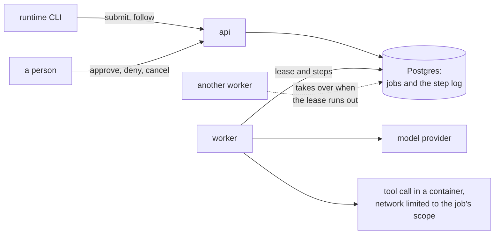

# agent-runtime

A platform that runs long AI agent jobs. An agent calls the model, runs a
tool, records the result, and repeats. Every step is written to a log in
Postgres. When a worker goes away in the middle of a job, another worker
continues it from that log.



## What is built

- **A job survives its worker.** A worker holds a job through a lease. When
  the lease runs out, another worker resumes the job from the step log.
- **A worker that lost its job cannot write to it.** Its writes are refused.
- **An interrupted tool call runs again only when that is safe.** Otherwise
  the job waits for a person to approve or deny.
- **Shell commands run in a sandbox.** Each call gets a container of its
  own, with no network unless the job has a scope.
- **A scope is enforced by a firewall the command cannot change.** A job
  reaches its targets and nothing else.
- **A tool call can wait for a person** before it runs.
- **A job can be cancelled**, is failed at its deadline, and stays inside its
  token budget.
- **A busy provider slows a job, it does not fail it.** A rate limit or
  overload makes the job wait, then it goes on.

Not built: retry on other provider errors, and a limit on provider calls
shared by workers. Everything else that is missing or accepted is in
[Known limits](docs/limits.md).

Locally the model provider is a fake that answers from scenario files, so
nothing here calls a paid API.

## Quickstart

Requires [uv](https://docs.astral.sh/uv/), Docker with Compose, make, and
Linux: `make` reads the group of `/var/run/docker.sock` with GNU `stat`.

```sh
git clone https://github.com/sindredg/agent-runtime.git
cd agent-runtime
make up
uv run runtime submit examples/hello.json --follow
```

`make up` builds the images and starts Postgres, the API, one worker, the
fake provider and a fake issue tracker. The job asks the agent to read one
file. The output is the job id, one line per step, and the outcome:

```text
01a1e686-e31e-73d2-af47-e26d4b14a322
   1  model_request   model=hello messages=1
   2  model_response  stop_reason=tool_use tokens=460+44 I will read hello.txt from the workspace.
   3  tool_intent     read_file {"path": "hello.txt"}
   4  tool_result     ok Hello from the workspace.
   5  model_request   model=hello messages=3
   6  model_response  stop_reason=end_turn tokens=553+22 The file hello.txt holds a short greeting. The job is done.
succeeded  tokens_used=1079
```

The text of the two responses is scripted in the fake provider. The tool call
and its result are real: the worker read the file.

Next: [the other examples, job files and the CLI](docs/usage.md). `make
clean` stops the stack and deletes its database.

## Results

Each guarantee has a test with a pass line fixed before the run, and a run
with the mechanism switched off to show that the test can fail. A check that
such a run did not reach is named with its result.

| Guarantee | Status | Evidence |
|---|---|---|
| A job survives a worker stopping | Tested | [200 of 200 jobs, 176 kills](docs/results/durability.md#a-job-survives-a-worker-stopping) |
| An unsafe tool call does not run twice without approval | Tested, one accepted exception | [No operation id with two issues](docs/results/durability.md#an-unsafe-tool-call-does-not-run-twice-without-approval) |
| A stale worker cannot corrupt a job | Tested | [No write after the takeover](docs/results/durability.md#a-stale-worker-cannot-corrupt-a-job) |
| A job that crashes its worker every time does not loop forever | Tested | [Failed after 5 takeovers](docs/results/durability.md#a-job-that-crashes-its-worker-does-not-loop-forever) |
| Every job stays inside its token budget and deadline, and can be cancelled | Tested, with [accepted exceptions](docs/limits.md#halt-and-budget) | [Budget, cancel and deadline](docs/results/controls.md#budget-deadline-and-cancel) |
| A tool can reach only its job's scope, and nothing else of the host | Tested, with [accepted exceptions](docs/limits.md#sandbox-and-scope) | [23 of 23 escape tests](docs/results/sandbox.md) |
| A tool call that needs approval does not run before a person approved it | Tested | [134 issues for 134 approvals](docs/results/controls.md#approval-before-a-tool-call) |
| Bad tool output does not break a job | Tested | [100 MB cut to 64 KiB, the job goes on](docs/results/controls.md#bad-tool-output) |
| Provider rate limits slow jobs, they do not fail them | Built for one job, no shared limiter. Not yet in a recorded run. | [Backoff](docs/backoff.md) |
| Throughput scales with workers | Not measured | |

Every result is from one run at commit `e656fd8`, on one machine, against
the fake provider. The output of the switched-off runs is kept on that
machine, not in the repository. The run, and what it does not show:
[Results](docs/results/README.md).

The fake provider is compared with the Claude API by a contract test that is
run by hand: [Testing](docs/testing.md#the-contract-test). Eight jobs have
run against the API: [Runs against the Claude API](docs/results/api.md).

## Documentation

| Page | Covers |
|---|---|
| [Running jobs](docs/usage.md) | The examples, job files, the CLI |
| [Architecture](docs/architecture.md) | Components, how a job runs, and a map of the other pages |
| [Results](docs/results/README.md) | The evidence behind each guarantee |
| [Runs against the Claude API](docs/results/api.md) | Eight jobs with a real model, and what they do not show |
| [Known limits](docs/limits.md) | What is accepted and what is not built |
| [OWASP APTS](docs/apts.md) | The security standard's requirements that the runtime meets, and its gaps |
| [Decision records](docs/adr/README.md) | Why it is built this way |

## Development

uv installs the pinned Python and tools into `.venv`.

| Command | What it does |
|---|---|
| `make up` | Build the images, start every service, wait until all are healthy |
| `make up-claude` | The same stack with the worker on the Claude API. Every job costs money. |
| `make logs` | Follow the service logs |
| `make down` | Stop the services, keep the database volume |
| `make clean` | Stop the services, delete the database volume |
| `make test` | Unit tests |
| `make integration` | Integration tests. Needs the stack from `make up`. |
| `make escape` | Escape tests: tries to get out of the sandbox. Needs no stack. |
| `make chaos` | Chaos tests: kills, pauses and crashes workers. Run `make up` afterwards. |

Suites, failure switches and the lint commands are in
[Testing](docs/testing.md). Ports and environment variables are in
[Settings](docs/settings.md).

The API has no authentication. Do not publish its port on another interface.

## License

Apache License 2.0. See [LICENSE](LICENSE).
