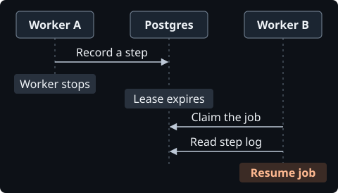

# agent-runtime

A worker runs an AI agent job by calling a model, running tools and recording
each step in Postgres. If the worker stops, another worker can claim the
same job when its lease expires and continue from the step log.



## Quickstart

Requires [uv](https://docs.astral.sh/uv/), Docker with Compose, make, and
Linux with GNU `stat` for the Docker socket group. The quickstart uses a local fake provider.

```sh
git clone https://github.com/sindredg/agent-runtime.git
cd agent-runtime
make up
uv run runtime submit examples/hello.json --follow
```

`make up` builds the images and starts Postgres, the API, one worker, the
fake provider, a fake issue tracker and a fake notification receiver. The
job asks the agent to read one file. The output is the job id, one line per
step, and the outcome:

```text
01a1e686-e31e-73d2-af47-e26d4b14a322
   1  model_request   model=hello messages=1
   2  model_response  stop_reason=tool_use tokens=460+44 I will read hello.txt from the workspace.
   3  tool_intent     read_file {"path": "hello.txt"}
   4  tool_result     ok Hello from the workspace.
   5  model_request   model=hello messages=3
   6  model_response  stop_reason=end_turn tokens=553+22 The file hello.txt holds a short greeting. The job is done.
succeeded  tokens_used=1079
```

The fake provider scripts the model responses. The worker reads
`hello.txt` from the job workspace and records its contents in `tool_result`.

Next: [the other examples, job files and the CLI](docs/usage.md). `make
clean` stops the stack and deletes its database.

## What is built

Jobs can wait for approval and post the question to an operator's URL,
run shell commands in a sandbox and enforce token budgets and deadlines.
See [Architecture](docs/architecture.md) for how the pieces fit together
and [Known limits](docs/limits.md) for the boundaries of each guarantee.

## Results

Each tested guarantee has a test with a pass line fixed before the run, and
a run with the mechanism switched off to show that the test can fail. A check
that such a run did not reach is named with its result.

| Guarantee | Status | Evidence |
|---|---|---|
| A job survives a worker stopping | Tested | [200 of 200 jobs, 169 kills](docs/results/durability.md#a-job-survives-a-worker-stopping) |
| An unsafe tool call does not run twice without approval | Tested, with [accepted exceptions](docs/limits.md#tool-calls) | [No operation id with two issues, also in Gitea](docs/results/durability.md#an-unsafe-tool-call-does-not-run-twice-without-approval) |
| A stale worker cannot corrupt a job | Tested | [No write after the takeover](docs/results/durability.md#a-stale-worker-cannot-corrupt-a-job) |
| A job that crashes its worker every time does not loop forever | Tested | [Failed after 5 takeovers](docs/results/durability.md#a-job-that-crashes-its-worker-does-not-loop-forever) |
| Every job stays inside its token budget and deadline, and can be cancelled | Tested, with [accepted exceptions](docs/limits.md#halt-and-budget) | [Budget, cancel and deadline](docs/results/controls.md#budget-deadline-and-cancel) |
| A tool can reach only its job's scope, and nothing else of the host | Tested, with [accepted exceptions](docs/limits.md#sandbox-and-scope) | [23 of 23 escape tests](docs/results/sandbox.md) |
| A tool call that needs approval does not run before a person approved it | Tested | [134 issues for 134 approvals](docs/results/controls.md#approval-before-a-tool-call) |
| Bad tool output does not break a job | Tested | [100 MB cut to 64 KiB, the job goes on](docs/results/controls.md#bad-tool-output) |
| A job that repeats one call with the same result is stopped | Tested, with [stated limits](docs/limits.md#halt-and-budget) | [Stopped at the fifth repeat, also across a takeover](docs/results/controls.md#a-job-that-repeats-itself) |
| A provider's rate limit (429) slows a job, it does not fail it | Tested for one job. No limit shared by workers. | [One job waits out 60 s of 429s](docs/results/controls.md#a-busy-provider-slows-a-job) |
| The step log cannot be changed without detection | Tested, with [stated limits](docs/step-log-chain.md#what-it-does-not-catch) | [Changes refused or found; 483 jobs verified](docs/results/durability.md#the-step-log-cannot-be-changed-without-detection) |
| A job goes on past its context window, and a takeover sends the same requests | Tested on the fake provider. One job on a real model ran and did not pass. | [Three summaries; the same requests after 12 kills](docs/results/long-job.md) |
| A job that waits for a person tells the operator, at least once | Tested. In the kill run the receiver holds each POST 1.5 s. | [Every question arrived, in three runs of 20 jobs](docs/results/notify.md) |
| Throughput scales with workers | Not measured | |

The table's results are from one run of every suite at `4ed43c0`, on one
machine, against the fake provider. CI runs the suites on each pull request
that changes more than `docs/`, with 20 kills. Runs at other commits are named on [Results](docs/results/README.md).

The fake provider is compared with the Claude API by a contract test that is
started by hand: [The contract test](docs/contract-test.md). Eight single
jobs ran against the API first: [Runs against the Claude API](docs/results/api.md).

The kill runs also passed on the Claude API, 33 jobs on each of three
models: every job succeeded and no issue was opened twice
([Kill run results](docs/results/kill-runs.md#runs)).

One long job also ran on the Claude API with `claude-haiku-5-5`. It finished
through 20 summaries and 3 takeovers, and its review missed 2 of the 12
violations that a late notice in the job's prompt decides, so it did not pass
([One long job on a real model](docs/results/long-job-real-model.md)).

## Documentation

| Page | Covers |
|---|---|
| [Running jobs](docs/usage.md) | The examples, job files, the CLI |
| [Architecture](docs/architecture.md) | Components, how a job runs, and a map of the other pages |
| [Results](docs/results/README.md) | The evidence behind each guarantee |
| [Runs against the Claude API](docs/results/api.md) | Eight jobs with a real model, and what they do not show |
| [Known limits](docs/limits.md) | What is accepted and what is not built |
| [OWASP APTS](docs/apts.md) | The security standard's requirements for the runtime's layer: status and gaps |
| [Decision records](docs/adr/README.md) | Why it is built this way |

## Development

uv installs the pinned Python and tools into `.venv`.

| Command | What it does |
|---|---|
| `make up` | Build the images, start every service, wait until all are healthy |
| `make up-claude` | The same stack with the worker on the Claude API. Every job costs money. |
| `make logs` | Follow the service logs |
| `make down` | Stop the services, keep the database volume |
| `make clean` | Stop the services, delete the database volume and the lab's Gitea data |
| `make test` | Unit tests |
| `make integration` | Integration tests. Needs the stack from `make up`. |
| `make escape` | Escape tests: tries to get out of the sandbox. Needs no stack. |
| `make chaos` | Chaos tests: kills, pauses and crashes workers. Run `make up` afterwards. |
| `make lab` | [Lab demo](docs/lab-demo.md): a worker stopped in a call to Gitea. Puts the normal stack back. |
| `make kills` | [Kill runs](docs/kill-runs.md): killed workers, judged without a reference run. Run `make up` afterwards. |

Suites, failure switches and the lint commands are in
[Testing](docs/testing.md). Ports and environment variables are in
[Settings](docs/settings.md).

The API has no authentication. Do not publish its port on another interface.

## License

Apache License 2.0. See [LICENSE](LICENSE).
