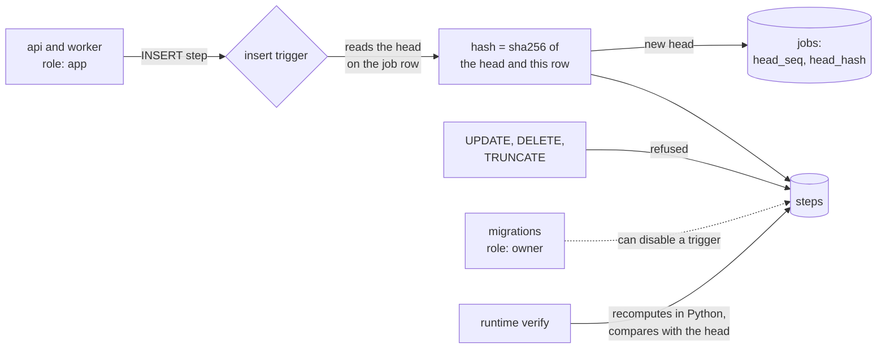

# 0013: Chain the step log with a hash, and write it as a role that cannot switch the chain off

Status: accepted, 2026-11-17. Not built.

## Context

The step log is the record of what a job did. Resume, approval and audit all
read it. Today a row of it can be changed or deleted without a trace.

One database role does everything. `runtime` is a superuser, owns the
tables, and is used by the API, the worker and the migrations. APTS asks for
a log whose changes can be detected (AR-012).

## Options

Who can switch the protection off:

| Option | For | Against |
|---|---|---|
| One role, protected by triggers | No change to the stack. | The application's own credentials can drop the trigger. The test would pass and show nothing. |
| Two roles: an owner for migrations, an app role for the API and the worker | The app role cannot alter, disable or bypass a trigger. | A second credential. The owner can still rewrite the log. |
| Two roles, and the head hash kept outside the database | A rewrite by the owner is found. | A second store, and a decision about who holds it. |

Where the hash is made: in a trigger, not in the application. Four places
in the code insert steps, and all of them pass through a trigger.

## Decision

Two roles, a chain made by a trigger, and a verify command.

- The owner role owns the tables and runs the migrations. The app role is
  used by the API and the worker. It is not a superuser.
- The app role may read and insert steps. On jobs it may read, insert, and
  update every column except the head.
- Each step has a `hash`: SHA-256 over the job's head hash and the row. The
  row's fields are the job id, `seq`, the lease epoch, `created_at` in
  microseconds, `kind` and `payload::text`.
- Every field is fixed in width or carries its length, so two different rows
  cannot give the same input. The first step chains from the job id.
- An insert trigger computes the hash and overwrites any value the writer
  sent. It refuses a step that does not follow the head, and writes the new
  head to the job row. It runs with the owner's rights.
- A second trigger refuses UPDATE and DELETE on steps. A third refuses
  TRUNCATE.
- `runtime verify` recomputes the chain in Python and compares every stored
  hash and the head. It reads `payload::text` as text, so it does not have to
  print JSON the way Postgres does.
- The migration fills the hashes of existing rows in `seq` order.

Tried on Postgres 18.7 in a throwaway container:

| Attempt | Result |
|---|---|
| App role: UPDATE, DELETE, TRUNCATE on steps | Permission denied |
| App role: disable or drop a trigger | Refused: must be owner |
| App role: `session_replication_role = replica` | Permission denied |
| App role: write the head on the job row | Permission denied |
| App role: insert `seq` 5 after 3 | Refused by the trigger |
| Owner: disable the trigger, change step 2 | The recomputation names step 2 |
| The same row hashed in Python, and in another session time zone | Equal |

## Consequences

- A change by the app role is refused. A change by the owner is found by
  `runtime verify`.
- A cut-off tail is found, because the head is on the job row and the app
  role cannot write it.
- Not caught: an owner or superuser who rewrites every later hash and the
  head. A restore of an older backup is not caught either. The head outside
  the database is the follow-up for both.
- The chain shows that a row is what was stored. It does not show that what
  the worker stored was true.
- A status change without a step, such as a cancel, is not in the chain.
- The hash depends on how Postgres prints `jsonb`. A version that printed it
  differently would need the chain computed again.
- Every insert of a step now also updates the job row. The cost is not
  measured.
- The stack gets a second credential. The owner's default password on
  `127.0.0.1` stays a [known limit](../limits.md#api).
