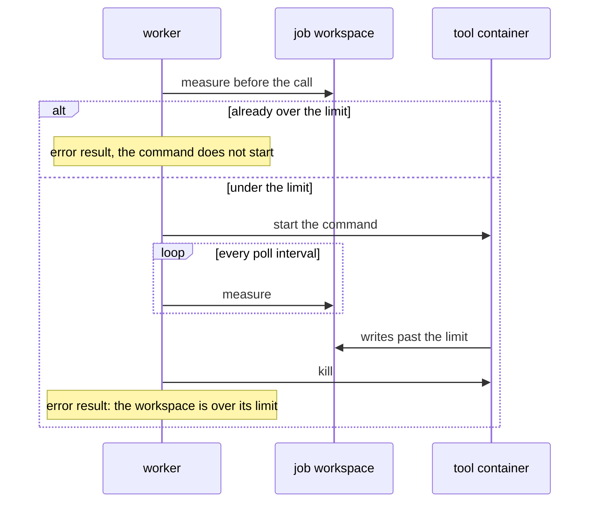

# 0014: Limit a job's workspace with a watcher, and accept an overshoot

Status: accepted, 2026-11-17. Not built.

## Context

A sandboxed command writes to its job's workspace. All workspaces are on one
volume, on the disk that Postgres and the other jobs use. Nothing limits how
much a command writes, so one job can fill the disk for all
([issue 28](https://github.com/sindredg/agent-runtime/issues/28)).

## Options

| Option | For | Against |
|---|---|---|
| A quota from the storage driver | Hard, enforced by the kernel. | Needs XFS with project quotas. Docker Desktop and the default CI runners have none. |
| A file system per job on a loop device | Hard. | Needs a privileged helper to make and mount it. Not tried to the end. |
| A workspace in memory, copied out after a call | Hard, no privilege. | Uses RAM. The copy has to be made by a party the command cannot touch. |
| A watcher: the worker measures and kills | No privilege. Works wherever Docker does. | Soft. What is written between two measurements gets through. |
| A watcher with a write rate limit | Would bound the overshoot. | Tried: the limit does not slow ordinary writes. |

The rate limit was tried on Docker Desktop on WSL2 (cgroup v2), with
`--device-write-bps` at 1 MiB/s. The container's `io.max` showed the limit.

| 30 MiB written with | No limit | 1 MiB/s limit |
|---|---|---|
| Direct I/O | 0.0 s | 30.0 s |
| Buffered writes and `fsync` | 0.1 s | 0.1 s |
| Buffered writes | 0.1 s | 0.1 s |

## Decision

A watcher, as a soft limit. No write rate limit.

- The worker measures a job's workspace before a sandboxed call, and again
  at a fixed interval while the call runs.
- Over the limit before the call: the command does not start. The call gets
  an error result that says why.
- Over the limit during the call: the worker kills the container. The call
  gets an error result that says why, and the job goes on.
- The limit and the interval are settings.
- No rate limit is set. It would suggest a bound that ordinary writes do not
  have.
- A hard limit is a separate decision
  ([issue 78](https://github.com/sindredg/agent-runtime/issues/78)).

## Consequences

- A command can write past the limit by its write speed times the interval
  and the time a kill takes. In the trial, 30 MiB took 0.1 s.
- The disk can still be filled by a command that writes faster than the
  watcher reacts. The limit makes that harder, not impossible.
- A job over its limit cannot shrink its workspace: the command that would
  delete files does not start either. It goes on without sandboxed tools.
- Each measurement walks the workspace. A workspace with many files makes it
  slow, and the interval longer than its setting.
- This record covers the job workspace only.
- The test needs a run with the watcher switched off, in which the command
  writes past the limit and is not stopped.
