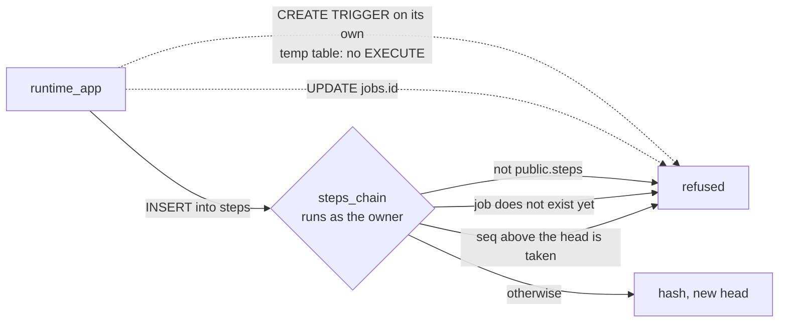

# 0015: Keep the chain's trigger to the owner and the steps table

Status: accepted, 2026-11-17. Built in migration 0007.

## Context

[ADR 0013](0013-chain-the-step-log-and-split-the-database-roles.md) lets the
app role update every job column but the head, and has the insert trigger
run with the owner's rights. A review of the first build found four ways
around it:

- EXECUTE on a function is granted to PUBLIC by default, and every role may
  create a temporary table. The app role could hang the trigger function on
  a table of its own and move any job's head as the owner.
- The foreign key is checked at the end of a statement. One statement could
  insert steps and then their job, and the trigger let such steps through
  unchained.
- One UPDATE of `jobs.id` could move a job's steps under another job's row.
- An insert skipped by ON CONFLICT DO NOTHING kept the head the trigger
  wrote, when the head was behind the log.

It also found a gap that ADR 0013 states too narrowly. An owner who deletes
the last steps and sets the head to the new last step needs no hash, and
the recomputation does not find it.

## Options

| Option | For | Against |
|---|---|---|
| Revoke and check in the database | Closes each path where it opens. | More checks in the trigger. |
| A trigger function without SECURITY DEFINER, the head writable by the app | Nothing runs as the owner. | The app could write any head, and a cut tail would no longer be found. |

## Decision

- EXECUTE on `step_hash`, `steps_chain` and `steps_refuse` is revoked from
  PUBLIC. A trigger fires without it.
- `steps_chain` refuses to run on any table but `public.steps`, a step whose
  job does not exist, and a `seq` above the head that is taken already.
- The app role may not update `jobs.id`.
- The start check refuses a role that may run `steps_chain`.

## Consequences

- The app role's paths found in the review are refused and tested.
- Not caught, added to ADR 0013's list: an owner or superuser who cuts the
  tail and sets the head back. The head outside the database is the
  follow-up here too.
- A tool that needs to change a job's id has to run as the owner.
