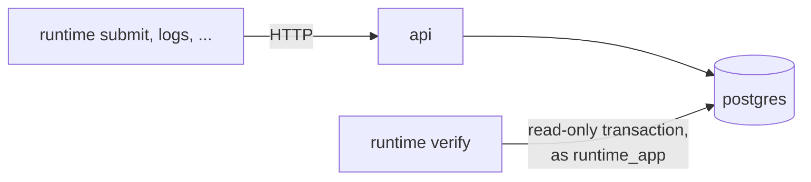

# 0016: `runtime verify` reads the database, not the API

Status: accepted, 2026-11-18. Built.

## Context

[ADR 0013](0013-chain-the-step-log-and-split-the-database-roles.md) decides
that the step log's chain is checked by a recomputation in Python. Every
other command of the CLI talks to the API. A check of the log is wanted for
every job, and also when the API is down or the database is a restored copy.

## Options

| Option | For | Against |
|---|---|---|
| A route in the API, called by the CLI | One way in for the CLI. No database login on the operator's side. | Needs a running API. Checking every job needs a list of jobs, which the API does not have. The API checks the database it serves. |
| The CLI connects to Postgres | Works on a stopped stack and on a copy. Checks every job. | A second way in, and a database login for the operator. |

## Decision

`runtime verify` connects to Postgres. The URL comes from `--database-url`
or `RUNTIME_DATABASE_URL`, and defaults to the stack's app role on
`127.0.0.1`. It reads in a read-only transaction, so the app role is enough.

Exit status 0 when every chain holds, 1 for a mismatch, 2 when a job could
not be checked. A mismatch outranks a job that could not be checked. The URL
is never printed.

## Consequences

- The CLI is no longer an API client only. The operator needs a database
  login; the app role's is enough.
- The check reads the same database the API and the worker write. It does
  not cover a rewrite by the owner of every later hash and the head.
