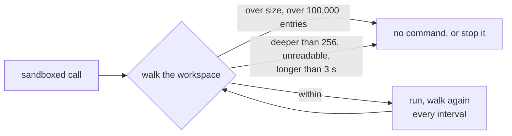

# 0017: Bound the workspace walk, and state what it cannot see

Status: accepted, 2026-11-18. Built.

## Context

[ADR 0014](0014-limit-a-jobs-workspace-with-a-watcher.md) limits a job's
workspace with a watcher that walks it. A review of the first build ran
commands against it on Docker Desktop:

| What the command did | What happened |
|---|---|
| Kept a file open, deleted it, wrote 300 MiB | Not counted. The space stays until the container ends. |
| Made 1 million empty files | One walk took 12.6 s. A 1 GiB write passed before it ended. |
| `fallocate` of 4 GiB | Took 53 ms. Stopped, but the 4 GiB stayed. |

A walk without bounds also sits inside the time bounds of a call. A slow
one delayed the start, and with it the time by which a dead worker's
container has ended.

## Options

| Option | For | Against |
|---|---|---|
| Bound the walk, state the rest | Small. Keeps the watcher soft, as decided. | The unseen cases stay. |
| A floor of free space on the volume | Sees every way of filling the disk. | One job, or anything else, low on space stops every job. |
| A hard limit per workspace | Closes all three. | A privileged part, or a storage driver with quotas. |

## Decision

Bound the walk and state what it cannot see. The floor and the hard limit
are left to [issue 78](https://github.com/sindredg/agent-runtime/issues/78).

- The walk stops at a limit on files and directories (setting, 100,000), at
  256 levels, and at 3 s. Past the first two the workspace is over its
  limit. Too deep, too slow, or any file system error counts as over too.
- The walk also stops as soon as the size is passed.
- The 3 s are part of `ends_within` and `call_within`, before the start
  bound. With the defaults the call ends within 70 s, which fits the 75 s
  stop grace with its 5 s margin.
- A command that ends while a walk runs is not held up by the walk.

## Consequences

- Per call, the watcher bounds neither a deleted file held open, a single
  large reservation, nor a file moved behind the walk.
- A workspace with more files than the limit gets no sandboxed command.
- A takeover during a sandboxed call waits 3 s longer.
- 100,000 entries took about 0.4 s to walk here, and about 1.3 s at the
  review's rate of 80,000 per second.
