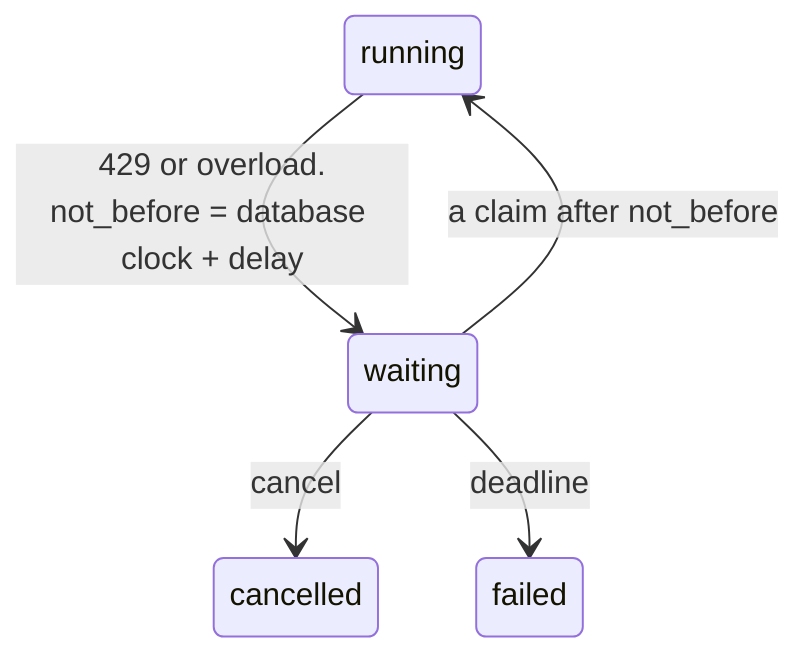

# 0018: Wait out a busy provider in the `waiting` status

Status: accepted, 2026-11-18.

## Context

A rate limit (429) or overload (529, or the same error inside a stream) from
the provider failed the job. A real workload meets rate limits before it
needs many workers. The `waiting` status and the `not_before` column existed
and nothing set them.

## Options

| Option | For | Against |
|---|---|---|
| The worker sleeps and keeps the lease | Simple. | The worker is idle. A wait longer than the lease needs renewals. |
| The SDK retries | No code. | The attempts are not in the step log. Its waits are short. |
| Release to `waiting` with `not_before` | Any worker resumes the job. Each wait is a step. | The claim and the store change. |

## Decision

Release to `waiting` with `not_before`.

- Only 429 `rate_limit_error` and 529 or in-stream `overloaded_error` wait.
  A spend-cap 429 fails the job, as do 5xx, timeouts and broken streams.
- The n-th wait in a row lasts at least `max(retry-after, d/2)` with
  `d = min(60, 2 * 2**(n-1))` seconds, plus a random part of up to `d/2`.
- The move and a `status_changed` step go in one fenced statement.
  `not_before` is set from the database clock.
- The claim takes a `waiting` job once `not_before` has passed. That is not
  a takeover.
- A job whose cancel was requested is cancelled instead of waiting.
- The count `n` comes from the step log, so any worker continues it.

## Consequences

- With `retry-after: 5`, a window of 60 s refuses one job at most six times.
- The request step stays without a response and is sent again, as after a
  stop.
- Workers do not share a limit. Many jobs can come back together, spread
  only by the random part. A shared limiter is planned.
- A job can wait until its deadline.
