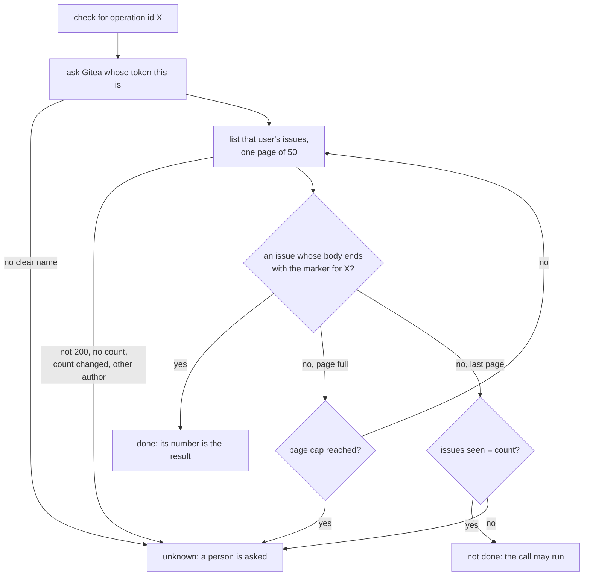

# 0019: Find a Gitea issue by a marker line, not by search

Status: accepted, 2026-11-18.

## Context

The lab demo runs `create_issue` against Gitea, a real issue tracker in a
container. The fake tracker stores an operation id with each issue. Gitea
has no such field and no idempotency key. The check after an interrupted
call still has to tell "done" from "not done" without guessing.

A trial on Gitea 28.4.0: the `q=` search goes through a full-text index. It
did not find an exact operation id right after the issue was created. A
plain list of issues, filtered by author, showed each new issue at once (20
of 20). It is sorted by creation; an edit or a comment does not move an issue.

## Options

| Option | For | Against |
|---|---|---|
| Search with `q=` | One request. | Found nothing for an exact id. The index can lag behind the database. |
| A label per operation id | Filtered by Gitea. | A label per call. Needs a wider token. |
| List the token user's issues and match a marker line | Reads the database. Exact match. | One request per 50 issues. |

## Decision

List and match.

- The tool appends `agent-runtime operation-id: <id>` as the body's last
  line. Only a body that ends with that line counts. The model's text comes
  before it, so a marker the model wrote cannot answer for another call.
- The check asks Gitea for the token's user (`GET /user`) and lists only
  that user's issues. No setting can name a different user than the one
  that opened the issues. Another author in that list gives "unknown".
- "Not done" only after a complete, steady scan: every page read, the same
  `X-Total-Count` on each page, and as many issues seen as counted.
  Anything else is "unknown", and a person decides.
- The token can write issues and read its own user, nothing else.

## Consequences

- A check costs one request for the user and one per 50 of its issues, up
  to 20 pages. More issues give "unknown" until older ones are moved.
- A deletion moves later issues up past the page being read. It also lowers
  the count, so it gives "unknown". So does a new issue by the same user.
- A person who edits the marker line, or writes below it, makes the check
  miss the issue. A rerun then opens a second issue.
- A request still on its way to Gitea when the check runs is not seen. The
  same holds for the fake tracker. A takeover comes a lease after the kill.
