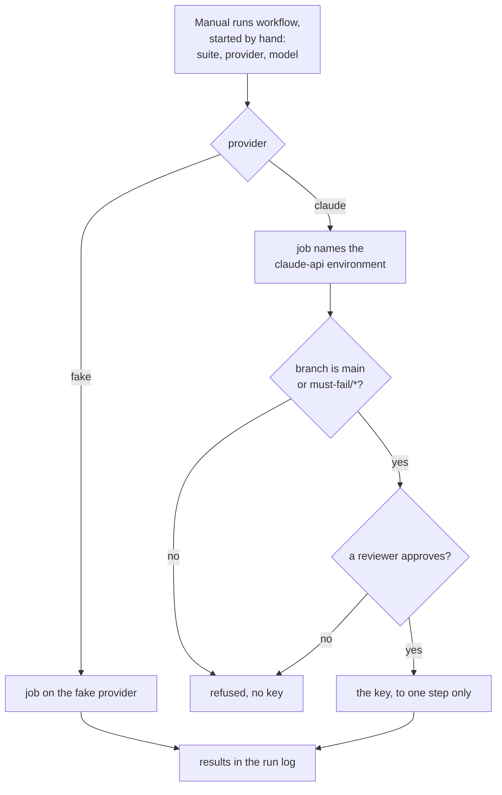

# 0020: Run recorded kill runs and API runs in a manual workflow

Status: accepted, 2026-11-19.

## Context

A kill run is void when the wall clock moves more than 1 s against the
monotonic clock during a test: leases end by the wall clock. On a WSL2
development machine the guest's clock ran 6 to 10 percent slow against
outside time, and the time service stepped it forward about every 32 s.
Every local kill test was void.

The runs on the Claude API need the key. Until now it lived in `.env` on
the machine that ran them, the same machine with the clock problem.

## Options

| Option | For | Against |
|---|---|---|
| Correct the local clock (chrony on the Hyper-V clock) | Same machine as development. | Works only while the error is under about 10 percent. The result needs that caveat. |
| A cloud VM per run | Steady clock. | Infrastructure to build, and to destroy after each run. |
| A workflow started by hand on GitHub Actions | Steady clock, already used by CI. The log is public. | The key is stored in GitHub. x86_64 runners only. |

## Decision

A workflow started by hand.

- `.github/workflows/manual-runs.yml`, started only by `workflow_dispatch`.
  Inputs are choices: suite (kills, the must-fail run, contract), provider
  (fake, claude), model.
- A job on the Claude API names the `claude-api` environment. It holds the
  key as an environment secret, needs a reviewer's approval before the job
  starts, and admits only `main` and `must-fail/*`.
- The key reaches one step through `env`. The kill runner never reads it.
- One paid run at a time, never cancelled while it runs.
- A result names the commit, the run id and where it ran. A local run is
  still possible, but is not recorded.

## Consequences

- The key is in GitHub. A reviewer and the branch rule guard it. A key used
  only for these runs, with a spend limit, bounds the loss if it leaks.
- The workflow file of the branch that is started is the one that runs.
  The branch rule limits that to `main` and `must-fail/*`.
- The run log is public. It shows results, test output, raw contract
  responses and, on failure, worker logs. None of these holds the key.
- A must-fail run is a branch `must-fail/<name>` with the switched-off
  mechanism, started with the same workflow, deleted after the run.
- The local clock stays wrong until it is corrected. Timings measured
  locally carry that note.
