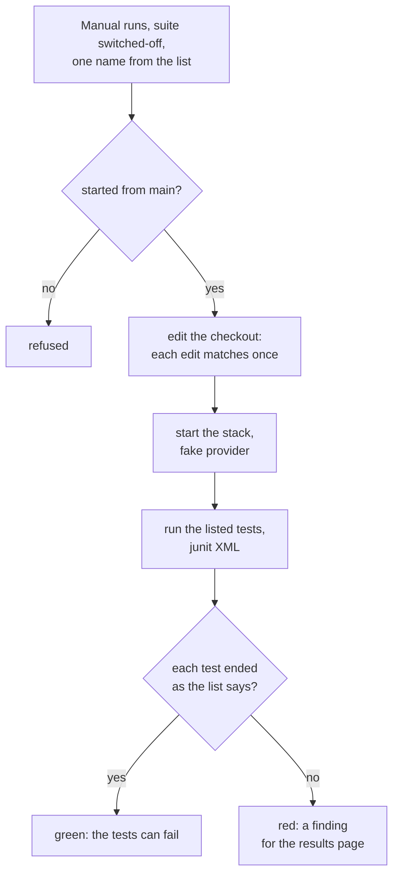

# 0021: Run switched-off runs from a reviewed list in the Manual runs workflow

Status: accepted, 2026-11-20. Extends [ADR 0020](0020-run-recorded-kill-and-api-runs-in-a-manual-workflow.md).

## Context

A guarantee counts as tested only with a run that removes its mechanism and
fails its test. Such runs were edits made by hand on the development machine,
whose clock steps (ADR 0020).

The edits lived outside the repository: three of thirty no longer matched the
code. One run failed on a provider error, not on its guarantee.

## Options

| Option | For | Against |
|---|---|---|
| Edits by hand, run locally | Nothing to build. | The clock steps. Edits are not reviewed, and go stale. |
| A `must-fail/*` branch per run, as in ADR 0020 | Steady clock. | Each branch runs its own workflow and tests. Nothing checks the edit. |
| A list of named edits on `main`, run by the workflow | Steady clock. Edits reviewed and checked on every PR. | Another script to keep. |

## Decision

A list on `main`, run by the Manual runs workflow.

- `scripts/switched_off.py` names each run: the edits, the stack, the tests,
  and how each test must end. Failed, with a named assertion in the failure;
  or passed, with the reason it cannot fail.
- The verdict comes from pytest's junit XML. An error, a skipped test, a test
  that did not run, or a failure on another assertion is red.
- A unit test on every PR checks that each edit matches once and still
  compiles, that each test exists, and that the workflow offers the same names.
- `suite: switched-off` with a `switched_off` choice. It runs only from
  `main`, only on the fake provider, in a job that holds no secret.

## Consequences

- An expectation is fixed in the list before a run. A run that ends otherwise
  is a finding for the results page. The list is not edited to make it green.
- The run log is public: the commit, the edit and one verdict per test.
- A keyed switched-off run still uses a `must-fail/*` branch (ADR 0020).
- The edits are written against today's code. A refactor that moves one
  fails the unit test, and the entry is updated in that PR.
