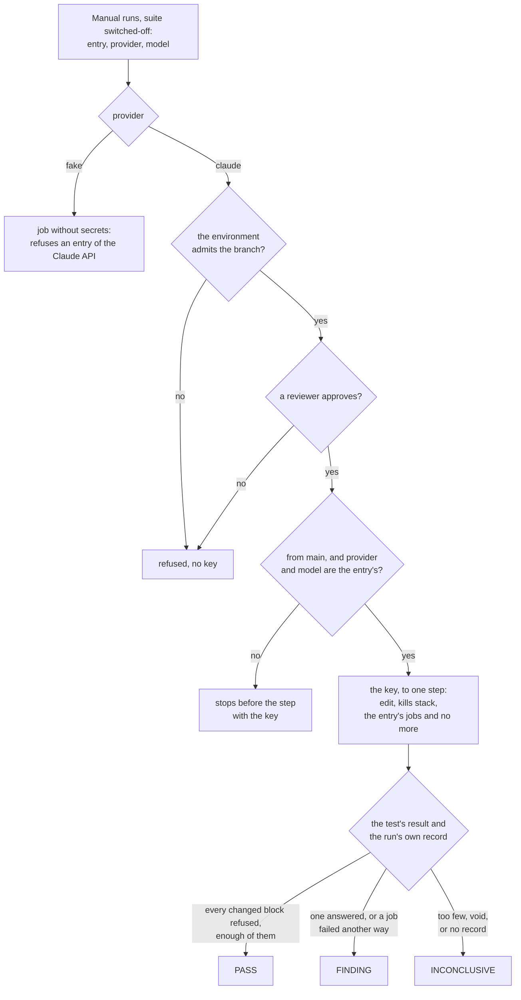

# 0022: Run switched-off entries on the Claude API from the reviewed list

Status: accepted, 2026-11-21. Extends [ADR 0021](0021-run-switched-off-runs-from-a-reviewed-list.md)
and replaces one line of it: a keyed switched-off run no longer uses a `must-fail/*` branch.

## Context

In 15 recorded jobs a worker rebuilt a `thinking` block from the step log, sent
it back, and the API answered. No run shows the API refuse a changed block
([issue 122](https://github.com/sindredg/agent-runtime/issues/122)).

That run needs the key. Until now a keyed switched-off run was a `must-fail/*`
branch: its own workflow file, Makefile and tests, with the key after one approval
([issue 130](https://github.com/sindredg/agent-runtime/issues/130)).

## Options

| Option | For | Against |
|---|---|---|
| A `must-fail/*` branch per keyed run | Nothing to build. | Code nobody reviewed gets the key. The environment has to admit such branches. |
| Keyed entries in the list, judged by the test's failure alone | The edit is reviewed on `main`. | One job failing for any reason passes the run. A real model's jobs differ. |
| Keyed entries in the list, judged by the run's record too | Edit, tests and judge are reviewed. The verdict counts jobs. | More script, and rules that need their own unit tests. |

## Decision

Keyed entries in the list on `main`, judged by the kill runner's record.

- An entry names its provider, model, stack and number of jobs. The check on
  every PR refuses a keyed entry with a model the workflow does not offer, a
  stack other than `kills`, or jobs that could spend more than 250,000 tokens.
- The workflow routes by the provider input. Before the step with the key, the
  keyed job refuses a ref other than `main`, and an entry whose provider or
  model is not the one picked.
- The script starts a keyed entry only with `SWITCHED_OFF_PROVIDER=claude`. It
  builds the run's settings from the entry, and gives the key to the stack and
  the tests only. The kill runner refuses a job past the entry's number.
- The verdict is PASS, FINDING or INCONCLUSIVE:
  [how a run is judged](../kill-runs.md#a-switched-off-run-on-the-claude-api).
- `rehearse` runs a keyed entry on the fake provider, with no key. It checks
  every step of the run before one that costs money, and is not a result.

## Consequences

- The environment's branch rule guards the key, not the workflow: a branch runs
  its own copy of the file and can drop the refusals. No keyed switched-off run
  starts before the environment admits `main` only.
- A start with the wrong provider or model asks the reviewer first and stops
  after. That costs one approval, and no tokens.
- A finding is recorded and not run again until it passes. An inconclusive run
  shows nothing, and is repeated only on a new decision, with the entry
  unchanged. Two in a row mean the entry is redesigned.
- The must-fail run with the intent write removed has no entry yet. With `main`
  only, it cannot be repeated with the key
  ([issue 150](https://github.com/sindredg/agent-runtime/issues/150)).
- A `must-fail/*` branch still runs on the fake provider: that job holds no secret.
- A run started on a development machine is possible, and is not recorded.
