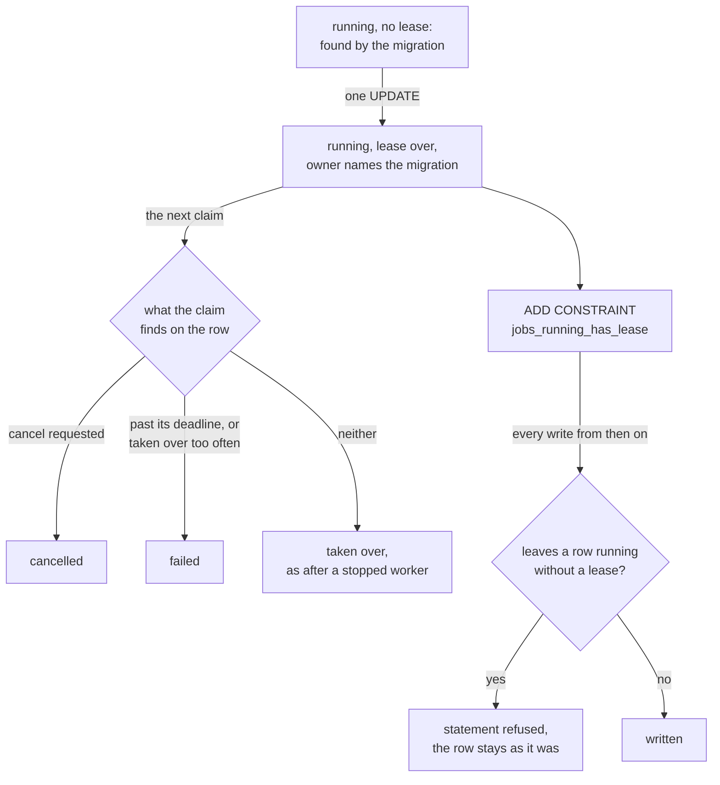

# 0023: A running job has a lease, and the database refuses one without

Status: accepted, 2026-11-21. Follows [ADR 0004](0004-fence-writes-with-the-lease-epoch-and-a-row-lock.md). Nothing is built yet.

## Context

Once its worker is gone, nothing ends a `running` job that has no lease. The
claim and the deadline sweep take a `running` job only when `lease_expires_at`
is earlier than now, and `NULL` never is. A cancel leaves it `running`.

A cancel at the instant a lease ran out wrote such rows until it was fixed
([issue 127](https://github.com/sindredg/agent-runtime/issues/127)). Every
writer of the jobs table keeps the rule today:

| The writer | Functions | Lease |
|---|---|---|
| makes a job `running` | `claim_job` | Sets owner and expiry with the status, from one clock reading. |
| keeps it `running` | `renew_lease`, `append_step`, `cancel_job` on a held job, the chain's trigger | Leaves the status as it was, and the lease in place. |
| moves it out of `running` | `leave_running`, `fail`, `fail_overdue`, and `cancel_job` and the claim when they end a job | Clears owner and expiry. |
| never writes a `running` row | `create_job`, `approve_job`, `deny_job`, `update_status` | Does not write the lease. |

The schema holds no later writer to it. The one lease `CHECK` keeps owner and
expiry together. A job in any other status has no lease in any writer, and no
reader depends on that.

## Options

| The rule | For | Against |
|---|---|---|
| No constraint | Nothing to build. | The next such bug is silent: a job that nothing ends. |
| Readers treat a missing lease as one that is over | The row heals itself. | It hides the bug, and changes the claim and the sweep. |
| `CHECK`: `running` needs a lease | The bug becomes a failed statement. The row stays valid. | A claim or a cancel fails instead. |
| `CHECK` both ways: a lease only while `running` | The whole invariant. | A lease left on a job that is not `running` harms nothing. |

| A `running` row that has no lease already | For | Against |
|---|---|---|
| Refuse to migrate | No migration changes a job. | The stack stays down until someone runs the same update by hand. |
| End the job in the migration | Done at once. | The migration picks the status and writes the step: a second halt path. |
| Give it a lease that is over | One `UPDATE`. The claim ends the job on its tested path. | A migration changes job rows. |
| `NOT VALID`, leave the row | The migration cannot fail. | The row still never ends. Every later update of it is refused, a cancel too. |

## Decision

- Add `jobs_running_has_lease`:
  `CHECK (status <> 'running' OR (lease_owner IS NOT NULL AND lease_expires_at IS NOT NULL))`.
  `status` is `NOT NULL`, so the expression is never `NULL`.
- It is a second constraint, beside `jobs_lease_owner_and_expiry_together`.
  A refused statement names the rule it broke.
- Not the other direction: a lease on a job that is not `running` stays allowed.
- The migration first gives each `running` row without a lease an owner that
  names the migration and the expiry `now()`, and logs the count. Then a plain
  `ADD CONSTRAINT`, which checks every row, in the same transaction.
- No `NOT VALID`. The services start only after the migration, and the table
  is small.

## Consequences

- A row left by issue 127 has `cancel_requested`, so the next claim cancels it
  and writes its step. Any other repaired row is failed at its deadline or
  at the takeover limit, or is taken over and run on.
- The cost: a writer bug now fails a statement. The claim picks the oldest
  job and the worker retries, so a claim bug that is no race stops the whole
  queue. A cancel bug answers 500.
- The rule does not bound the expiry. A lease that ends in a hundred years
  holds a job just as well. It catches a writer bug, nothing more.
- `alembic check` does not compare `CHECK` constraints. This one lives in the
  migration and in a test that writes a `running` row without a lease.
- A search finds two tests that write `running` without a lease, in
  `test_migrations.py` and `test_store.py`. They get a lease.
- Checked on PostgreSQL 18.7, in a throwaway database with the schema of
  `14962b4`, on the development machine. The plain `ADD CONSTRAINT` failed on
  such a row. Under `NOT VALID`, an update of its token count was refused.
- Same database: the claim statement, as the runtime renders it, `cancelled`
  the repaired row. Three plain `ADD CONSTRAINT` runs took 0.2 to 0.4 s on
  1,000,003 rows (558 MB). The [chaos run](../results/README.md) left 421 jobs.
- Accepted limit: nothing refuses a `waiting` job without `not_before`. No
  writer makes one. The claim passes it over, but a cancel and the deadline
  sweep still end it.
