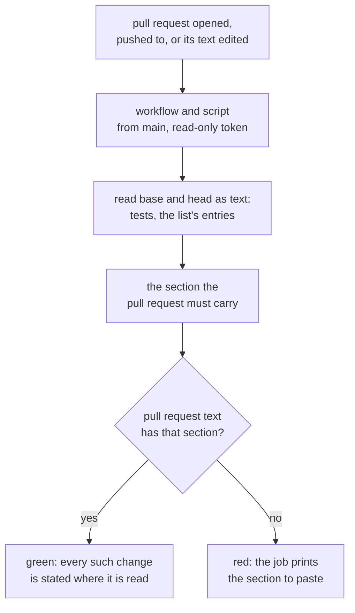

# 0024: Show a changed test in the pull request, by a check the pull request cannot change

Status: accepted, 2026-11-21. Extends [ADR 0021](0021-run-switched-off-runs-from-a-reviewed-list.md). Nothing is built yet ([issue 157](https://github.com/sindredg/agent-runtime/issues/157)).

## Context

A guarantee counts as tested when its test passes and a run with the
mechanism switched off fails. That holds only while the test stays as strict
as it was.

One pull request can change a mechanism and the test that guards it. The
unit test of ADR 0021 sees an entry whose edit, test or assertion text is
gone. It does not see a removed test that no entry names, or an entry whose
expectation changed.

Every pull request comes from one account, and the `main` ruleset requires
no approval.

## Options

| Option | For | Against |
|---|---|---|
| A required approval, with `CODEOWNERS` on the tests | GitHub's own mechanism. | [An author cannot approve their own pull request](https://docs.github.com/en/pull-requests/collaborating-with-pull-requests/reviewing-changes-in-pull-requests/approving-a-pull-request-with-required-reviews). It needs a second account. |
| A check that runs from the pull request's own tree | Runs on the pull request that adds it. | That pull request can change the check: the weakness ADR 0021 names for a branch. |
| A check from `main`'s copy, with its result in the pull request's text | The pull request cannot change it. No write token. | It cannot run on the pull request that adds it. |
| The same check, plus a label or a comment | Shows in the list of pull requests. | A write token in a job that a pull request starts. |
| Every switched-off entry on every pull request | Shows a weakened test by running it. | A stack per entry and minutes each: 8 entries today, more after [issue 158](https://github.com/sindredg/agent-runtime/issues/158). |

## Decision

A check from `main`'s copy that reads and never runs the pull request, and
fails until the pull request's text states what changed.

- The trigger is [`pull_request_target`](https://docs.github.com/en/actions/reference/workflows-and-actions/events-that-trigger-workflows#pull_request_target):
  the workflow and the script are `main`'s. The job has a read-only token and
  no environment.
- The script reads both trees as text, with `git` and `ast`. It imports
  nothing from the pull request and collects no tests.
- Guarded: test functions under `tests/`, the entries of
  `scripts/switched_off.py`, and the check's own script and workflow.
- The section names each removed test and each removed or changed entry. It
  counts changed tests and changed support code per file.
- The job is red until the pull request's text holds that section, word for
  word. An edit of the text runs the job again.
- No label and no comment.

## Consequences

- The check shows a change. It does not judge it: whoever reads the pull
  request does.
- A weakened assertion shows as a changed test, not as a weaker one. The
  assertion an entry names must still be in the test file (ADR 0021), and a
  switched-off run shows whether the test can still fail.
- A pass line is guarded where a test asserts it or an entry expects it. One
  that no assertion carries, a run count for example, is not: the results
  page states it with the run.
- The check cannot run on the pull request that adds it. It lands as
  configured, not tested. Its first evidence is a trial pull request that
  removes a test without naming it, which must be red.
- A pull request that changes the script or the workflow is listed like any
  other. The change takes effect after the merge.
- It becomes a required check of the `main` ruleset after its first run.
- Running a pull request's code under this trigger would be unsafe. The
  script's unit tests include a tree whose files raise when imported.
