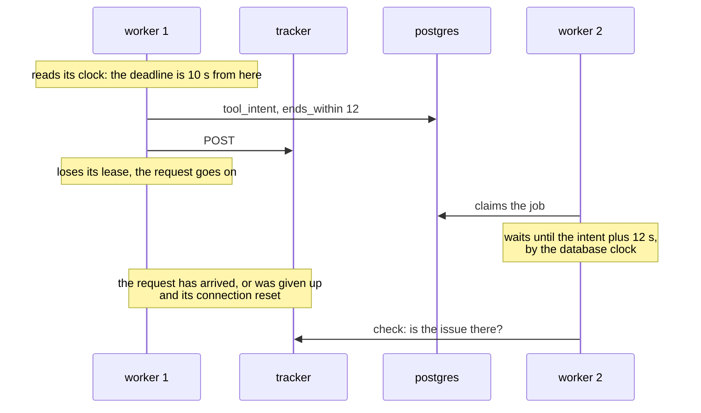

# 0025: A tool in the worker names how long its request can still arrive

Status: accepted, 2026-11-21. Follows [ADR 0005](0005-rerun-an-interrupted-tool-call-only-when-it-is-safe.md) and [ADR 0008](0008-run-each-tool-call-in-its-own-container.md).

## Context

A tool that is runtime code runs in a thread of its worker. Nobody can stop
a thread, so it goes on when the worker loses the job without being killed.

`create_issue` had a timeout for each step of its request, not for the
whole. A worker that took the job over asked the tracker at once. The first
worker's request could arrive after that answer: two issues for one call
([issue 103](https://github.com/sindredg/agent-runtime/issues/103)).

A sandboxed call already has this covered: its intent names a bound, and a
takeover waits it out (ADR 0008).

## Options

| Option | For | Against |
|---|---|---|
| Run such tools in a child process and kill it | A hard stop for any tool. | A process per call, for every tool in the worker. |
| The tool gives its request one deadline and names it. A takeover waits that long | Small. The wait that containers already have. | The bound is the tool author's promise. Every takeover of such a call waits. |
| Cancel the request when the lease is lost | Stops sending sooner. | A worker that is paused cannot cancel. The wait is needed all the same. |
| An idempotency key in the tracker | No wait. | Gitea has none (ADR 0019). |
| State the limit | Nothing to build. | The call can run twice with no kill at all. |

## Decision

The tool names a bound, and a takeover waits it out.

- A tool in the worker can set `ends_within`: the seconds after a call
  starts by which it sends nothing more that changes the system behind it.
  The tool keeps to it itself.
- `create_issue` puts one deadline of 10 s on the request that opens the
  issue. It counts from before the intent is written, where the wait counts
  from: a call that gets to run late has less time, and with none left
  sends nothing.
- Past the deadline the request is cancelled and its connection reset. An
  ordinary close is not enough: the kernel goes on sending a request that
  was written and not delivered, for a minute or more. Tried with a path
  that drops data: two issues with a close, one with a reset.
- The tool names 12 s: the deadline, and 2 s for two clocks that differ.
- The worker writes the number into `tool_intent`. A worker that takes the
  job over waits until that long after the intent, by the database clock,
  before it asks the tool's check. It is the wait of ADR 0008.
- A tool that names no bound is not waited for. `read_file` changes nothing
  outside and is simply run again.

## Consequences

- A takeover of an interrupted `create_issue` call takes up to 12 s longer,
  also when the first worker is dead and sends nothing.
- Not covered: a request the tracker has received and stores later than the
  bound. A check cannot see a request that is still on its way (ADR 0019).
- Not covered: a worker paused between its lease check and the start of the
  call, the gap of [ADR 0004](0004-fence-writes-with-the-lease-epoch-and-a-row-lock.md),
  and a machine suspended during the call, whose clock stops with it.
- The reset is shown for plain HTTP. Over TLS it is not tried.
- The request that opens the issue does not go through a proxy named in the
  environment. The lookup does.
- A call that a worker of an earlier version started has no deadline. The
  wait still applies to it, with nothing behind it.
- The deadline bounds what is sent, not when the thread returns: a slow name
  lookup, and the lookup of the issue afterwards, can take longer.
- A new tool that changes something outside has to name a bound and keep to
  it. The runtime cannot check the promise.
