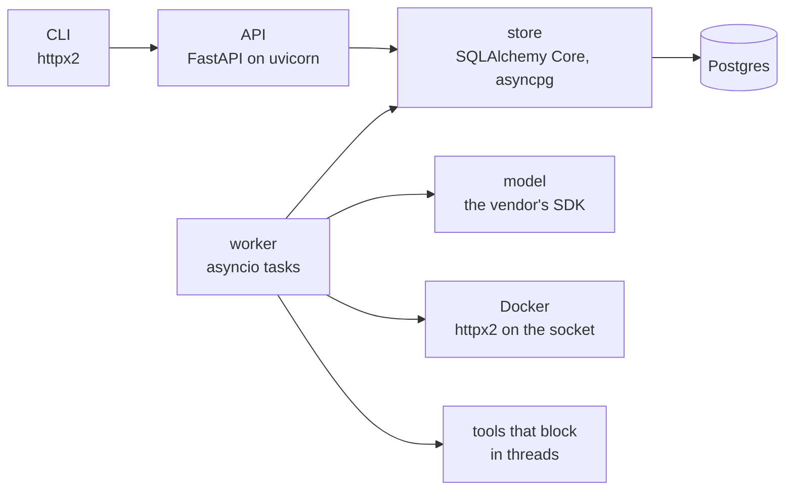

# 0026: Write the runtime in Python on asyncio, with the SQL written out

Status: accepted, 2026-11-21. Written after the fact: the choice dates from the first commit.

## Context

A worker mostly waits: for the model's stream, for Postgres, for Docker. For
one job it does several things at once. It renews the lease, watches for a
cancel, and runs the call, and it has to drop the call the moment one of the
others says so.

Every write to a job is one statement with a row lock and a condition
([ADR 0004](0004-fence-writes-with-the-lease-epoch-and-a-row-lock.md)). The
model is reached through the vendor's SDK
([ADR 0003](0003-official-sdk-and-a-wire-compatible-fake.md)). A tool is
code somebody writes for the runtime.

## Options

| Option | For | Against |
|---|---|---|
| Python on asyncio, SQLAlchemy Core | One language for the runtime, the fakes, the tests and a tool. A call is a task that can be raced and cancelled. | One event loop per process: code that blocks it stalls the heartbeat. |
| Python with a thread per activity | A tool may block as it likes. | A thread cannot be stopped. A halt would wait for the call it is meant to end. |
| An ORM for the store | Less SQL to write. | A fenced write is one statement with its lock. A unit of work chooses the statements itself. |
| Go | Cheap concurrency, one static binary. | A second language beside the tools, which their authors write in Python. |

## Decision

Python on asyncio, with each statement written out.

- Python 3.15. Every dependency is pinned to an exact version and locked
  with uv.
- Whatever waits is a task: the API on FastAPI and uvicorn, the store on
  asyncpg under SQLAlchemy Core, the SDK's async client, httpx2 for Docker
  and the trackers.
- No ORM. A write to a job is a statement the code spells out.
- pydantic checks a job's spec and the API's requests. mypy runs in strict
  mode over the code and the tests.
- A tool that blocks runs in a thread.
- The API, the worker, the migrations and both fakes run from one image.

## Consequences

- Code that blocks the event loop of a worker stalls its heartbeat, and the
  job is taken over. A tool author has to know which kind of tool it is.
- A thread cannot be stopped, so a tool in the worker outlives a halt
  ([ADR 0025](0025-a-tool-in-the-worker-names-how-long-its-request-can-arrive.md)).
- A worker runs one job at a time. More throughput is more workers
  ([ADR 0002](0002-postgres-as-the-job-queue.md)).
- Only one Python release is supported. A dependency without a build for it
  holds the whole runtime back.
