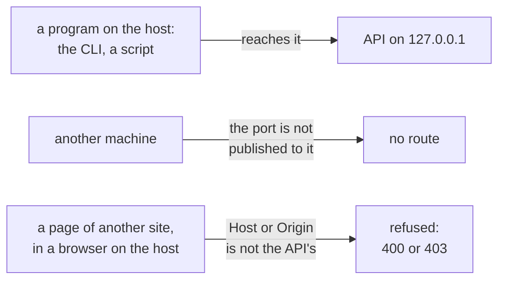

# 0027: The API has no authentication and answers on localhost only

Status: accepted, 2026-11-21. Written after the fact: the choice dates from the first API.

## Context

The API submits, cancels, approves and denies. An approval is a control: a
tool call that needs one does not run without it
([ADR 0011](0011-ask-a-person-before-a-risky-tool-call.md)).

The runtime has one operator, on the machine it runs on. Users, tenants and
billing are not what it is for.

## Options

| Option | For | Against |
|---|---|---|
| No authentication, localhost only, a foreign Host or Origin refused | Nothing to configure. The network and the browser are both closed. | Every local process is the operator. The log cannot say who approved. |
| One shared token in a header | Keeps other local users out. | A secret for the CLI to hold and for every log to leave out. It still names nobody. |
| An identity per operator, by OIDC or client certificates | The log names who approved. The API could be exposed. | An identity provider and key handling, for one operator. |

## Decision

No authentication. The API is reachable from its own host only.

- It listens on `127.0.0.1` unless `API_HOST` says otherwise, and the
  compose file publishes its port on `127.0.0.1`.
- A request whose `Host` is not one of the API's names is refused with 400.
  That stops a page that points a name of its own at the host.
- A change that carries another site's `Origin` is refused with 403. That
  stops a form on another site's page.
- The names are `localhost` and `127.0.0.1`, or `API_ALLOWED_HOSTS`. The two
  fakes have the same check.

## Consequences

- Every user and process of the host can submit, cancel, approve and deny.
  The approval gate keeps the model out, not a local person
  ([Known limits](../limits.md#api)).
- An approval step says that a call was approved, not by whom
  ([issue 94](https://github.com/sindredg/agent-runtime/issues/94)).
- The API must not be published on a network as it is. In front of a proxy
  that authenticates, the proxy's name goes into `API_ALLOWED_HOSTS`.
- More than one operator, or an API on a network, needs a new record. The
  third option is the one to start from.
