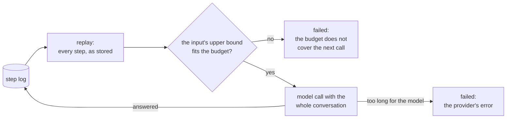

# 0028: Send the whole conversation every time, and fail a job that outgrows the context window

Status: accepted, 2026-11-21. Written after the fact: the choice dates from the first worker.

## Context

The step log is the conversation. A worker that claims a job replays the log
and sends what the first worker would have sent. The chaos tests compare the
two requests.

Some blocks have to go back exactly as they came. A `thinking` block is
signed, and the provider refuses one that was changed
([results](../results/kill-runs.md#with-the-stored-signature-changed)).

One tool result is bounded: a command's output is cut at 64 KiB, and
`read_file` refuses a file over its limit. Nothing bounds how long the
conversation as a whole gets.

## Options

| Option | For | Against |
|---|---|---|
| Send everything, and fail when it no longer fits | A takeover sends exactly what the log holds. Nothing can be summarised wrongly. | The model's context window bounds how long a job can be. |
| Drop or cut old tool results | Longer jobs with no extra model call. | The model loses what it read. Which results to cut is a guess. |
| Summarise earlier turns with a model call | The longest jobs. | A summary is a new output that costs tokens and can drop the instruction that matters. A signed block cannot be rewritten. |

## Decision

The whole conversation goes out with every model call. Nothing in it is cut
or summarised.

- Replay builds the conversation from every step, as stored.
- The budget's upper bound counts the whole input
  ([ADR 0010](0010-one-halt-path-and-a-budget-bound.md)). A job whose budget
  is smaller than the model's window stops there first.
- A request the provider refuses as too long fails the job, with the
  provider's error. It is not sent again shorter.

## Consequences

- A job cannot be longer than the model's context window. Work that needs
  more has to be submitted as several jobs.
- Each call sends the whole conversation again, so a job's token count grows
  faster than its number of turns.
- If summaries are built later, each one has to be a step of the log: a
  takeover must send the same conversation, and the log has to show what the
  model was told.
