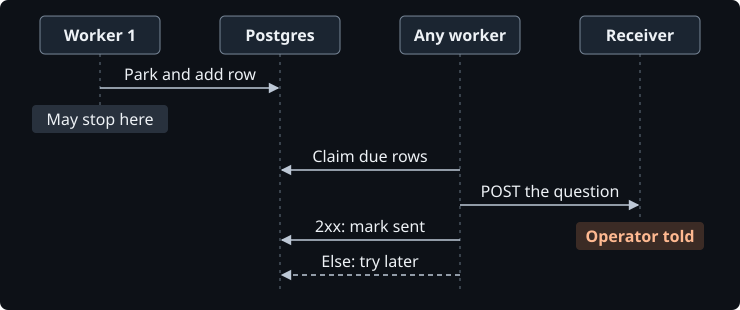

# 0029: A parked job notifies from a row its park writes

Status: accepted, 2026-11-21. Follows [ADR 0011](0011-ask-a-person-before-a-risky-tool-call.md) and [ADR 0012](0012-an-answer-names-its-question.md). Nothing is built yet.

## Context

A job that needs a person's answer is parked in `needs_approval`, and
nothing leaves the runtime
([issue 75](https://github.com/sindredg/agent-runtime/issues/75)). A person
finds out by asking for the job. A job nobody looks at fails at its
deadline.

The worker that parks a job gives up its lease in the same statement. No
worker holds a parked job, so a delivery that worker starts has nobody to
finish it when the worker stops.

A question holds the tool's input, which the model wrote. The reason of a
question about an interrupted call can hold a tool check's error text,
which the system behind the tool can write.

## Options

Who sends:

| Option | For | Against |
|---|---|---|
| The parking worker sends after the park | No table. | A worker killed between the park and the POST never notifies. Nothing retries. |
| A delivery row written with the park, sent by a loop in every worker | Survives any one worker. Works while one worker runs. | A table, a migration and a loop. |
| The same row, sent by a service of its own | The sender needs neither the Docker socket nor the provider key. | With that service down, jobs park and nobody is told. |

What is promised:

| Option | For | Against |
|---|---|---|
| At most once: one try | Never a repeat. | A receiver down for a second loses the question. |
| At least once, with an id on every POST | A lost answer or a killed worker costs a repeat, not a miss. | The receiver has to drop repeats by the id. |
| Exactly once | What a reader expects. | Cannot be shown: a POST with a lost answer was delivered or was not. |

## Decision

A delivery row written with the park, sent by every worker, at least once.

- The statement that parks a job also writes a row in `notifications`: the
  job, the question (the `seq` of its `approval_requested` step), and
  whether the call is asked about before it runs or after an interruption.
  A job whose cancel was requested is cancelled by that statement, not
  parked, and gets no row.
- A worker with `NOTIFY_URL` set looks for due rows every second. Its claim
  skips rows another worker has locked and moves the next try 12 s ahead in
  the same statement. A worker killed during the POST leaves a row that
  comes due again.
- The POST is JSON: `id` (job and question), `job_id`, `question`, `tool`
  and `reason`, one of two fixed words. It holds no tool input and no
  reason text.
- The POST has one 10 s deadline and uses no proxy from the environment,
  as in
  [ADR 0025](0025-a-tool-in-the-worker-names-how-long-its-request-can-arrive.md).
  It follows no redirect: the address called is the one in the settings.
- Any 2xx is a delivery. One statement marks the row and appends a
  `notification_sent` step to the job's log, if the job still waits on that
  question.
- After a failure the next tries come 2, 4, 8, 16, then every 30 s later.
  There is no cap: the job's deadline ends it. A row whose question was
  answered, or whose job is final, is closed without a POST.
- The URL comes from the worker's settings, never from a job file. A URL in
  a job file would let a job make the runtime call any address.

## Consequences

- A receiver can get the same question more than once and has to compare
  the `id`. A run with no failure sends one POST per question.
- The notification says which tool asks, not what it would run. The person
  reads the question with `runtime status` or the status page.
- A failed POST never stops or fails a job. A receiver that stays down
  means the job fails at its deadline, as today.
- The row is written also with no URL set, so a URL set later finds the
  questions still open.
- A question answered before its first POST is never sent, and its job has
  no `notification_sent` step.
- A parked job's log can now grow by one step while it waits. The event
  stream says once per stop that a job waits, and took any new step as a
  new stop: it has to leave this kind out.
- Not covered: authentication towards the receiver. The POST carries no
  token, so a receiver on an open address cannot tell it from another
  sender's.
- Not covered: other events. A job that fails or finishes sends nothing.
- A receiver that expects another body, such as ntfy or a mail gateway,
  needs a small adapter in front of it.
- The receiver's address is the operator's choice. A worker can reach
  whatever that URL names, on its own network too.
