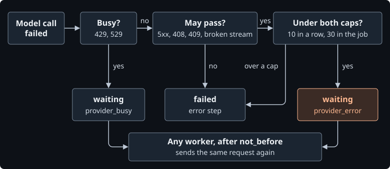

# 0030: Wait out a provider error that may pass, up to a cap

Status: accepted, 2026-11-24. Extends [ADR 0018](0018-wait-out-a-busy-provider-in-the-waiting-status.md) and changes one point of it: an overload inside a stream now falls under these caps.

## Context

A 5xx, a timeout or a broken stream failed the job, though the same request
could succeed a minute later
([issue 99](https://github.com/sindredg/agent-runtime/issues/99)).

A retry of such a call has a cost a busy answer does not have. A call that
broke during its stream can be billed, and nothing reports what it cost, so
it is not in `tokens_used`.

## Options

| Option | For | Against |
|---|---|---|
| The SDK retries | No code. | The attempts are not in the step log. |
| Wait as for a busy answer, no cap | One path. | A provider that always answers 500 holds a job until its deadline. |
| Wait as for a busy answer, with caps | One path. The unmetered calls are bounded. | A long incident fails the job. |
| Also charge each failed call to the budget | The budget sees retries. | Nothing reports the cost, so the number would be invented. |

## Decision

Wait as for a busy answer, with two caps.

- A 5xx but 529, 408, 409, a timeout, a broken or incomplete stream, a 200
  that is no message stream, and a retryable error event inside a stream wait,
  with the cause `provider_error`. A spend cap and other 4xx still fail.
- An overload or rate limit inside a stream counts here, not as busy. Output
  has begun, so the call can be billed, and a busy wait has no cap.
- The move, `not_before`, the delay and `retry-after` are those of ADR 0018.
  `n` counts every wait since the last response, of either cause.
- At most 10 such waits since the last response, and 30 in the job. The next
  error fails the job, and its error names the cap.
- A busy wait does not reset the error count. Otherwise a provider that
  alternates 429 and 500 never reaches the cap.
- The counts come from the step log, so any worker continues them.

## Consequences

- Ten waits in a row last 181 to 362 s, without a `retry-after` and without
  the time of the calls. That rides out an incident of a few minutes.
- A `retry-after` raises each wait and can hold a job until its deadline.
- A job makes at most 37 failed calls of this kind: 30 waits, the one that
  fails it, and one for each of the six workers it can lose before a wait is
  stored. Each can be billed without being counted.
- A busy provider still has no cap and can hold a job until its deadline.
- The caps were tested against the fake provider's faults, not against an
  incident of the Claude API.
