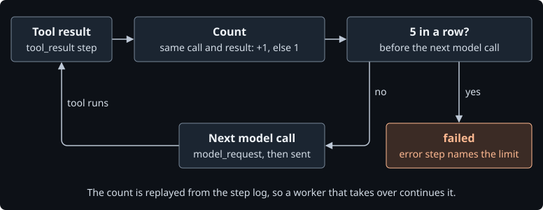

# 0031: Stop a job that repeats one call with the same result

Status: accepted, 2026-11-24.

## Context

A job stops at its token budget, its deadline, a cancel or its sixth
takeover. Nothing stopped a job that makes no progress inside those limits.
A model that reads the same file again and again ran until the budget or the
deadline ended it ([issue 168](https://github.com/sindredg/agent-runtime/issues/168)).

## Options

| Option | For | Against |
|---|---|---|
| A cap on model calls per job, from the spec with a default | Bounds every job. | New API surface. A default that fits a long job never stops a loop early. |
| A stop after N identical calls, results not compared | Simple. | Stops a job that polls and sees a change. |
| A stop after N identical calls with identical results | No progress by definition. No new setting. | Misses loops over two or more calls. |
| Tell the model instead of failing | The job may recover. | A new message type, and the model already saw the result four times. |
| Neither, with the limit stated | No code. | A model stuck on one read spends the whole budget. |

## Decision

Stop a job that makes the same tool call and gets the same result five
times in a row.

- A repeat is a `tool_result` whose call has the same tool name and input,
  as canonical JSON, as the call before it, with the same content and `is_error`.
- The count runs over the job's tool results in `seq` order, across
  responses. A different call or result starts it again at one.
- Replay counts it from the step log, so a worker that takes over continues
  it. The worker checks it before it writes the next `model_request`.
- At five the job ends `failed`, and its `error` step names the limit, and
  the tool when the worker offers it. The call after the fifth result is never sent.
- The limit is a constant, like the takeover limit. No spec field, no setting.

## Consequences

- A loop over two calls (A, B, A, B), an input that changes a little each
  time, or a result that changes on its own, such as a time stamp, is not seen.
  The budget and the deadline still end such a job.
- A poll that legitimately sees the same answer five times is stopped too.
- The loop scenario of the budget test reads two files in turn, so the
  budget, not this stop, still ends it.
