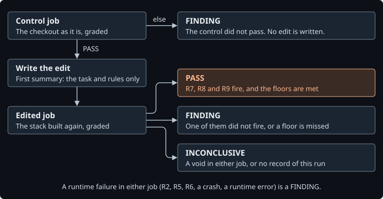

# 0034: Judge a keyed long-job entry by a control job and an edited job

Status: accepted, 2026-11-26. Extends [ADR 0022](0022-run-switched-off-entries-on-the-claude-api-from-the-list.md), which keeps its text.

## Context

ADR 0022 judges a keyed entry by its record: every changed block refused,
enough of them. A long job is judged by its outcome instead
([Long-job grader](../long-job-grader.md)). A real model's job can fail a
clause for its own reasons, so a failing edited job alone shows little.

## Options

| Option | For | Against |
|---|---|---|
| A mode of the long-job suite, outside the list | Nothing changes in the list. | The edit and the key leave the reviewed list. |
| An entry judged by its tests alone | Fits the list as it is. | A job that fails R7 on its own passes the run. |
| An entry judged by a control job and an edited job | The edited job's failure is compared with a pass on the same seed and model. | Two jobs per run, and a judge of its own. |

## Decision

An entry judged by two graded jobs: `long-notices-dropped`, on the `long`
stack and the Claude API.

- The control job runs first, with no edit. Its record must be PASS and
  every test must pass, or the run is a FINDING and the edit is never
  written.
- Then the edit drops the notices from the first summary, the stack is built
  again, and the edited job runs with the same seed and model.
- PASS: the edited job fails on R7, R8 and R9 with its floors met.
- FINDING: one does not fire, a floor is missed, a test does not end as
  listed, or R2, R5, R6, a crash or a runtime error shows in either job.
- INCONCLUSIVE: a void in either job, or no record of this run.
- In both jobs a test looks for the job's answers in what the run printed,
  recorded and kept. A leak is a FINDING.
- A rehearsal runs the control job only, on the fake provider, with no key
  and no seed.

## Consequences

- The entry runs only in the workflow job `long-job`, which holds the key.
  One approval of the `claude-api` environment covers both of its jobs.
- The entry cannot start while the token bound of keyed long jobs is unset.
  It has no value yet.
- On the fake provider only the control job can run: the fake's scripted
  reviewer does not follow the edited summary.
