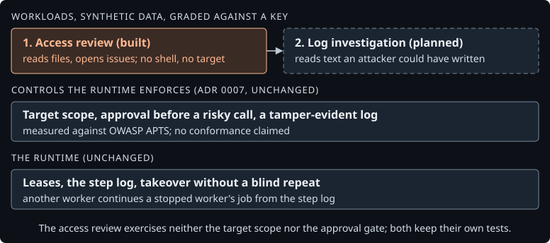

# 0035: Prove the runtime on defensive jobs over synthetic data first

Status: accepted, 2026-11-26. Narrows one sentence of
[0007](0007-security-agents-and-owasp-apts-as-the-yardstick.md)'s context:
the first workloads are defensive jobs over synthetic data, not
reconnaissance and testing against live targets. The rest of 0007 holds as
written.

## Context

ADR 0007 names reconnaissance and testing against authorised targets as the
jobs the runtime is for. A first workload has to show that a long job
finishes correctly, and a reader has to be able to check that from the
published output.

A job against a live target has no fixed answer: the target and its text
change between runs. A job over synthetic data can carry its own answer key.

## Options

| Option | For | Against |
|---|---|---|
| Keep 0007 as written: reconnaissance and testing against authorised targets | The workload 0007 names. | No answer key. Needs a live target. |
| Defensive jobs on synthetic data first, 0007's controls unchanged | Graded against a key and reproducible from a seed. No target to reach. | Exercises fewer of the controls at first. |
| Leave security work, run general jobs | The widest audience. | Drops what the controls are for. |

## Decision

Defensive jobs over synthetic data first.

- The first workloads are, in this order, an access review of a synthetic
  organisation ([Access review generator](../access-review.md)) and a log
  investigation.
- Each is generated from a seed and graded against an answer key. The access
  review's verdict checks the grants a notice decides, in files first read
  after the job's first summary; the rest of the key is reported, not
  asserted ([Long-job grader](../long-job-grader.md)).
- The rest of 0007 holds: the three controls the runtime enforces, OWASP
  APTS as the yardstick, no conformance claim, no testing tools shipped.

## Consequences

- The access review runs with no sandbox: it reads files and opens issues,
  with no shell and no target, and no call waits on the approval gate. It
  exercises neither the target scope nor the gate; both keep their own tests
  ([APTS table](../apts.md)). `runtime verify` runs on every graded job.
- The log investigation is planned, not built. It reads text an attacker
  could have written. What such text can change is tested on the fake
  provider ([Tool calls](../limits.md#tool-calls)); the run on a real model
  is open ([issue 160](https://github.com/sindredg/agent-runtime/issues/160)).
- Jobs against live targets stay what the controls are built for. None is a
  first workload.
- At the time of this record no model has run the access review. Its
  [grader](../long-job-grader.md) is configured, not tested.
