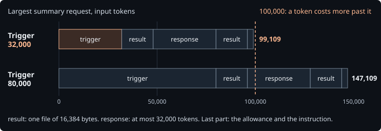

# 0038: Size the long job's trigger so no request passes 100,000 tokens

Status: accepted, 2026-11-28.

## Context

The keyed long job ([ADR 0034](0034-judge-a-keyed-long-job-entry-by-a-control-and-an-edited-job.md))
had a trigger of 80,000 in the full shape and 20,000 in the short one. In
10 short jobs on `claude-haiku-5-5`, each stopped at its 1,500,000-token
budget before reading all 36 files.

Files measured about 0.67 tokens a byte. For each file read, the model read
one again 0.8 times ([issue 261](https://github.com/sindredg/agent-runtime/issues/261)).

[ADR 0037](0037-ask-for-one-tool-call-per-response-in-a-job-that-summarises.md)
says a request holds at most the trigger, one response and one tool result.
That holds for every request but the summary request. The trigger is read on
a response, and the summary request follows that response's tool result, so
it holds two results. Past 100,000 input tokens, a token costs more.

## Options

| Option | For | Against |
|---|---|---|
| Keep 80,000 | Fewer summaries. | A summary request of up to 147,109 tokens. A full job is estimated at about 30M tokens. |
| Smaller files | Fewer tokens a read. | Changes the generated corpus and its commitment. |
| A trigger of 32,000 | Every request stays under 100,000. | About twice the summaries, and each one can drop a fact. |

## Decision

- Both shapes of the keyed long job use a trigger of 32,000 (`TRIGGER` in
  `tests/long_job/rules.py`).
- The largest summary request is the trigger, two results of 16,384 bytes,
  one response of 32,000 tokens, the budget's allowance on two requests and
  the instruction: 99,109, counting at most one token a byte. A unit test
  holds this under 100,000 for both shapes.
- A full job is given at most 25,000,000 tokens, a short job 4,000,000 and
  3,600 s.

## Consequences

- No request of the keyed job passes 100,000 input tokens, so no token of
  it costs more than the output price.
- The full job summarises about twice as often as at 80,000. Each summary
  can drop a notice, so a pass is harder to reach.
- The bound rests on the largest file being 16,384 bytes. The generator's
  checks hold every corpus file at that size for any seed, and the index
  depends only on the number of files.
- ADR 0037's text stays. This record corrects its bound for the summary
  request.
