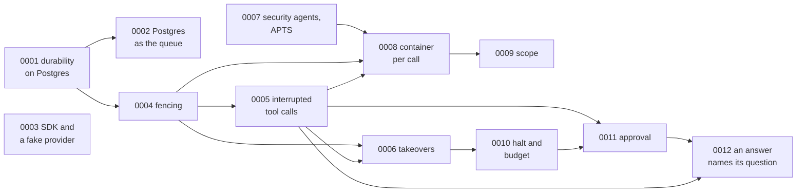

# Decision records

One record per real decision: context, options, decision, consequences. An
accepted record keeps its text. A change is a new record.

An arrow means the later record builds on, or follows from, the earlier one.

| Record | Decision | Built |
|---|---|---|
| [0001](0001-build-durability-on-postgres.md) | Build job durability on Postgres instead of adopting a workflow engine | Yes |
| [0002](0002-postgres-as-the-job-queue.md) | Use Postgres as the job queue | Yes |
| [0003](0003-official-sdk-and-a-wire-compatible-fake.md) | Call the model through the official SDK, and test against a fake that speaks the same wire format | Yes |
| [0004](0004-fence-writes-with-the-lease-epoch-and-a-row-lock.md) | Fence a worker's writes with the lease epoch and a row lock, and accept one gap | Yes |
| [0005](0005-rerun-an-interrupted-tool-call-only-when-it-is-safe.md) | Rerun an interrupted tool call only when that is known to be safe. Otherwise ask a person. | Yes |
| [0006](0006-count-takeovers-apart-from-claims.md) | Count takeovers apart from claims, and release the job when a worker is told to stop | Yes |
| [0007](0007-security-agents-and-owasp-apts-as-the-yardstick.md) | Build for security agents, and measure the controls against OWASP APTS | [The APTS table](../apts.md) has the milestone 2 rows |
| [0008](0008-run-each-tool-call-in-its-own-container.md) | Run each tool call in its own container, started by the worker | For `run_shell` and `list_dir` |
| [0009](0009-enforce-the-target-scope-in-the-network-namespace.md) | Enforce a job's target scope in the network namespace of its tools | For `run_shell` |
| [0010](0010-one-halt-path-and-a-budget-bound.md) | Halt a job through one path, and bound a model call's tokens before it is sent | Yes |
| [0011](0011-ask-a-person-before-a-risky-tool-call.md) | Ask a person before a risky tool call runs | Yes |
| [0012](0012-an-answer-names-its-question.md) | An answer names the question it answers | Yes |

Each record states what was built at the time it was written. What is built
now is described in [Architecture](../architecture.md).
