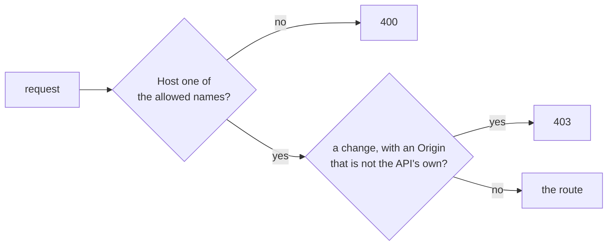
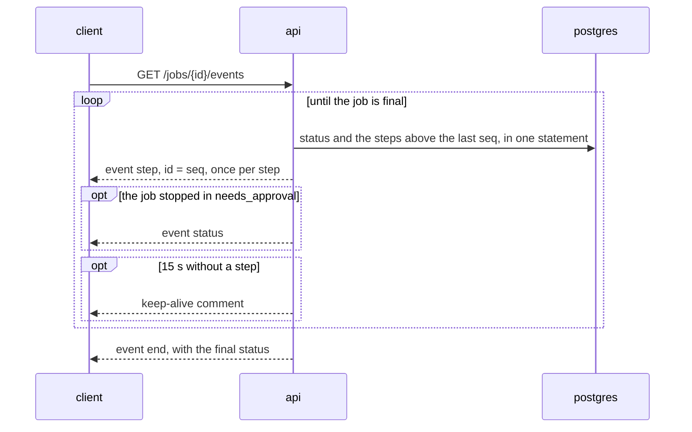

# API

The API accepts jobs, serves them with their steps, and takes cancels and
approval answers. It holds no state. The code is `src/runtime/api/app.py`.

It has no authentication. The stack publishes it on `127.0.0.1` only: do not
publish its port on another interface.

A browser reaches localhost for any page it shows, so the API answers only
requests that name it by an allowed name (`API_ALLOWED_HOSTS`):

- A page that points its own name at 127.0.0.1 (DNS rebinding) sends that
  name in `Host`, and is refused.
- A form sent from another site's page, also one on another port of
  localhost, carries that site in `Origin`. Reads are left to the browser:
  the API sends no CORS header.
- IPv6 addresses are not accepted as names, so `[::1]` is refused.

## Routes

| Route | Returns |
|---|---|
| `POST /jobs` | 201 and the job. The body is a [job file](usage.md#job-files). |
| `GET /jobs/{id}` | The job |
| `GET /jobs/{id}/steps?after=&limit=` | Steps with `seq` above `after`, in order, at most 1000 |
| `GET /jobs/{id}/events` | The steps as server-sent events |
| `POST /jobs/{id}/approve` | The job, now `queued`, after an `approval_given` step |
| `POST /jobs/{id}/deny` | The job, now `queued`, after an `approval_denied` step |
| `POST /jobs/{id}/cancel` | 200 or 202 and the job |
| `GET /healthz` | 200 while the process serves. It does not check Postgres. |

FastAPI also serves `/docs`, `/redoc` and `/openapi.json`.

## Refusals

| Status | When |
|---|---|
| 400 | A `Host` that is not one of the allowed names |
| 403 | A change sent with an `Origin` that is not the API's own address |
| 404 | The job does not exist |
| 409 | An answer the job does not wait on, or a cancel of a job that succeeded or failed |
| 422 | A job id that is not a UUID, a parameter out of range, an unknown field, a missing question number |

- The body of approve and deny is `{"question": <seq>}`. See
  [Approval](approval.md#an-answer-names-its-question).
- The answers of the cancel route are in
  [Cancel, deadline and budget](halt.md#what-the-cancel-route-answers).
- `prompt` and `system` are limited to 1,000,000 characters each, `files` to
  1 MiB. The size of a request body is not capped.

## The event stream

- Status and steps are read in one statement. When the status is final,
  every step has been seen.
- A job that stops in `needs_approval` is not over. The stream says so once
  each time the job stops there, and stays open.
- `Last-Event-ID` or `?after=` continues a broken stream. `Last-Event-ID`
  wins when both are given.
- The API polls the database for new steps. Nothing is pushed.
