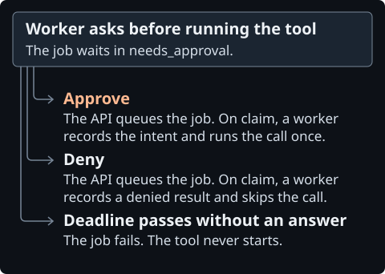

# Approval

A tool call can wait for a person before it runs. The runtime asks, parks the
job, and runs the call only after an approval
([ADR 0011](adr/0011-ask-a-person-before-a-risky-tool-call.md)).

## Ask, answer, run

The CLI shows the tool, its input and the reason for the question. To answer,
send the question number with `runtime approve` or `runtime deny`.
See [a job that asks](usage.md#a-job-that-asks) for an example.

## Which calls are asked about

Every call needs approval if the tool sets `needs_approval` or the job
lists the tool in `needs_approval`. The job cannot turn off the tool’s flag.

- A name in the spec that is not a tool of the claiming worker fails the job
  there, before anything starts. A misspelt name would gate nothing.
- That also fails a job that a worker with fewer tools claims or takes over.
- No tool that ships sets the flag. A job has to name the tools it wants
  asked about.
- The gate is per tool, not per call. The code is `worker/approval.py`.

## An answer names its question

The question number is the `seq` of the `approval_requested` step
([ADR 0012](adr/0012-an-answer-names-its-question.md)).

| An answer | Is |
|---|---|
| To the question the job waits on | Stored, and the job is queued |
| To another question | Refused with 409. The message names the open question. |
| To a job that is not waiting | Refused with 409. The message names the job's status. |
| Without a question number | Refused with 422 |
| One of several sent at once | Stored once. The others are refused. |

- A refused answer writes nothing.
- Replay counts an answer only for the question it names, and only the first.
- An older denial that names no question still counts for its call. An older
  approval that names none does not. The job waits on the same question
  again.

## One approval, one run

- The intent of an approved run is marked `needs_approval`. The intent uses
  the approval up.
- A call that is interrupted after its intent does not run again without a
  new approval. That holds also when the tool is idempotent or its check
  says the call did not happen.
- If the check finds the call's result, the result is stored and nobody is
  asked.
- The log binds every worker, also one whose copy of the tool does not ask,
  as during a deploy that changes a tool's definition. A question that is
  open before any intent parks the job again.

## The two reasons a job waits

The `approval_requested` step says which, in its `reason`.

| Reason | What has run | Approving means |
|---|---|---|
| The tool needs approval | Nothing of the call | Run it once |
| A worker went away during the call, and nobody can tell whether it happened | Maybe the whole call | Run it again. Look at the system the tool changes first. |

The second case is decided in
[Interrupted tool calls](interrupted-calls.md).

## Ending the wait

A job in `needs_approval` leaves it by an approval, a denial, a cancel, or
its deadline. A job whose cancel is requested while its worker would park it
is `cancelled` instead.

The log records that a call was approved or denied, not by whom: the API has
no authentication. See [Known limits](limits.md#approval).
