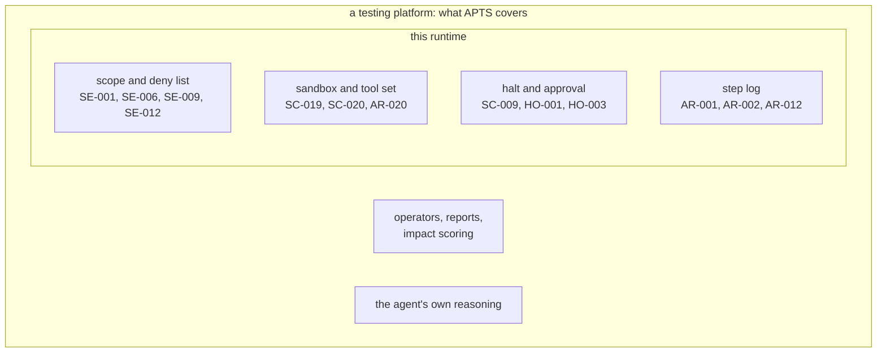

# OWASP APTS: the runtime's layer

This is a mapping of the runtime's layer, not a conformance claim.

[OWASP APTS](https://github.com/OWASP/APTS) (the Autonomous Penetration
Testing Standard) is written for a whole testing platform. This runtime is
one layer of such a platform: it runs an agent's jobs, holds their scope,
asks a person before a gated call, and keeps the step log.

The requirements were read at commit
[`9e4b4d8`](https://github.com/OWASP/APTS/tree/9e4b4d841a014f5d631b52b24ae48df2bf01c9dd)
of the APTS repository, which states version 0.1.0. The repository has no
tag for the version, so the commit is the reference.

Code links point at commit `5d7c43b`, so they stay on their line. Each
linked line holds the same text as when its row was written. Other frameworks:
[Framework mapping](framework-mapping.md).

## Status

| Status | Meaning |
|---|---|
| tested | A recorded result on a [results page](results/README.md), or a test in the suites of the run recorded there |
| built, not tested | In the code, with no recorded result |
| planned | Planned for a later milestone |
| gap | Not built, and not planned yet |

## Scope

| Requirement | What it asks | What the runtime does | Status | Code | Evidence |
|---|---|---|---|---|---|
| SE-001, target list | A machine-readable scope, validated before testing; no test on a scope that fails | `scope` in the job spec. A bad scope, IPv6, or one that touches the deny list is refused at submit with 422. | tested | [spec.py:43](https://github.com/sindredg/agent-runtime/blob/5d7c43b074ed42d49af4fe11d44b3ab182e4d768/src/runtime/spec.py#L43), [scope.py:75](https://github.com/sindredg/agent-runtime/blob/5d7c43b074ed42d49af4fe11d44b3ab182e4d768/src/runtime/scope.py#L75) | [test_scope.py:73](https://github.com/sindredg/agent-runtime/blob/5d7c43b074ed42d49af4fe11d44b3ab182e4d768/tests/unit/test_scope.py#L73), [test_api.py:253](https://github.com/sindredg/agent-runtime/blob/5d7c43b074ed42d49af4fe11d44b3ab182e4d768/tests/integration/test_api.py#L253) |
| SE-001, the rest | Test windows, attack types, asset criticality, the signed authorization, escalation contacts | A deadline and the tools that need approval. The rest is not in the spec. | gap | [spec.py:30](https://github.com/sindredg/agent-runtime/blob/5d7c43b074ed42d49af4fe11d44b3ab182e4d768/src/runtime/spec.py#L30) | |
| SE-006 | A scope check before every network action; a failed check stops the action and is logged | A packet filter in the call's network namespace drops what is out of scope and counts it. It sees addresses and ports, not URLs or redirects. | tested | [scope.py:204](https://github.com/sindredg/agent-runtime/blob/5d7c43b074ed42d49af4fe11d44b3ab182e4d768/src/runtime/scope.py#L204), [runner.py:200](https://github.com/sindredg/agent-runtime/blob/5d7c43b074ed42d49af4fe11d44b3ab182e4d768/src/runtime/sandbox/runner.py#L200) | [Scope and sandbox](results/sandbox.md), [test_scope.py:93](https://github.com/sindredg/agent-runtime/blob/5d7c43b074ed42d49af4fe11d44b3ab182e4d768/tests/escape/test_scope.py#L93) |
| SE-009 | A hard deny list, checked before the scope, unchanged during an engagement | A fixed list, checked at submit, plus the runtime's own Docker networks, read at worker start. Both are checked before each call and first in the filter. | tested | [scope.py:43](https://github.com/sindredg/agent-runtime/blob/5d7c43b074ed42d49af4fe11d44b3ab182e4d768/src/runtime/scope.py#L43), [runner.py:345](https://github.com/sindredg/agent-runtime/blob/5d7c43b074ed42d49af4fe11d44b3ab182e4d768/src/runtime/sandbox/runner.py#L345) | [Scope and sandbox](results/sandbox.md), [test_scope.py:138](https://github.com/sindredg/agent-runtime/blob/5d7c43b074ed42d49af4fe11d44b3ab182e4d768/tests/escape/test_scope.py#L138) |
| SE-012 | Connect to the validated address without a second resolution | A name is resolved once per call, written into the intent and pinned in the call's hosts file. TTLs are not read. | tested, for the pinning | [scope.py:163](https://github.com/sindredg/agent-runtime/blob/5d7c43b074ed42d49af4fe11d44b3ab182e4d768/src/runtime/scope.py#L163) | [Scope and sandbox](results/sandbox.md), [test_scope.py:118](https://github.com/sindredg/agent-runtime/blob/5d7c43b074ed42d49af4fe11d44b3ab182e4d768/tests/escape/test_scope.py#L118) |

The deny list holds link-local (with the metadata address) and Docker's DNS
server. Other production networks are on it only if listed in
`SANDBOX_DENY_NETWORKS`. Details: [Scope](scope.md#the-deny-list).

## Sandbox and tools

| Requirement | What it asks | What the runtime does | Status | Code | Evidence |
|---|---|---|---|---|---|
| SC-019 | The agent's environment bounded from outside: files, network, processes, system calls | A container per call: no capabilities, not root, read-only root, CPU, memory and process limits. A blocked action is a failed result. | tested | [runner.py:249](https://github.com/sindredg/agent-runtime/blob/5d7c43b074ed42d49af4fe11d44b3ab182e4d768/src/runtime/sandbox/runner.py#L249) | [Scope and sandbox](results/sandbox.md), [bad tool output](results/controls.md#bad-tool-output), [test_escape.py:70](https://github.com/sindredg/agent-runtime/blob/5d7c43b074ed42d49af4fe11d44b3ab182e4d768/tests/escape/test_escape.py#L70) |
| SC-020 | The allowed tools enforced outside the model | The worker offers a fixed set of tools from its code. A call of any other name gets an error result and nothing runs. | tested | [\_\_init\_\_.py:15](https://github.com/sindredg/agent-runtime/blob/5d7c43b074ed42d49af4fe11d44b3ab182e4d768/src/runtime/tools/__init__.py#L15), [agent.py:244](https://github.com/sindredg/agent-runtime/blob/5d7c43b074ed42d49af4fe11d44b3ab182e4d768/src/runtime/worker/agent.py#L244) | [test_worker.py:133](https://github.com/sindredg/agent-runtime/blob/5d7c43b074ed42d49af4fe11d44b3ab182e4d768/tests/integration/test_worker.py#L133) |
| AR-020 | The audit trail out of the agent's reach | Tool containers have no route to Postgres: the runtime's networks are on every deny list. The worker writes the log. | tested | [runner.py:345](https://github.com/sindredg/agent-runtime/blob/5d7c43b074ed42d49af4fe11d44b3ab182e4d768/src/runtime/sandbox/runner.py#L345) | [Scope and sandbox](results/sandbox.md), [test_scope_in_stack.py:35](https://github.com/sindredg/agent-runtime/blob/5d7c43b074ed42d49af4fe11d44b3ab182e4d768/tests/integration/test_scope_in_stack.py#L35) |

The workspace has a soft size limit, not a disk quota: a command writes on
until the next measurement ([Sandbox](sandbox.md#workspace-size)). The hard
limit is [issue 78](https://github.com/sindredg/agent-runtime/issues/78).

## Halt and approval

| Requirement | What it asks | What the runtime does | Status | Code | Evidence |
|---|---|---|---|---|---|
| SC-009, HO-008 | A halt on command and when the control plane is lost: no new action within 5 s, processes ended and state kept within 60 s | Cancel and the deadline kill a running command. A lost lease is noticed at the next renewal (10 s default), a lost database at the lease's end (30 s). | tested, for cancel and deadline. Gap: a lost lease or database can miss the 5 s. | [halt.py:61](https://github.com/sindredg/agent-runtime/blob/5d7c43b074ed42d49af4fe11d44b3ab182e4d768/src/runtime/worker/halt.py#L61), [agent.py:850](https://github.com/sindredg/agent-runtime/blob/5d7c43b074ed42d49af4fe11d44b3ab182e4d768/src/runtime/worker/agent.py#L850) | [Budget, deadline and cancel](results/controls.md#budget-deadline-and-cancel), [test_halt_worker.py:60](https://github.com/sindredg/agent-runtime/blob/5d7c43b074ed42d49af4fe11d44b3ab182e4d768/tests/integration/test_halt_worker.py#L60) |
| HO-001, HO-010 | A person's approval before high-risk or irreversible actions | A tool's definition or the job's spec makes each call wait for a person. The answer names the question. | tested | [approval.py:20](https://github.com/sindredg/agent-runtime/blob/5d7c43b074ed42d49af4fe11d44b3ab182e4d768/src/runtime/worker/approval.py#L20), [agent.py:412](https://github.com/sindredg/agent-runtime/blob/5d7c43b074ed42d49af4fe11d44b3ab182e4d768/src/runtime/worker/agent.py#L412) | [Approval](results/controls.md#approval-before-a-tool-call), [test_approval.py:152](https://github.com/sindredg/agent-runtime/blob/5d7c43b074ed42d49af4fe11d44b3ab182e4d768/tests/integration/test_approval.py#L152) |
| HO-003 | A time limit per decision, and a safe default when nobody answers | A job that waits for an answer is failed at its deadline and the call never runs. One deadline per job. | tested | [jobs.py:519](https://github.com/sindredg/agent-runtime/blob/5d7c43b074ed42d49af4fe11d44b3ab182e4d768/src/runtime/store/jobs.py#L519) | [Approval](results/controls.md#approval-before-a-tool-call), [test_approval.py:250](https://github.com/sindredg/agent-runtime/blob/5d7c43b074ed42d49af4fe11d44b3ab182e4d768/tests/chaos/test_approval.py#L250) |
| HO-006 | An operator's pause, with the state kept for resuming | No pause command. A waiting job holds no worker, and a stopped worker hands its job back at a step boundary. | gap | [agent.py:685](https://github.com/sindredg/agent-runtime/blob/5d7c43b074ed42d49af4fe11d44b3ab182e4d768/src/runtime/worker/agent.py#L685) | |
| SC-014 | Each reversible action tracked, with an automated rollback | Each call has its intent and result in the step log. Nothing about rollback. | gap | [agent.py:567](https://github.com/sindredg/agent-runtime/blob/5d7c43b074ed42d49af4fe11d44b3ab182e4d768/src/runtime/worker/agent.py#L567), [agent.py:582](https://github.com/sindredg/agent-runtime/blob/5d7c43b074ed42d49af4fe11d44b3ab182e4d768/src/runtime/worker/agent.py#L582) | |

Approval is per tool, not per action: with `run_shell` named, every command
asks. No reason is recorded with an answer, and not who gave it. Details:
[Approval](approval.md).

## Step log

| Requirement | What it asks | What the runtime does | Status | Code | Evidence |
|---|---|---|---|---|---|
| AR-001 | Every event in a structured, schema-validated log | One row per model call, tool intent and result, question, answer, status change, notification and error. Payloads are JSON, with no schema per kind. | gap | [steps.py:22](https://github.com/sindredg/agent-runtime/blob/5d7c43b074ed42d49af4fe11d44b3ab182e4d768/src/runtime/store/steps.py#L22) | |
| AR-002 | Every state transition logged with old state, new state and cause | A cancel, a park and a wait for a busy provider write a `status_changed` step. An answer has its own step; a claim, a release and a finish have none. | tested, for a cancel, a park and a wait. Gap for the rest. | [jobs.py:108](https://github.com/sindredg/agent-runtime/blob/5d7c43b074ed42d49af4fe11d44b3ab182e4d768/src/runtime/store/jobs.py#L108) | [test_status_changed.py:75](https://github.com/sindredg/agent-runtime/blob/5d7c43b074ed42d49af4fe11d44b3ab182e4d768/tests/integration/test_status_changed.py#L75), [test_status_changed.py:114](https://github.com/sindredg/agent-runtime/blob/5d7c43b074ed42d49af4fe11d44b3ab182e4d768/tests/integration/test_status_changed.py#L114), [test_backoff_store.py:56](https://github.com/sindredg/agent-runtime/blob/5d7c43b074ed42d49af4fe11d44b3ab182e4d768/tests/integration/test_backoff_store.py#L56) |
| AR-012 | A tamper-evident log: a hash chain, continuous sequence numbers | A trigger chains each step by hash and refuses a gap, a change and a delete. `runtime verify` recomputes it and finds a change by the owner. | tested | [0007_step_log_chain.py:84](https://github.com/sindredg/agent-runtime/blob/5d7c43b074ed42d49af4fe11d44b3ab182e4d768/migrations/versions/0007_step_log_chain.py#L84), [verify.py:56](https://github.com/sindredg/agent-runtime/blob/5d7c43b074ed42d49af4fe11d44b3ab182e4d768/src/runtime/verify.py#L56) | [Durability](results/durability.md#the-step-log-cannot-be-changed-without-detection), [test_step_log_chain.py:368](https://github.com/sindredg/agent-runtime/blob/5d7c43b074ed42d49af4fe11d44b3ab182e4d768/tests/integration/test_step_log_chain.py#L368) |

## Not in APTS

| Control | What the runtime does | Status | Code | Evidence |
|---|---|---|---|---|
| No blind repeat of a side-effecting call after a crash | The call's intent and the tool's check decide. When nobody can tell, a person is asked ([ADR 0005](adr/0005-rerun-an-interrupted-tool-call-only-when-it-is-safe.md)). | tested | [recovery.py:43](https://github.com/sindredg/agent-runtime/blob/5d7c43b074ed42d49af4fe11d44b3ab182e4d768/src/runtime/worker/recovery.py#L43), [agent.py:567](https://github.com/sindredg/agent-runtime/blob/5d7c43b074ed42d49af4fe11d44b3ab182e4d768/src/runtime/worker/agent.py#L567) | [Durability](results/durability.md#an-unsafe-tool-call-does-not-run-twice-without-approval), [test_kills.py:173](https://github.com/sindredg/agent-runtime/blob/5d7c43b074ed42d49af4fe11d44b3ab182e4d768/tests/chaos/test_kills.py#L173) |
