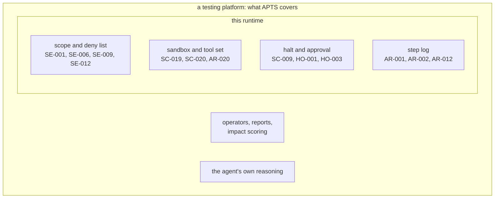

# OWASP APTS: the runtime's layer

This is a mapping of the runtime's layer, not a conformance claim.

[OWASP APTS](https://github.com/OWASP/APTS) (the Autonomous Penetration
Testing Standard) is written for a whole testing platform. This runtime is
one layer of such a platform: it runs an agent's jobs, holds their scope,
asks a person before a gated call, and keeps the step log.

The requirements were read at commit
[`9e4b4d8`](https://github.com/OWASP/APTS/tree/9e4b4d841a014f5d631b52b24ae48df2bf01c9dd)
of the APTS repository, which states version 0.1.0. The repository has no
tag for the version, so the commit is the reference.

## Status

| Status | Meaning |
|---|---|
| tested | A recorded result on a [results page](results.md), or a test in the suites of the run recorded there |
| built, not tested | In the code, with no recorded result |
| planned | Planned for a later milestone |
| gap | Not built, and not planned yet |

## Scope

| Requirement | What it asks | What the runtime does | Status | Evidence |
|---|---|---|---|---|
| SE-001, target list | A machine-readable scope, validated before testing; no test on a scope that fails | `scope` in the job spec. A bad scope, IPv6, or one that touches the deny list is refused at submit with 422. | tested | `test_scope.py`, `test_api.py`, in the [suites](results.md#the-suites) |
| SE-001, the rest | Test windows, attack types, asset criticality, the signed authorization, escalation contacts | A deadline and the tools that need approval. The rest is not in the spec. | gap | |
| SE-006 | A scope check before every network action; a failed check stops the action and is logged | A packet filter in the call's network namespace drops what is out of scope and counts it. It sees addresses and ports, not URLs or redirects. | tested | [Scope and sandbox](results-controls.md#scope-and-sandbox) |
| SE-009 | A hard deny list, checked before the scope, unchanged during an engagement | A fixed list plus the runtime's own Docker networks, read at worker start. Checked at submit, before each call, and first in the filter. | tested | [Scope and sandbox](results-controls.md#scope-and-sandbox) |
| SE-012 | Connect to the validated address without a second resolution | A name is resolved once per call, written into the intent and pinned in the call's hosts file. TTLs are not read. | tested, for the pinning | [Scope and sandbox](results-controls.md#scope-and-sandbox) |

The deny list holds link-local (with the metadata address) and Docker's DNS
server. Other production networks are on it only if listed in
`SANDBOX_DENY_NETWORKS`. Details: [Scope](scope.md#the-deny-list).

## Sandbox and tools

| Requirement | What it asks | What the runtime does | Status | Evidence |
|---|---|---|---|---|
| SC-019 | The agent's environment bounded from outside: files, network, processes, system calls | A container per call: no capabilities, not root, read-only root, CPU, memory and process limits. A blocked action is a failed result. | tested | [Scope and sandbox](results-controls.md#scope-and-sandbox), [bad tool output](results-controls.md#bad-tool-output) |
| SC-020 | The allowed tools enforced outside the model | The worker offers a fixed set of tools from its code. A call of any other name gets an error result and nothing runs. | tested | `test_worker.py`, in the [suites](results.md#the-suites) |
| AR-020 | The audit trail out of the agent's reach | Tool containers have no route to Postgres: the runtime's networks are on every deny list. The worker writes the log. | tested | [Scope and sandbox](results-controls.md#scope-and-sandbox) |

The workspace has no disk quota
([issue 28](https://github.com/sindredg/agent-runtime/issues/28)).

## Halt and approval

| Requirement | What it asks | What the runtime does | Status | Evidence |
|---|---|---|---|---|
| SC-009, HO-008 | A halt within 5 s on command and when the control plane is lost, with the state kept | Cancel and the deadline stop the job and kill a running command with its container. A worker that loses its lease stops at its deadline. | tested, for cancel and deadline | [Budget, deadline and cancel](results-controls.md#budget-deadline-and-cancel) |
| HO-001, HO-010 | A person's approval before high-risk or irreversible actions | A tool's definition or the job's spec makes each call wait for a person. The answer names the question. | tested | [Approval](results-controls.md#approval-before-a-tool-call) |
| HO-003 | A time limit per decision, and a safe default when nobody answers | A job that waits for an answer is failed at its deadline and the call never runs. One deadline per job. | tested | [Approval](results-controls.md#approval-before-a-tool-call) |
| HO-006 | An operator's pause, with the state kept for resuming | No pause command. A waiting job holds no worker, and a stopped worker hands its job back at a step boundary. | gap | |
| SC-014 | Each reversible action tracked, with an automated rollback | Each call has its intent and result in the step log. Nothing about rollback. | gap | |

Approval is per tool, not per action: with `run_shell` named, every command
asks. No reason is recorded with an answer, and not who gave it. Details:
[Approval](approval.md).

## Step log

| Requirement | What it asks | What the runtime does | Status | Evidence |
|---|---|---|---|---|
| AR-001 | Every event in a structured, schema-validated log | One row per model call, tool intent and result, question, answer and error. Payloads are JSON, not checked against a schema per kind. | gap | |
| AR-002 | Every state transition logged with old state, new state and cause | A cancel, a release on stop and a park for approval change the status without a step. | gap | |
| AR-012 | A tamper-evident log: a hash chain, continuous sequence numbers | The sequence number is continuous and unique per job. No hash chain yet. | planned | |

## Not in APTS

| Control | What the runtime does | Status | Evidence |
|---|---|---|---|
| No blind repeat of a side-effecting call after a crash | The call's intent and the tool's check decide. When nobody can tell, a person is asked ([ADR 0005](adr/0005-rerun-an-interrupted-tool-call-only-when-it-is-safe.md)). | tested | [Durability](results-durability.md#an-unsafe-tool-call-does-not-run-twice-without-approval) |
