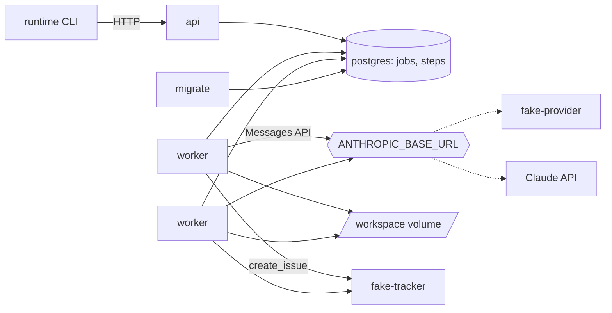
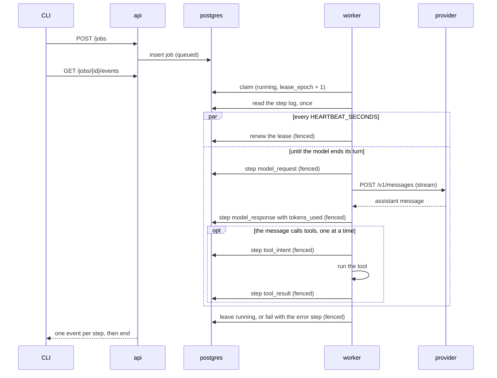
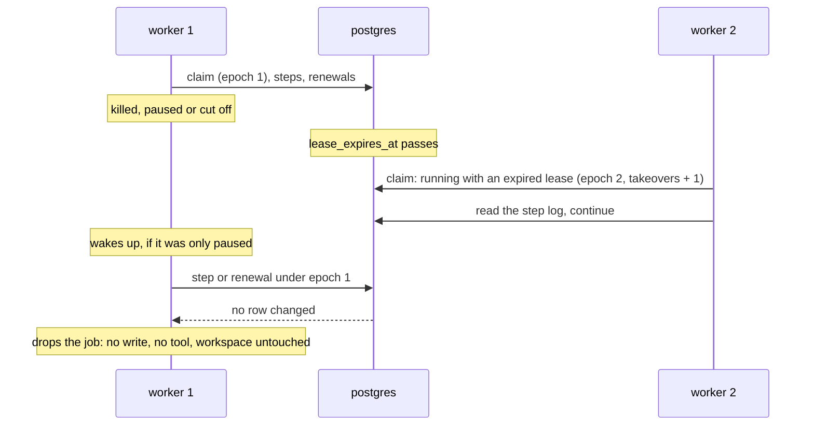

# Architecture

What is built, described from the code. Planned parts are marked as planned.
Decisions and their reasons are in the [decision records](adr/). Test results
are in the [README](../README.md#results).

## Components

| Component | Code | What it does |
|---|---|---|
| `api` | `src/runtime/api/` | Accepts jobs, returns jobs and steps, streams steps as server-sent events, approves a rerun. Holds no state. No authentication, so it is published on localhost only. |
| `worker` | `src/runtime/worker/` | Claims one job at a time, runs the agent loop, renews its lease while it does. Any worker can continue any job. |
| `postgres` | `migrations/`, `src/runtime/store/` | Jobs and the step log. Also the queue ([ADR 0002](adr/0002-postgres-as-the-job-queue.md)). |
| `migrate` | `migrations/` | Runs `alembic upgrade head` and exits. `api` and `worker` start after it succeeds. |
| `fake-provider` | `services/fake_provider/` | Answers `POST /v1/messages` from scenario files and keeps a log of the requests in memory, the newest 10,000 ([ADR 0003](adr/0003-official-sdk-and-a-wire-compatible-fake.md)). A scenario turn can ask for a delay. |
| `fake-tracker` | `services/fake_tracker/` | A stand-in for an issue tracker. Stores the issues it is sent with their operation ids, in memory, up to 100,000, and never merges two. |
| Provider client | `src/runtime/provider/` | The worker's one way to call a model: the official SDK behind a `Provider` interface. |
| Tools | `src/runtime/tools/` | `read_file`, `create_issue`, and `crash_worker` for failure tests. They run inside the worker process, not in a sandbox. |
| CLI | `src/runtime/cli.py` | `runtime submit`, `status`, `logs`, `approve`. Talks to the API only. |

## How a job runs

The step log is the only state of a job. A worker reads it once when it gets
the job, replays it into the conversation (`worker/replay.py`), and folds in
each step it writes itself. A job that another worker left unfinished is read
the same way: that is the whole of resume.

## What happens when a worker goes away

What the second worker does depends on where the log ends:

| The log ends with | The worker |
|---|---|
| A `model_request` without a `model_response` | Sends the request again. What arrived of the first answer is gone. |
| A complete step | Does what comes next. |
| A `tool_intent` without a `tool_result` | Decides by the table under [Interrupted tool calls](#interrupted-tool-calls). |

## Data model

Defined by the migrations. `src/runtime/store/schema.py` mirrors the tables
for building statements. A test fails when columns, types, nullability, server
defaults or index columns differ between the two. It does not compare the
CHECK constraints, which exist only in the migrations, or the WHERE clause of
the partial index.

| Table | Columns | Rules |
|---|---|---|
| `jobs` | `id` (uuidv7), `status`, `spec`, `token_budget`, `tokens_used`, `deadline`, `not_before`, `lease_owner`, `lease_expires_at`, `lease_epoch`, `takeovers`, `cancel_requested`, `error`, `created_at` | Status is one of the seven below. Lease owner and expiry are set together or not at all. Counters are not negative. |
| `steps` | `job_id`, `seq`, `kind`, `payload`, `lease_epoch`, `created_at` | Primary key (`job_id`, `seq`). `seq` starts at 1. A job that has steps cannot be deleted. |

`lease_epoch` counts every claim that handed the job out. `takeovers` counts
only the claims that took a `running` job whose lease had expired
([ADR 0006](adr/0006-count-takeovers-apart-from-claims.md)).

One partial index, `jobs_claim_order` on (`created_at`, `id`), covers jobs
that are `queued`, `waiting` or `running`.

| Step kind | Payload | Written |
|---|---|---|
| `model_request` | `model`, `max_tokens`, `messages` (a count) | Before each model call |
| `model_response` | `id`, `content`, `stop_reason`, `usage`. `problem` if the response cannot be used. If the content cannot be stored, it is replaced by an empty list and `content_dropped` is set. | After each model call, in one statement with the `tokens_used` update |
| `tool_intent` | `tool_use_id`, `name`, `input` | Before every run of a tool. A call that is run again gets a new one. |
| `tool_result` | `tool_use_id`, `content`, `is_error`. `recovered` when the result came from the tool's check and the tool did not run again. | After a tool ran, or could not run |
| `approval_requested` | `tool_use_id`, `name`, `input`, `operation_id`, `reason` | When nobody can tell whether an interrupted call happened |
| `approval_given` | `tool_use_id`, `operation_id` | By `POST /jobs/{id}/approve` |
| `error` | `message` | When the job fails, by its worker or by the claim at the takeover limit |

`spec` and `payload` are `jsonb`. It cannot hold the NUL character, unpaired
surrogates, NaN or infinity. The store refuses those before the insert with
`InvalidPayload`, and object keys must be strings. `jsonb` stores numbers
without an int or float type. A float that is written without a fraction,
such as `1e22`, is read back as an int.

## Job statuses

| Status | Moves to | Used today |
|---|---|---|
| `queued` | `running`, `cancelled`, `failed` | To `running`, by a claim |
| `running` | `succeeded`, `failed`, `needs_approval`, `queued`, `waiting`, `cancelled` | To `succeeded`, `failed`, `needs_approval`, and `queued` when its worker is stopped |
| `needs_approval` | `queued`, `cancelled` | Yes: to `queued` by an approval |
| `waiting` | `running`, `cancelled`, `failed` | No, planned |
| `succeeded`, `failed`, `cancelled` | nothing | `cancelled` is never set yet |

A job becomes `running` only through a claim. A `running` job is moved only by
the worker that holds it, through a fenced write, or by a claim that finds its
lease expired. `update_status` moves jobs that no worker holds and checks the
move inside its `UPDATE`. Nothing calls it yet: it is there for cancel.

## Mechanisms

| Mechanism | How it works |
|---|---|
| Claim | One `UPDATE` in `store/jobs.py`. Its subquery picks the oldest job that is `queued`, or `running` with `lease_expires_at` before the database clock, with `FOR NO KEY UPDATE SKIP LOCKED`. It sets `lease_owner`, sets `lease_expires_at` from the database clock, and increments `lease_epoch`. Taking a `running` job also increments `takeovers`. |
| Takeover limit | A takeover of a job whose `takeovers` is already 5 is not made. The same statement marks the job `failed`, and the claim appends an `error` step in the same transaction. The worker loop that made the claim removes the job's workspace. Claims after a release or an approval are not counted and not limited ([ADR 0006](adr/0006-count-takeovers-apart-from-claims.md)). |
| Lease and heartbeat | A lease lasts `LEASE_SECONDS`. While a job runs, a task renews it every `HEARTBEAT_SECONDS` (`worker/lease.py`). The worker also keeps its own deadline on its monotonic clock: the time it sent the claim or the last successful renewal, plus the lease length. It checks that deadline before it touches the workspace, before each `model_request` and `tool_intent` step, and again immediately before each model call, tool run and tool check. |
| Fencing | Every write of a worker to its job is one statement in `store/held.py` that updates the job row and only matches while the job is `running` under the worker's `lease_epoch`: a step with its token count, a renewal, the move out of `running`, and a failure. The update locks the row, so a write and a claim of one job cannot overlap. The statements are sent in autocommit, outside a transaction block. A write that changes no row raises `LeaseLost` ([ADR 0004](adr/0004-fence-writes-with-the-lease-epoch-and-a-row-lock.md)). |
| Failure | A worker fails its job with one fenced statement: the move to `failed` and the `error` step, which takes the next `seq` by itself. A worker that stops while it fails a job leaves both or neither. A job with an `error` step is therefore never `running`, and no worker takes it over. |
| Dropping a job | On `LeaseLost`, or when the database cannot be reached, the worker drops the job: it writes nothing more, starts no tool and no model call, and leaves the status and the workspace alone. The job stays as it is until its lease runs out and another worker takes it over. |
| Duplicate steps | A second step with the same (`job_id`, `seq`) is refused. In a fenced write the refusal undoes the token count with it. |
| Resume | See [What happens when a worker goes away](#what-happens-when-a-worker-goes-away). |
| Graceful stop | On SIGTERM the worker claims nothing more. At the next step boundary it releases the job: `running` to `queued`, fenced, so the next claim is not a takeover. A model call in flight is cancelled at once. A running tool is waited for and its result stored. The compose stack gives the worker 30 seconds before Docker kills it. |
| Tool calls | A response is checked before any of its tools run: every tool call needs an id, a name and an object input, and ids must differ. The calls of one response run one after another. A failed call is an error result for the model, and the job goes on. |
| Provider errors | A failed model call fails the job with an `error` step. There is no retry. |
| Limits | `token_budget` and `deadline` are stored and not enforced. `tokens_used` is counted from the usage of each response that was received in full. A call that fails or is abandoned part way is not counted. |
| Workspace | `WORKSPACE_ROOT/<job id>`. Files from the spec are written if they are missing and left alone if they are there, so a job that is taken over keeps what its tools wrote. In the stack every worker mounts the same volume. Only the worker that made a job final removes its workspace. `read_file` refuses absolute paths, `..`, and symlinks that lead out, checked after symlinks are followed. |
| Event stream | The API polls for steps with a higher `seq`. Status and steps are read in one statement, so when the status is final every step has been seen. |

### Interrupted tool calls

Every tool call has an operation id: the job id and the model's id for the
call, joined by a colon. It is the same for every run of the call, and the
tool receives it. A tool declares whether it is `idempotent` and may bring a
`check` that asks the system behind it whether the call already happened
([ADR 0005](adr/0005-rerun-an-interrupted-tool-call-only-when-it-is-safe.md)).

A worker that finds a `tool_intent` without a `tool_result` decides in this
order (`worker/recovery.py`):

| Case | What the worker does |
|---|---|
| The worker has no tool of that name | Runs the call again under a new intent. The run only yields the "unknown tool" error result. |
| A person approved (`approval_given` follows the intent) | Runs the call again under a new intent. |
| The tool is idempotent | Runs the call again under a new intent. |
| The check answers done | Writes the `tool_result` from the check, marked `recovered`. The tool does not run. |
| The check answers not done | Runs the call again under a new intent. |
| The check answers unknown, fails, or there is none | Writes `approval_requested` and moves the job to `needs_approval`. Nothing else runs. |

An approval covers one run. If the approved rerun is interrupted too, a person
is asked again.

| Tool | Idempotent | Check |
|---|---|---|
| `read_file` | Yes | |
| `create_issue` | No | Asks the tracker for an issue with the operation id. Found: done. A clear answer with none: not done. Anything else: unknown. |
| `crash_worker` | Yes, on purpose | |

### Failure tests

These exist for the tests in `tests/chaos` and do nothing unless switched on.

| Switch | Effect |
|---|---|
| `FAILPOINT` | Names one of six points at which the worker ends its own process with exit status 137: `after_claim`, `after_model_request`, `mid_stream`, `after_tool_intent`, `after_tool_ran`, `after_tool_result`. It fires only on a job with `takeovers` 0, so the worker that takes the job over gets past it. |
| `FAILPOINT_TOOL` | Limits the three tool failpoints to calls of one tool. |
| `CHAOS_TOOLS=1` | Offers the `crash_worker` tool, which appends a line to `CHAOS_LOG_DIR/crash_worker.log` and then ends the process. |
| `delay_seconds` in a scenario turn | The fake provider waits that long inside the stream, after `message_start` and before the first content block. |
| `docker-compose.chaos.yml` | Three workers, a 2 second lease, the switches above, and a restart policy for workers that ended themselves. |

## API

| Route | Returns |
|---|---|
| `POST /jobs` | 201 and the job. Body: `prompt`, optional `system`, `model`, `files`, `token_budget`, `timeout_seconds`. Unknown fields are refused with 422. |
| `GET /jobs/{id}` | The job. 404 if there is none. |
| `GET /jobs/{id}/steps?after=&limit=` | Steps with `seq` above `after`, in order, at most 1000. |
| `GET /jobs/{id}/events` | Server-sent events: one `step` event per step with `id` set to its `seq`, then one `end` event with the final status. `Last-Event-ID` or `?after=` continues a broken stream. |
| `POST /jobs/{id}/approve` | The job, now `queued`, after an `approval_given` step was appended in the same transaction. 409 unless the job is `needs_approval`. Of several approvals sent at once, one succeeds. |
| `GET /healthz` | 200 while the process serves. It does not check Postgres. |

A job id that is not a UUID, or a parameter out of range, is a 422. The job
routes answer 404 for a job that does not exist. FastAPI also serves `/docs`,
`/redoc` and `/openapi.json`.

## Settings

| Variable | Read by | Default | Meaning |
|---|---|---|---|
| `DATABASE_URL` | api, worker, migrate | required | `postgresql://` URL. Query parameters go to asyncpg unchanged, so `sslmode` is not supported. |
| `ANTHROPIC_BASE_URL` | worker | the Claude API | Which provider to call. The stack sets it to the fake provider. |
| `ANTHROPIC_API_KEY` | worker | required | The provider key. The fake accepts any value. |
| `MODEL` | worker | required | Model for jobs that name none. With the fake provider it is a scenario name. |
| `MAX_TOKENS` | worker | 16000 | `max_tokens` of each model call. |
| `LEASE_SECONDS` | worker | 30 | How long a claim or a renewal holds a job. |
| `HEARTBEAT_SECONDS` | worker | 10 | Time between two renewals. Has to be shorter than the lease. |
| `TRACKER_URL` | worker | unset | The tracker `create_issue` talks to. Unset, the tool is not offered. The stack sets it to the fake tracker. |
| `WORKSPACE_ROOT` | worker | `/tmp/workspaces` | Parent of the job workspaces. The stack sets it to the shared volume at `/workspaces`. |
| `POLL_INTERVAL_SECONDS` | worker | 1 | Wait between two looks for a job when none was found. |
| `WORKER_ID` | worker | host name and process id | Stored as `lease_owner`. |
| `WORKER_ALIVE_FILE` | worker | `/tmp/worker.alive` | Touched every 5 seconds. The compose health check reads its age at this path. |
| `FAILPOINT`, `FAILPOINT_TOOL`, `CHAOS_TOOLS`, `CHAOS_LOG_DIR` | worker | unset | See [Failure tests](#failure-tests). |
| `DEFAULT_TOKEN_BUDGET` | api | 1000000 | For a submission without `token_budget`. |
| `DEFAULT_TIMEOUT_SECONDS` | api | 3600 | For a submission without `timeout_seconds`. |
| `API_HOST`, `API_PORT` | api | `127.0.0.1`, `8000` | Where the API listens. In `.env`, `API_PORT` is something else: the host port the stack publishes the API on. |
| `FAKE_SCENARIO_DIR` | fake-provider | scenarios in the package | Directory of scenario files. |
| `RUNTIME_API_URL` | CLI | `http://127.0.0.1:8000` | Where the CLI finds the API. |

The compose file maps `PROVIDER_BASE_URL`, `PROVIDER_API_KEY` and
`PROVIDER_MODEL` from `.env` onto the worker's three provider settings. They
have their own names so that a key exported in the shell does not reach the
stack by accident. See `.env.example`.

## Tests

| Suite | Needs | Covers |
|---|---|---|
| `tests/unit` | nothing | Status transitions, replay, the decision about an interrupted call, the lease deadline with a fake clock, failpoints, scenario parsing, the fake provider and the fake tracker in process, the provider client's failure handling, the tools, the CLI against a stubbed API. |
| `tests/integration` | `make up` | Migrations. The store on real Postgres: claims, takeovers, the limit, fenced writes with two connections. The worker against the fake provider: heartbeat, lost lease, resume at each interruption point, each row of the decision table, approval, graceful stop, each failpoint. The API over HTTP. Two jobs end to end through the stack. |
| `tests/chaos` | `make chaos` | Workers that are killed at random times, end themselves at failpoints, are paused past their lease, crash on every run, and get SIGTERM. See the [results](../README.md#results). |
| `tests/contract` | `make up`, a Claude API key | The fake provider against the Claude API. Run by hand. It has not been run yet, so the fake's match with the real API is not tested. |

The integration and chaos suites never mock Postgres. A test that checks what
happened outside a job reads a record other than the job's step log: the fake
provider's request log, the fake tracker's list of issues, the `crash_worker`
tool's log file, or a worker's container log.

## Known limits

Accepted, with the reason in the decision records:

- Fencing protects the database, not the outside world. A worker that passes
  its lease check and is then paused for longer than its lease starts that one
  tool or model call when it wakes. Its result is refused, but the tool ran.
  If a check answered "not done" for that call in the meantime and it was run
  again, the change is made twice and no person was asked.
- A tool that is running when its worker loses the lease runs to its end.
  Tools run in the worker process and cannot be stopped from outside.
- "Not done" from a tool's check is the tool author's claim. A check that
  cannot rule out a request still on its way has to answer unknown.
- The worker's lease deadline is on its monotonic clock and the lease itself
  on the database clock. A suspended machine, or a database clock that is set
  forward, lets one check pass on a lease that is over. The write that follows
  is still refused.
- Five takeovers fail a job, also when the workers were lost for reasons that
  have nothing to do with the job. The limit is a constant.
- A job that waits in `needs_approval` waits until a person approves it.
  Nothing times the wait out. Approve offers a rerun only: entering the
  result by hand, skipping the call and cancelling are not built.

Not built or not closed:

- A failed model call fails the job. There is no retry and no backoff.
- Budget and deadline are not enforced. A job cannot be cancelled.
- Tools run in the worker process. There is no sandbox, no output cap and no
  tool timeout. A tool that outlasts the stop grace period is killed with its
  worker, and the job is taken over when its lease runs out.
- A worker told to stop while it writes a `tool_intent` step still runs that
  tool, because the intent is already in the log.
- The operation id protects a call that the runtime runs again. It does not
  protect against the model: a model that is told a call failed and asks for
  it again makes a new call with a new id. A model that reuses a call id in a
  later turn gets the same operation id for a different call.
- A worker that learns from its heartbeat that the lease is gone does not
  cancel a model call in flight. The call runs to its end and its answer is
  then refused.
- A workspace can be left behind: when the write that makes a job final
  reaches the database but its answer does not reach the worker, and when two
  workers use different workspace roots.
- `not_before` and `cancel_requested` are columns that nothing reads or sets
  yet.
- `runtime submit --follow` and `runtime logs --follow` wait for a final
  status. They keep waiting while a job is in `needs_approval`.
- All workers have to see the same workspace directory. The stack does that
  with one volume on one host.
- The whole conversation is sent with every model call. A job that outgrows
  the model's context window fails.
- The API has no authentication, and it does not cap the size of a request
  body. Only the fields are limited: `prompt` and `system` to 1,000,000
  characters each, `files` to 1 MiB. Anyone who can reach the API can approve
  a rerun.
- `read_file` checks paths and symlinks. A hard link inside a workspace to a
  file outside it would be read. Nothing built so far can create one.
