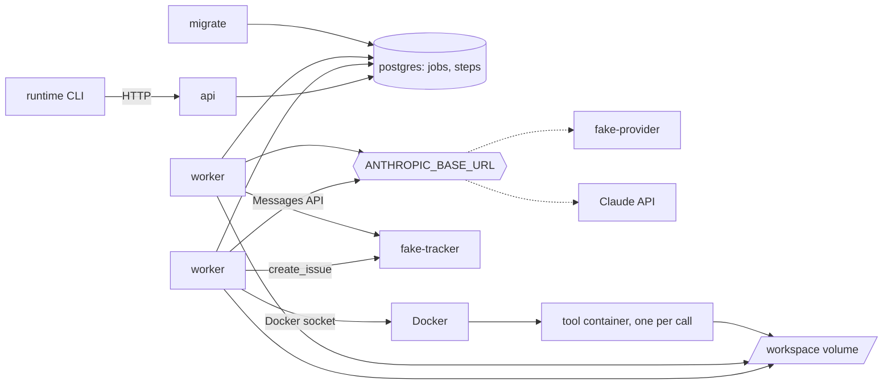
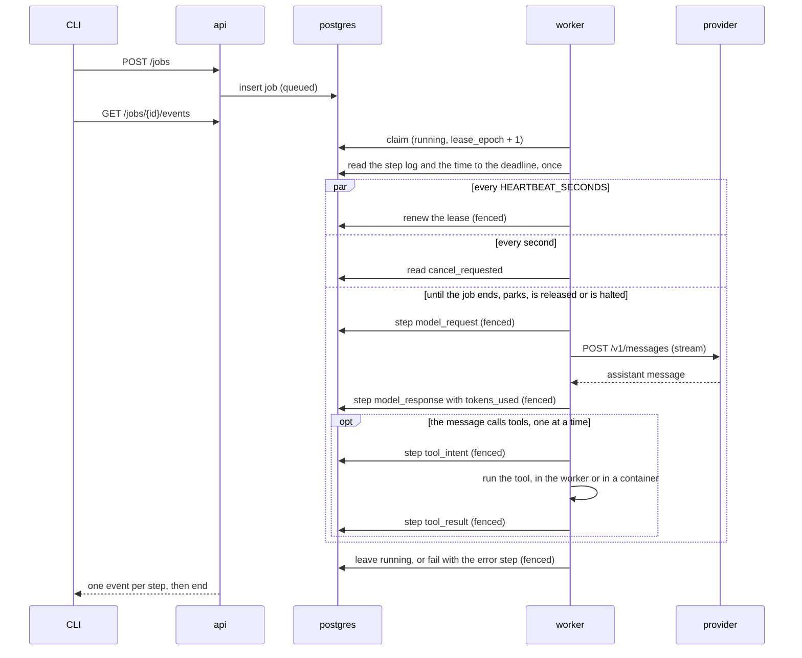

# Architecture

What is built, described from the code. Reasons are in the
[decision records](adr/). Test results are in [Results](results/README.md).

## Components

| Component | Code | What it does |
|---|---|---|
| `api` | `src/runtime/api/` | Accepts jobs, serves jobs and steps, takes cancels and approval answers. Holds no state. |
| `worker` | `src/runtime/worker/` | Claims one job at a time and runs the agent loop under a lease. Any worker can continue any job. |
| `postgres` | `migrations/`, `src/runtime/store/` | Jobs, the step log and the queue. Runs under an init process. |
| `migrate` | `migrations/`, `src/runtime/store/migrate.py` | Runs the migrations as the owner, sets the login of the [app role](database-roles.md), and exits. `api` and `worker` start after it. |
| `fake-provider` | `services/fake_provider/` | Answers `POST /v1/messages` from scenario files and logs each request. |
| `fake-tracker` | `services/fake_tracker/` | A stand-in issue tracker. Keeps each issue with its operation id. |
| Provider client | `src/runtime/provider/` | The worker's one way to call a model: the official SDK behind a `Provider` interface. |
| Tools | `src/runtime/tools/` | `run_shell` and `list_dir` run in a container per call. `read_file` and `create_issue` run in the worker. |
| Sandbox | `src/runtime/sandbox/` | Starts, reads and removes the container of each sandboxed call. A scoped call also gets a guard container. |
| CLI | `src/runtime/cli.py` | `runtime submit`, `status`, `logs`, `approve`, `deny`, `cancel`. Talks to the API only. |

The API has no authentication, so the stack publishes it on localhost only.

## How a job runs

The loop ends when the model ends its turn, when a call needs a person, when
the worker is told to stop, or when the job is halted.

Rules of one turn:

- A response is checked before any of its tools run. Every tool call needs an
  id, a name and an object input, and no id may repeat one the job has seen.
- A response that fails the check fails the job.
- The calls of one response run one after another.
- A failed tool call is an error result for the model, and the job goes on.
- A failed model call fails the job with an `error` step. There is no retry.

## Where a job's state lives

| State | Where | Who reads it |
|---|---|---|
| The conversation | The step log, table `steps` | A worker, once, when it gets the job |
| Status, lease, token count, deadline, cancel request | The job's row in `jobs` | The claim, the worker's fenced writes and its cancel watcher |
| The files the tools left | `WORKSPACE_ROOT/<job id>` | The tools of whichever worker holds the job |

A worker replays the log into the conversation (`worker/replay.py`) and folds
in each step it writes itself. A job another worker left is read the same way.
Only a tool call with an intent and no result needs more: see
[Interrupted tool calls](interrupted-calls.md).

## Workspace

- A claim that finds no workspace makes it from the spec's `files`. That is
  normally the first claim.
- It is written under a staging name and renamed into place, so it appears
  whole or not at all.
- A claim that finds one leaves it exactly as the tools left it.
- In the stack every worker mounts the same volume.
- The worker that makes a job final removes its workspace.
- A job the API cancels or the deadline check fails has no such worker. Its
  workspace waits for the sweep.
- Every worker sweeps its root every `SWEEP_INTERVAL_SECONDS`
  (`worker/sweep.py`). It removes the directories of jobs that are final or
  that the database does not know, and leaves those of open jobs.
- `read_file` refuses absolute paths, `..`, and symlinks that lead out.

## Pages

| Page | Covers |
|---|---|
| [Running jobs](usage.md) | The examples, job files, the CLI |
| [API](api.md) | Routes and the event stream |
| [Jobs and steps](data-model.md) | Statuses, tables, step kinds |
| [Database roles](database-roles.md) | The owner, the app role, and the start check |
| [Hash chain](step-log-chain.md) | How the step log is chained, and what a change runs into |
| [Durability](durability.md) | Claim, lease, fencing, takeover, graceful stop |
| [Interrupted tool calls](interrupted-calls.md) | When a call runs again, and when a person is asked |
| [Sandbox](sandbox.md) | The container of a tool call and its time bounds |
| [Scope](scope.md) | What a tool can reach on the network |
| [Cancel, deadline and budget](halt.md) | How a job is stopped and kept inside its limits |
| [Approval](approval.md) | Asking a person before a tool call runs |
| [Settings](settings.md) | Environment variables |
| [Testing](testing.md) | Suites, failure switches, commands |
| [Results](results/README.md) | The evidence behind each guarantee |
| [Runs against the Claude API](results/api.md) | Eight jobs with a real model |
| [Known limits](limits.md) | What is accepted and what is not built |
| [OWASP APTS](apts.md) | The APTS requirements of the runtime's layer, and what meets each |
