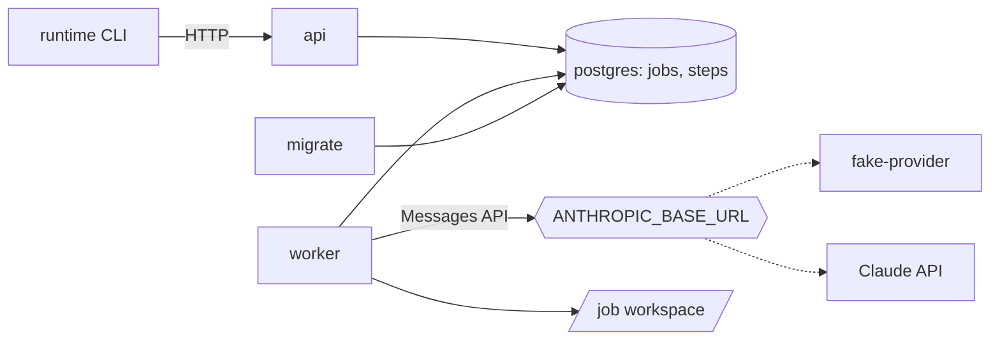
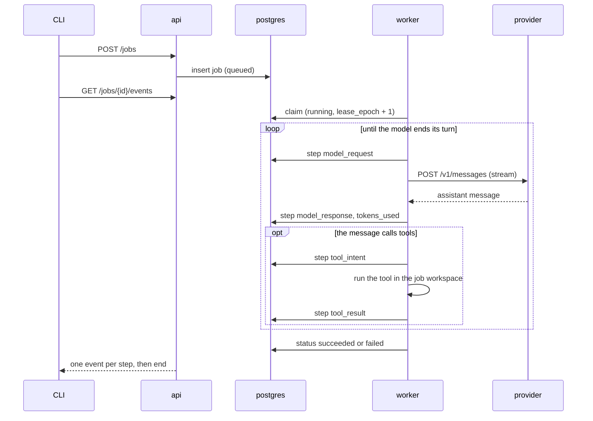

# Architecture

What is built, described from the code. Planned parts are marked as planned.
Decisions and their reasons are in the [decision records](adr/).

## Components

| Component | Code | What it does |
|---|---|---|
| `api` | `src/runtime/api/` | Accepts jobs, returns jobs and steps, streams steps as server-sent events. Holds no state. No authentication, so it is published on localhost only. |
| `worker` | `src/runtime/worker/` | Claims one queued job at a time and runs the agent loop until the job is final. |
| `postgres` | `migrations/`, `src/runtime/store/` | Jobs and the step log. Also the queue ([ADR 0002](adr/0002-postgres-as-the-job-queue.md)). |
| `migrate` | `migrations/` | Runs `alembic upgrade head` and exits. `api` and `worker` start after it succeeds. |
| `fake-provider` | `services/fake_provider/` | Answers `POST /v1/messages` from scenario files and keeps a log of the requests in memory, the newest 10,000 ([ADR 0003](adr/0003-official-sdk-and-a-wire-compatible-fake.md)). |
| Provider client | `src/runtime/provider/` | The worker's one way to call a model: the official SDK behind a `Provider` interface. |
| Tools | `src/runtime/tools/` | `read_file`. Runs inside the worker process, not in a sandbox. |
| CLI | `src/runtime/cli.py` | `runtime submit`, `status`, `logs`. Talks to the API only. |

## How a job runs

The step log is the only state of a job. Each pass of the agent loop rebuilds
the conversation from the steps (`worker/replay.py`) and does what comes next:
one model call, or the tool calls of the last response. The worker reads the
log from the database once, when it starts the job. After that it replays its
own copy, which grows with each step it writes. Each step is its own
transaction.

## Data model

Defined by the migrations. `src/runtime/store/schema.py` mirrors the tables
for building statements. A test fails when columns, types, nullability, server
defaults or index columns differ between the two. It does not compare the
CHECK constraints, which exist only in the migrations, or the WHERE clause of
the partial index.

| Table | Columns | Rules |
|---|---|---|
| `jobs` | `id` (uuidv7), `status`, `spec`, `token_budget`, `tokens_used`, `deadline`, `not_before`, `lease_owner`, `lease_expires_at`, `lease_epoch`, `cancel_requested`, `error`, `created_at` | Status is one of the seven below. Lease owner and expiry are set together or not at all. Counters are not negative. |
| `steps` | `job_id`, `seq`, `kind`, `payload`, `lease_epoch`, `created_at` | Primary key (`job_id`, `seq`). `seq` starts at 1. A job that has steps cannot be deleted. |

One partial index, `jobs_claim_order` on (`created_at`, `id`), covers jobs
that are `queued`, `waiting` or `running`.

| Step kind | Payload | Written |
|---|---|---|
| `model_request` | `model`, `max_tokens`, `messages` (a count) | Before each model call |
| `model_response` | `id`, `content`, `stop_reason`, `usage`. If the content cannot be stored, it is left out and `content_dropped` is set. | After each model call, in one transaction with the `tokens_used` update |
| `tool_intent` | `tool_use_id`, `name`, `input` | Before a tool runs |
| `tool_result` | `tool_use_id`, `content`, `is_error` | After a tool ran, or could not run |
| `error` | `message` | When the job fails |
| `approval_requested`, `approval_given` | | Planned, never written |

`spec` and `payload` are `jsonb`. It cannot hold the NUL character, unpaired
surrogates, NaN or infinity. The store refuses those before the insert with
`InvalidPayload`, and object keys must be strings. `jsonb` stores numbers
without an int or float type. A float that is written without a fraction,
such as `1e22`, is read back as an int.

## Job statuses

| Status | Moves to | Used today |
|---|---|---|
| `queued` | `running`, `cancelled`, `failed` | Yes |
| `running` | `waiting`, `needs_approval`, `succeeded`, `failed`, `cancelled` | Yes: to `succeeded` or `failed` |
| `waiting` | `running`, `cancelled`, `failed` | No, planned |
| `needs_approval` | `queued`, `cancelled` | No, planned |
| `succeeded`, `failed`, `cancelled` | nothing | `cancelled` is never set yet |

`update_status` checks the move inside its `UPDATE`, so a status that changed
in the meantime is not overwritten. A job becomes `running` only through a
claim.

## Mechanisms

| Mechanism | Built | Planned |
|---|---|---|
| Claim | One `UPDATE` picks the oldest `queued` job with `FOR NO KEY UPDATE SKIP LOCKED`, sets `lease_owner`, sets `lease_expires_at` from the database clock, and increments `lease_epoch`. | Claiming `waiting` jobs and `running` jobs whose lease expired. A cap on takeovers ([ADR 0006](adr/0006-count-takeovers-apart-from-claims.md)). |
| Lease | Set at the claim, 30 seconds. | Heartbeat. Nothing renews or checks the lease yet. |
| Fencing | Every step stores the `lease_epoch` of its writer. | Refusing a step whose epoch is not the job's current one ([ADR 0004](adr/0004-fence-writes-with-the-lease-epoch-and-a-row-lock.md)). |
| Duplicate steps | A second step with the same (`job_id`, `seq`) is refused and the first one stays. | |
| Resume | The agent loop is already driven by a replay of the log. | A second worker picking up a job after the first one stopped. |
| Tool calls | A response is checked before any of its tools run: every tool call needs an id, a name and an object input, and ids must differ. `tool_intent` is written before the tool runs and `tool_result` after. A failed call is an error result for the model, and the job goes on. | Deciding from an intent without a result whether a rerun is safe ([ADR 0005](adr/0005-rerun-an-interrupted-tool-call-only-if-it-is-idempotent.md)). |
| Provider errors | A failed model call fails the job with an `error` step. There is no retry. | Backoff and retry on rate limits and overload. |
| Limits | `token_budget` and `deadline` are stored. `tokens_used` is counted from the usage of each response that was received in full. A call that fails part way is not counted. | Enforcing them. Cancel. |
| Workspace | `WORKSPACE_ROOT/<job id>`, filled from the spec's `files` and removed when the job is final. `read_file` refuses absolute paths, `..`, and symlinks that lead out, checked after symlinks are followed. In the stack the workspace is in memory and is lost when the worker stops. | A sandbox container per tool call. A workspace that outlives its worker. |
| Event stream | The API polls for steps with a higher `seq`. Status and steps are read in one statement, so when the status is final every step has been seen. | |

## API

| Route | Returns |
|---|---|
| `POST /jobs` | 201 and the job. Body: `prompt`, optional `system`, `model`, `files`, `token_budget`, `timeout_seconds`. Unknown fields are refused with 422. |
| `GET /jobs/{id}` | The job. 404 if there is none. |
| `GET /jobs/{id}/steps?after=&limit=` | Steps with `seq` above `after`, in order, at most 1000. |
| `GET /jobs/{id}/events` | Server-sent events: one `step` event per step with `id` set to its `seq`, then one `end` event with the final status. `Last-Event-ID` or `?after=` continues a broken stream. |
| `GET /healthz` | 200 while the process serves. It does not check Postgres. |

A job id that is not a UUID, or a parameter out of range, is a 422. The three
job routes answer 404 for a job that does not exist. FastAPI also serves
`/docs`, `/redoc` and `/openapi.json`.

## Settings

| Variable | Read by | Default | Meaning |
|---|---|---|---|
| `DATABASE_URL` | api, worker, migrate | required | `postgresql://` URL. Query parameters go to asyncpg unchanged, so `sslmode` is not supported. |
| `ANTHROPIC_BASE_URL` | worker | the Claude API | Which provider to call. The stack sets it to the fake provider. |
| `ANTHROPIC_API_KEY` | worker | required | The provider key. The fake accepts any value. |
| `MODEL` | worker | required | Model for jobs that name none. With the fake provider it is a scenario name. |
| `MAX_TOKENS` | worker | 16000 | `max_tokens` of each model call. |
| `WORKSPACE_ROOT` | worker | `/tmp/workspaces` | Parent of the job workspaces. |
| `POLL_INTERVAL_SECONDS` | worker | 1 | Wait between two looks for a job when none was found. |
| `WORKER_ID` | worker | host name and process id | Stored as `lease_owner`. |
| `WORKER_ALIVE_FILE` | worker | `/tmp/worker.alive` | Touched every 5 seconds. The compose health check reads its age at this path. |
| `DEFAULT_TOKEN_BUDGET` | api | 1000000 | For a submission without `token_budget`. |
| `DEFAULT_TIMEOUT_SECONDS` | api | 3600 | For a submission without `timeout_seconds`. |
| `API_HOST`, `API_PORT` | api | `127.0.0.1`, `8000` | Where the API listens. In `.env`, `API_PORT` is something else: the host port the stack publishes the API on. |
| `FAKE_SCENARIO_DIR` | fake-provider | scenarios in the package | Directory of scenario files. |
| `RUNTIME_API_URL` | CLI | `http://127.0.0.1:8000` | Where the CLI finds the API. |

The compose file maps `PROVIDER_BASE_URL`, `PROVIDER_API_KEY` and
`PROVIDER_MODEL` from `.env` onto the worker's three provider settings. They
have their own names so that a key exported in the shell does not reach the
stack by accident. See `.env.example`.

## Tests

| Suite | Needs | Covers |
|---|---|---|
| `tests/unit` | nothing | Status transitions, replay, scenario parsing, the fake provider in process, the provider client's failure handling, `read_file`, the CLI against a stubbed API. |
| `tests/integration` | `make up` | Migrations, the store on real Postgres, the provider client and the worker against the fake provider over HTTP, the API over HTTP, one job end to end through the stack. |
| `tests/contract` | `make up`, a Claude API key | The fake provider against the Claude API. Run by hand. It has not been run yet, so the fake's match with the real API is not tested. |

Postgres is never mocked. Where a test checks what the worker sent, it reads
the fake provider's request log, not the step log the worker wrote.

## Known limits

- A job whose worker stops stays `running`. Nothing takes it over.
- A job also stays `running` when its worker is alive but cannot write to
  Postgres at the moment the job ends, for example during a database restart.
  The worker logs it and moves on to the next job.
- A failed model call fails the job. There is no retry.
- The worker runs one job at a time and finishes it before it stops. A stop
  signal during a long job waits for the job, or for the container runtime to
  kill the process.
- Budget and deadline are not enforced. A job cannot be cancelled.
- Tools run in the worker process. There is no sandbox.
- The whole conversation is sent with every model call. A job that outgrows
  the model's context window fails.
- The API has no authentication, and it does not cap the size of a request
  body. Only the fields are limited: `prompt` and `system` to 1,000,000
  characters each, `files` to 1 MiB.
- `read_file` checks paths and symlinks. A hard link inside a workspace to a
  file outside it would be read. Nothing built so far can create one.
