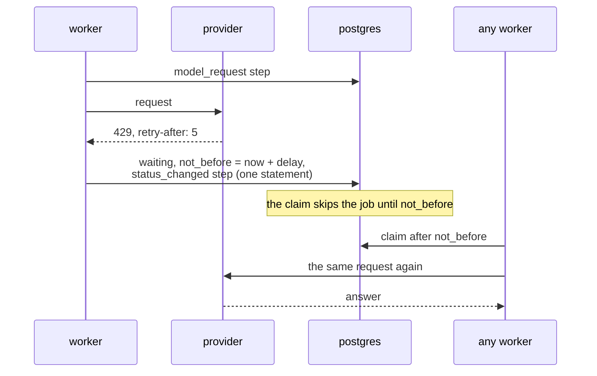

# Backoff

A rate limit or overload from the provider slows a job; it does not fail it.
The job waits in `waiting` and goes on from its step log
([ADR 0018](adr/0018-wait-out-a-busy-provider-in-the-waiting-status.md)).



The code is `worker/backoff.py`, `store/held.py` (`leave_running`) and the
claim in `store/jobs.py`.

## Which errors wait

| Answer | Outcome |
|---|---|
| 429, whatever its error type | Waits |
| 529, or `rate_limit_error` or `overloaded_error` inside a stream | Waits |
| A spend cap (`enforced_spend_limit_reached`), as a 429 or inside a stream | Fails the job: waiting does not lift it |
| 5xx, 408, 409, timeouts, broken streams | Fails the job ([issue 99](https://github.com/sindredg/agent-runtime/issues/99)) |

## How long

The n-th busy answer in a row sets `d = min(60, 2 * 2**(n-1))` seconds.

| n | 1 | 2 | 3 | 4 | 5 | 6 and later |
|---|---|---|---|---|---|---|
| Shortest wait | 1 | 2 | 4 | 8 | 16 | 30 |
| Longest wait | 2 | 4 | 8 | 16 | 32 | 60 |

- A `retry-after` header raises the shortest wait to its value. The random
  part, up to `d/2`, comes on top.
- `retry-after` is read as seconds. A date is not read, and a value over one
  day is cut to one day.
- An answer from the model sets n back to 1.

## The step

Each wait is a `status_changed` step, written with the move:

```json
{"from": "running", "to": "waiting", "cause": "provider_busy",
 "not_before": "2026-11-18T15:00:05.1+00:00", "attempt": 1,
 "delay_seconds": 5.1, "retry_after": 5, "error": "provider answered 429: ..."}
```

`error` is the provider's text, cut to 1000 characters. `runtime logs` prints
the step as `running -> waiting (provider_busy) until ...`.

## While it waits

- No worker holds a waiting job. A cancel ends it at once, and the deadline
  check fails it at its deadline, before `not_before` if need be.
- A worker whose job's cancel was requested cancels it instead of moving it
  to `waiting`.
- The claim after the wait counts in `lease_epoch`, not in `takeovers`.

## Limits

- Workers share no limit on provider calls. Jobs that were refused together
  are spread only by the random part. A shared limiter is planned.
- A job can wait until its deadline. Nothing caps the number of waits.
- Any 429 but a spend cap waits, also one that waiting cannot lift. ADR 0018
  names only `rate_limit_error` ([issue 142](https://github.com/sindredg/agent-runtime/issues/142)).
- The tests use the fake provider's busy window (`PUT /_fake/busy`). The
  Claude API's own rate limits have not been met in a run.
