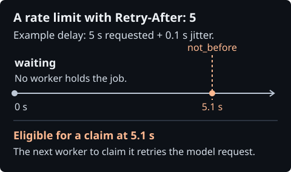
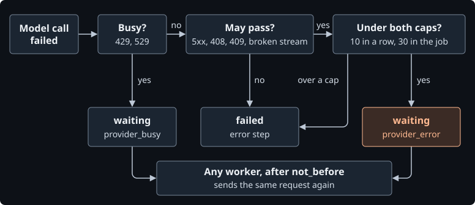

# Backoff

A 429 or 529 from the provider slows a job; it does not fail it. An error
that may pass, an overload inside a stream included, does the same up to a
cap. The job waits in `waiting`
and goes on from its step log
([ADR 0018](adr/0018-wait-out-a-busy-provider-in-the-waiting-status.md),
[ADR 0030](adr/0030-wait-out-a-provider-error-up-to-a-cap.md)).



The worker records `waiting`, the retry time (`not_before`) and the
`status_changed` step in one database statement. Workers skip the job until
the database clock reaches that time. See the [wait calculation](../src/runtime/worker/backoff.py)
and [claim query](../src/runtime/store/jobs.py).

## Which errors wait



| Answer | Cause | Outcome |
|---|---|---|
| 429, whatever its error type | `provider_busy` | Waits |
| 529 | `provider_busy` | Waits |
| Another 5xx, 408, 409 | `provider_error` | Waits, up to the caps |
| `api_error`, `timeout_error`, `overloaded_error` or `rate_limit_error` inside a stream | `provider_error` | Waits, up to the caps |
| A timeout, a broken or incomplete stream, a 200 that is no message stream | `provider_error` | Waits, up to the caps |
| A spend cap (`enforced_spend_limit_reached`), as a 429 or inside a stream | | Fails the job: waiting does not lift it |
| Any other 4xx | | Fails the job |

## The caps

- At most 10 waits for a provider error since the last response, and 30 in
  the job. The next error fails the job, and its error names the cap.
- Ten waits in a row last 181 to 362 s, without a `retry-after` and without
  the time of the calls. A `retry-after` can hold a job until its deadline.
- The job cap bounds calls that can be billed and are not counted: 31 with a
  recorded wait or failure, plus one for each of the six workers a job can lose.
- An error inside a stream counts, also an overload: output has begun, so the
  call can be billed.
- A busy wait does not reset the error count, and has no cap of its own.
- The counts come from the step log, so any worker continues them.

## How long

The n-th wait since the last response, of either cause, sets
`d = min(60, 2 * 2**(n-1))` seconds.

| n | 1 | 2 | 3 | 4 | 5 | 6 and later |
|---|---|---|---|---|---|---|
| Shortest wait | 1 | 2 | 4 | 8 | 16 | 30 |
| Longest wait | 2 | 4 | 8 | 16 | 32 | 60 |

- A `retry-after` header raises the shortest wait to its value. The random
  part, up to `d/2`, comes on top.
- `retry-after` is read as seconds. A date is not read, and a value over one
  day is cut to one day.
- An answer from the model sets n back to 1.

## The step

Each wait is a `status_changed` step, written with the move:

```json
{"from": "running", "to": "waiting", "cause": "provider_busy",
 "not_before": "2026-11-18T15:00:05.1+00:00", "attempt": 1,
 "delay_seconds": 5.1, "retry_after": 5, "error": "provider answered 429: ..."}
```

`cause` is `provider_busy` or `provider_error`. `error` is the provider's
text, cut to 1000 characters. `runtime logs` prints the step as
`running -> waiting (provider_busy) until ...`.

## While it waits

- No worker holds a waiting job. A cancel ends it at once, and the deadline
  check fails it at its deadline, before `not_before` if need be.
- A worker whose job's cancel was requested cancels it instead of moving it
  to `waiting`.
- The claim after the wait counts in `lease_epoch`, not in `takeovers`.

## Limits

- Workers share no limit on provider calls. Jobs that were refused together
  are spread only by the random part. A shared limiter is planned.
- A busy provider can hold a job until its deadline: busy waits have no cap.
- A failed call can be billed and is not in `tokens_used`.
- Any 429 but a spend cap waits, also one that waiting cannot lift. ADR 0018
  names only `rate_limit_error` ([issue 142](https://github.com/sindredg/agent-runtime/issues/142)).
- The tests use the fake provider's busy window (`PUT /_fake/busy`) and its
  counted faults (`PUT /_fake/fault`). The Claude API's own rate limits and
  server errors have not been met in a run.
