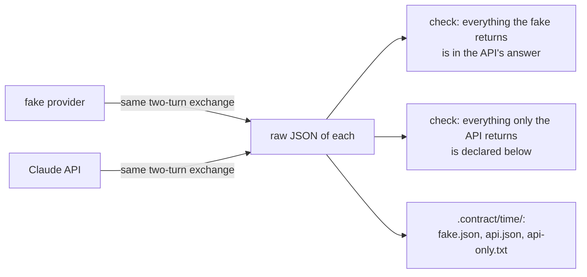

# The contract test

The fake provider stands in for the Claude API in every other suite. The
contract test checks that stand-in against the API itself. It needs a key,
so it is never part of CI. A recorded run starts from the Manual runs
workflow and waits for a reviewer ([ADR 0020](adr/0020-run-recorded-kill-and-api-runs-in-a-manual-workflow.md)):

```sh
gh workflow run manual-runs.yml -f suite=contract -f provider=claude -f model=claude-haiku-5-5
```

The same run on a local machine:

```sh
make up
ANTHROPIC_API_KEY=<key> CONTRACT_MODEL=<model id> uv run pytest tests/contract
```

It sends five small requests to the API, one of which is refused on purpose.



## Both directions

- **Fake to API.** Every message field, usage field and block field the fake
  returns must be in the API's answer. A field the worker could rely on and
  the API never sends fails the test.
- **API to fake.** Every block type, block field, message field, usage field
  and stop reason that only the API returned must be in the list below. So
  must a response with more than one `tool_use` block. A new entry fails the
  test until it is modelled in the fake or added here with a reason.

Each run writes both raw exchanges and the API-only list to
`.contract/<time>/`, which git ignores.

That each comparison finds a difference is shown on made-up responses in
`tests/unit/test_contract_comparison.py`. A unit test also checks that the
list below and `NOT_MODELLED` in the test hold the same entries.

### What the fake does not model

| Entry | Why it is not modelled |
|---|---|
| `block type thinking` | The worker sends every block back unchanged. The API accepted its own `thinking` block back, also after a takeover ([API runs](results/api.md)). |
| `tool_use block field caller` | The worker does not read it and sends the block back unchanged. |
| `more than one tool_use block in a response` | No packaged scenario has two calls in one turn. The worker's handling of two calls is tested with a scripted provider in `tests/integration/test_resume.py`. |
| `message field container` | The worker does not read it. It was `null` in the run of 2026-11-19. |
| `message field diagnostics` | The worker does not read it. It was `null` in that run. |
| `message field stop_details` | The worker does not read it. It was `null` in that run. |
| `usage field cache_creation` | The worker does not read it. It splits `cache_creation_input_tokens`, which was 0. |
| `usage field inference_geo` | The worker does not read it. It was `global`. |
| `usage field output_tokens_details` | The worker counts `output_tokens` only. `thinking_tokens` was 0. |
| `usage field service_tier` | The worker does not read it. It was `standard`. |
| `usage field speed` | The worker does not read it. It was `standard`. |

From a response the worker reads the id, the model, the content blocks, the
stop reason, `input_tokens` and `output_tokens`
(`src/runtime/provider/messages.py`).

## Runs

| Date | Commit | Model | Result |
|---|---|---|---|
| 2026-11-14 | `8f73f6e` | `claude-haiku-5-5` | 3 of 4. The fourth expected text before the tool call, and the model wrote none. |
| 2026-11-17 | `a27b0f8` | `claude-haiku-5-5` | 4 of 4, the comparison one way only. |
| 2026-11-19 | `adc388d` | `claude-haiku-5-5` | 4 of 5, the first two-way run. The API returned eight fields that were not declared yet. |
| 2026-11-19 | `672103b` | `claude-haiku-5-5` | 5 of 5, both ways. Nine entries only the API returned, all declared. |

The two runs of 2026-11-19 are GitHub Actions runs
[44603223641](https://github.com/sindredg/agent-runtime/actions/runs/44603223641)
and [44614433826](https://github.com/sindredg/agent-runtime/actions/runs/44614433826).
Between them the eight fields were declared and nothing else changed.
Status: tested.

The nine entries of the second run are the eight fields and `tool_use block
field caller`. It did not bring out a `thinking` block or a second
`tool_use` block: those two entries are declared from earlier jobs
([API runs](results/api.md)).

## What a pass does not show

- The fake was not broken and then compared with the API.
- It is one exchange of two turns with one model. A field or stop reason
  that this exchange does not bring out is not compared. `refusal` is one:
  the worker handles it, and no run has shown it.
- Whole jobs against the API are a separate record:
  [Runs against the Claude API](results/api.md).
