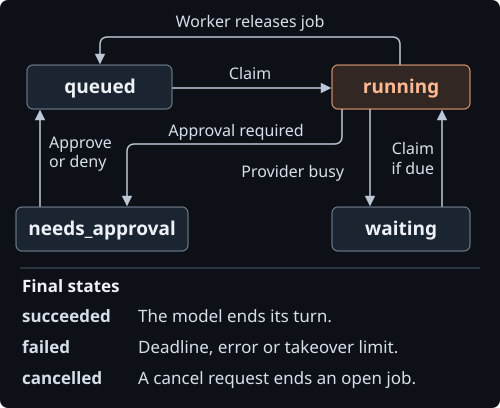
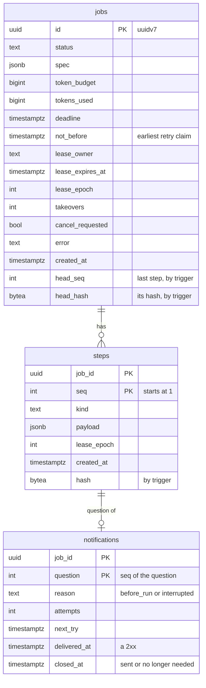

# Jobs and steps

Two tables hold a job's record: its row in `jobs` and its steps in `steps`.
A third, `notifications`, holds the questions to send to a person. Its files
are in the workspace. The migrations in `migrations/` define the tables.

## Job statuses

New jobs start in `queued`. A takeover changes the lease owner while the
job stays `running`. Any open job can be cancelled or fail at its deadline.
See [Approval](approval.md) and [Backoff](backoff.md) for the two ways a run can pause.

## Who moves a job

| Who | Moves | How |
|---|---|---|
| A claim | `queued`, or `waiting` past its `not_before`, to `running`. A `running` job whose lease is over stays `running` under the new worker. | One `UPDATE` in `store/jobs.py` |
| The worker that holds the job | `running` to anything else | A fenced write in `store/held.py` |
| A claim, instead of handing the job out | To `cancelled` if a cancel was requested. To `failed` past the deadline or at the takeover limit. | The same `UPDATE` |
| A cancel | A job no worker holds, to `cancelled` | `cancel_job` |
| The deadline check | A job no worker holds, to `failed` | `fail_overdue`, run by every worker each second |
| An approval or denial | `needs_approval` to `queued` | The API, with the answer step |

- A job becomes `running` only through a claim.
- A `running` job under a live lease is moved only by its worker.
- "No worker holds it" means `queued`, `waiting`, `needs_approval`, or
  `running` with its lease over.
- A park in `needs_approval` or a move to `waiting` becomes `cancelled`
  instead if a cancel was requested.

## Tables

- Lease owner and expiry are set together or not at all. Counters are not
  negative.
- A job that has steps cannot be deleted.
- Steps are append-only and chained by a hash. `seq` has no gaps. See
  [The step log's hash chain](step-log-chain.md).
- `lease_epoch` counts every claim that handed the job out. `takeovers`
  counts only claims of a `running` job whose lease had expired
  ([ADR 0006](adr/0006-count-takeovers-apart-from-claims.md)).
- Index `jobs_claim_order` on (`created_at`, `id`) covers `queued`, `waiting`
  and `running` jobs. The claim reads it.
- Index `jobs_open_deadline` on (`deadline`) covers jobs that are not final.
  The deadline check reads it.
- Index `jobs_status_id` on (`status`, `id`) serves the job list with a
  status filter. Without a filter the list reads the primary key.
- The statement that parks a job writes its `notifications` row, for the
  job's last question. A park that turns into a cancel writes none
  ([ADR 0029](adr/0029-notify-from-a-row-the-park-writes.md)). Every
  worker with `NOTIFY_URL` set sends them, one row per claim.

`src/runtime/store/schema.py` mirrors the tables for building statements. A
test fails when the two differ. It does not compare the CHECK constraints or
the WHERE clauses of the partial indexes.

## Step kinds

| Kind | Written | Main fields |
|---|---|---|
| `model_request` | Before each model call | `model`, `max_tokens`, `messages` (a count), `input_bound`, `tokens_used` |
| `model_response` | After each model call, with the `tokens_used` update | `id`, `content`, `stop_reason`, `usage` |
| `tool_intent` | Before every run of a tool. A call that runs again gets a new one. | `tool_use_id`, `name`, `input` |
| `tool_result` | After a tool ran, could not run, or was denied | `tool_use_id`, `content`, `is_error` |
| `approval_requested` | When a person has to decide about a call | `tool_use_id`, `name`, `input`, `operation_id`, `reason` |
| `approval_given` | By `POST /jobs/{id}/approve` | `tool_use_id`, `operation_id`, `question` |
| `approval_denied` | By `POST /jobs/{id}/deny` | `tool_use_id`, `operation_id`, `question` |
| `error` | When the job fails, whoever fails it | `message` |
| `status_changed` | With a cancel, a park for approval and a wait for a busy provider, in the same statement or transaction | `from`, `to`, `cause` (`cancel_requested`, `approval_requested` or `provider_busy`). A wait adds [its details](backoff.md#the-step). |
| `notification_sent` | When the receiver answered 2xx and the job still waits on that question. Once per question. | `question` |

A new kind needs a migration: the kinds are a CHECK constraint.

Fields that are present only in some steps:

| Field | On | Means |
|---|---|---|
| `problem` | `model_response` | The response cannot be used |
| `content_dropped` | `model_response` | The content could not be stored and was replaced by an empty list |
| `needs_approval` | `tool_intent` | The run has a person's approval behind it |
| `ends_within` | `tool_intent` | Seconds by which a sandboxed call's container has ended, or a tool's own request |
| `scope` | `tool_intent` | Each target of a scoped call, with its resolved addresses and ports |
| `recovered` | `tool_result` | The result came from the tool's check. The tool did not run again. |
| `truncated` | `tool_result` | The output was cut to fit 64 KiB |
| `dropped_packets` | `tool_result` | What the guard of a scoped call dropped |
| `denied` | `tool_result` | A person refused the call |
| `question` | `approval_given`, `approval_denied` | The `seq` of the `approval_requested` step it answers |

## What a payload can hold

`spec` and `payload` are `jsonb`.

- It cannot hold the NUL character, unpaired surrogates, NaN or infinity. The
  store refuses those before the insert with `InvalidPayload`.
- Object keys must be strings.
- Numbers have no int or float type. A float written without a fraction,
  such as `1e22`, is read back as an int.
- A second step with the same (`job_id`, `seq`) is refused. In a fenced
  write the refusal undoes the token count with it. A step whose `seq` is
  not the next one is refused by the chain's trigger.
