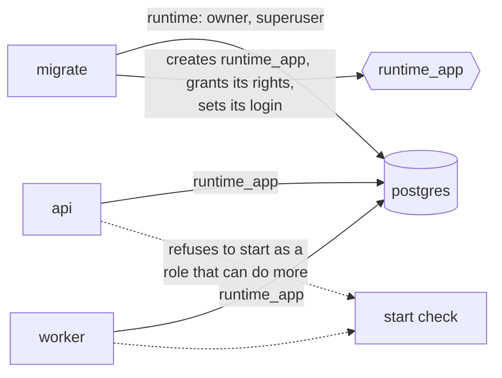
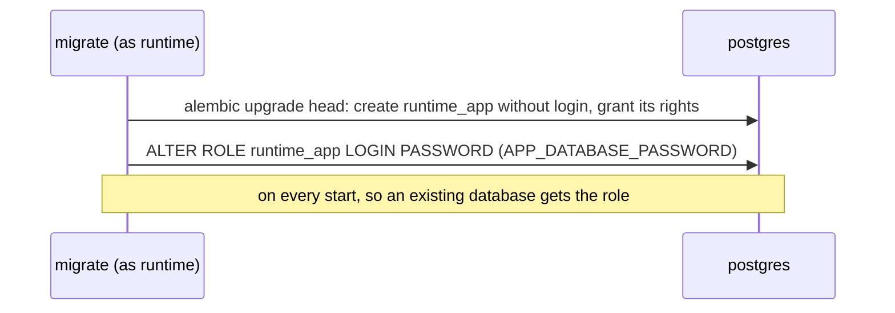

# Database roles

Two Postgres roles. The owner runs the migrations. The API and the worker
connect as `runtime_app`, which may add steps but not change them. The
reasons are in [ADR 0013](adr/0013-chain-the-step-log-and-split-the-database-roles.md).

## What each role may do

| Role | Used by | `steps` | `jobs` |
|---|---|---|---|
| `runtime` | `migrate`, tests that build a database | Everything. It owns the tables and is a superuser. | Everything |
| `runtime_app` | `api`, `worker` | SELECT, INSERT | SELECT, INSERT, UPDATE by column. No DELETE. |

- `runtime_app` cannot alter a table, add, disable or drop a trigger,
  create a table, or set `session_replication_role`.
- Its UPDATE on `jobs` is granted per column. A column that a later
  migration adds is not writable until that migration grants it.
- Migration 0006 grants the rights. Its downgrade takes them back and keeps
  the role: a role belongs to the server, not to one database.

## How the role gets its login

`python -m runtime.store.migrate` does both. The password never sits in a
migration. The server quotes it, so any characters work in the role; the
URL in `DATABASE_URL` needs them percent-encoded.

## The start check

The API and the worker read their own role's rights before they do
anything else (`src/runtime/store/roles.py`). They stop with `RoleError` if
the role:

- is a superuser,
- is a member of the role that owns `jobs` or `steps`,
- holds UPDATE, DELETE, TRUNCATE or TRIGGER on `steps`.

Connected as the owner, both would run, and nothing on the step log would
hold them back.

## What this does not protect

- The owner and any superuser can still change or delete steps.
- Both passwords have development defaults, and Postgres is published on
  `127.0.0.1`. See [Known limits](limits.md#api).
- A change to a job's columns by `runtime_app` is not refused. The fence and
  the gate in the code are what limit it.
