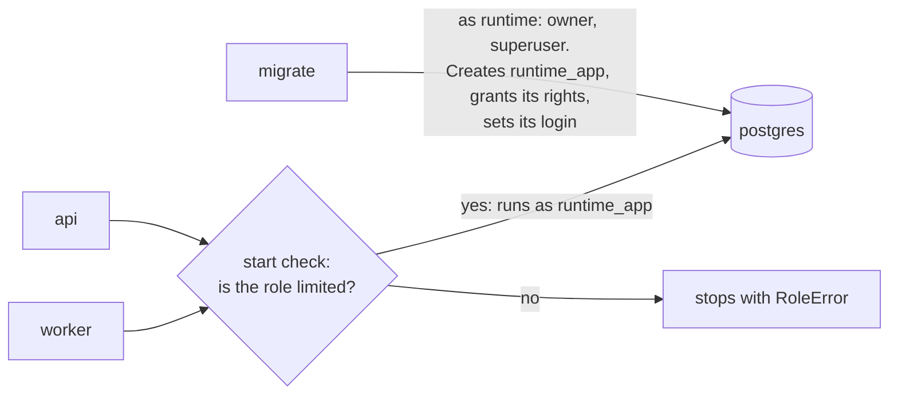
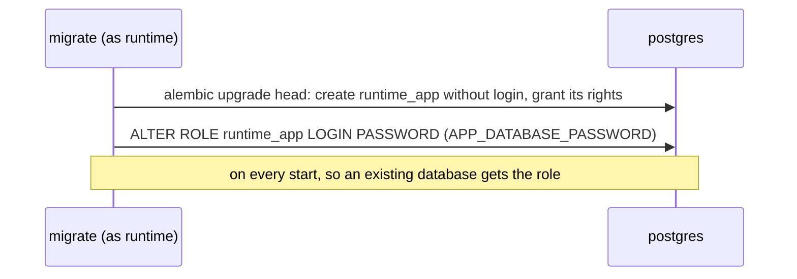

# Database roles

Two Postgres roles. The owner runs the migrations. The API and the worker
connect as `runtime_app`, which may add steps but not change them. The
reasons are in [ADR 0013](adr/0013-chain-the-step-log-and-split-the-database-roles.md).

## What each role may do

| Role | Used by | `steps` | `jobs` |
|---|---|---|---|
| `runtime` | `migrate`, tests that build a database | Everything. It owns the tables and is a superuser. | Everything |
| `runtime_app` | `api`, `worker` | SELECT, INSERT | SELECT, INSERT and UPDATE by column: not the [chain's head](step-log-chain.md), and no UPDATE of `id`. No DELETE. |

- `runtime_app` cannot alter a table, add, disable or drop a trigger,
  create a table, or set `session_replication_role`.
- Its INSERT and UPDATE on `jobs` are granted per column. A column that a
  later migration adds is not writable until that migration grants it.
- Migration 0006 grants the rights. 0007 narrows INSERT to columns and
  takes UPDATE of `id` back.
  Their downgrades take them back and keep the role: a role belongs to the
  server, not to one database.

## How the role gets its login

`python -m runtime.store.migrate` does both. The password never sits in a
migration. Compose puts the same value into the URL of the API and the
worker without encoding it, so it has to be URL-safe.

## The start check

The API and the worker read their own role's rights before they do
anything else (`src/runtime/store/roles.py`). They stop with `RoleError` if
the role:

- is a superuser,
- is a member of the role that owns `jobs` or `steps`,
- holds UPDATE, DELETE, TRUNCATE or TRIGGER on `steps`,
- may insert or update `head_seq` or `head_hash` on `jobs`,
- may run the chain's trigger function `steps_chain`,
- may create objects in the schema `public`.

Connected as the owner, both would run, and nothing on the step log would
hold them back. A database that cannot be reached yet is tried again every
2 seconds until the service is stopped.

## What this does not protect

- The owner and any superuser can switch the triggers off and change or
  delete steps. The [chain](step-log-chain.md) finds that, unless every
  later hash and the head are rewritten too.
- `migrate` sends the app role's password to Postgres in clear, inside the
  compose network. A server set to log every statement logs it.
- Both passwords have development defaults, and Postgres is published on
  `127.0.0.1`. See [Known limits](limits.md#api).
- A change to a job's columns by `runtime_app` is not refused. The fence and
  the gate in the code are what limit it.
