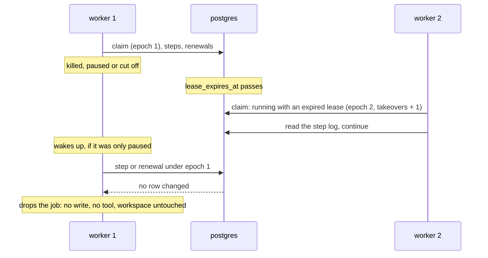
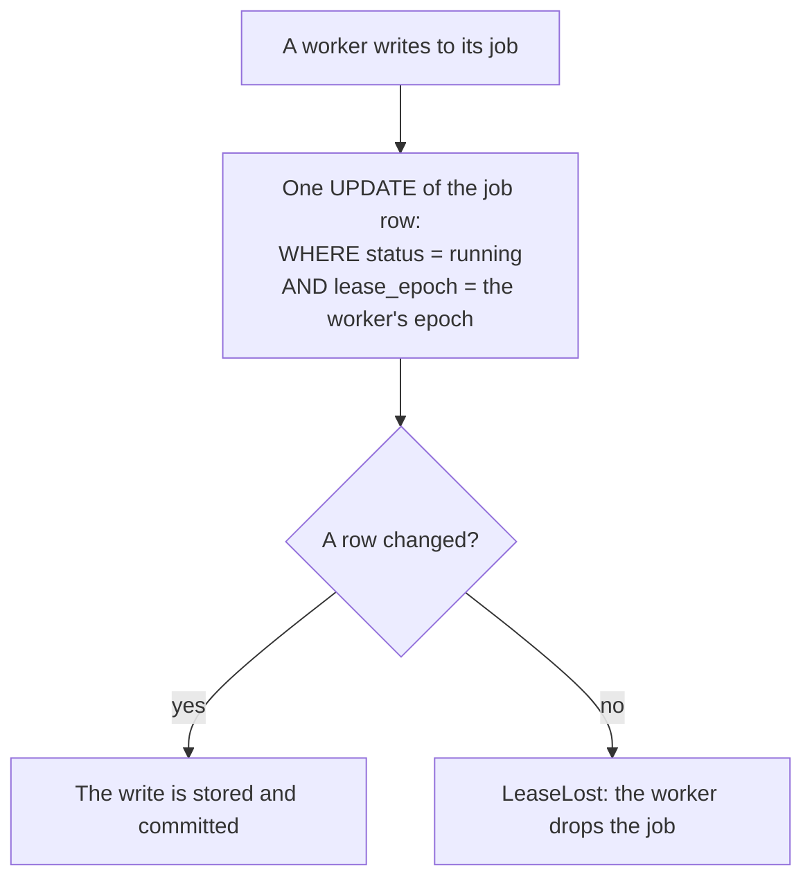

# Durability

A job survives its worker. A worker holds a job through a lease, and when the
lease runs out another worker continues the job from the step log.

## When a worker goes away

What the second worker does depends on where the log ends:

| The log ends with | The worker |
|---|---|
| A `model_request` without a `model_response` | Sends the request again. What arrived of the first answer is gone. |
| A complete step | Does what comes next |
| A `tool_intent` without a `tool_result` | Decides by the rules in [Interrupted tool calls](interrupted-calls.md) |

## Claim

One `UPDATE` in `store/jobs.py` ([ADR 0002](adr/0002-postgres-as-the-job-queue.md)).

- Its subquery picks the oldest job that is `queued`, `waiting` with
  `not_before` before the database clock ([Backoff](backoff.md)), or
  `running` with `lease_expires_at` before the database clock.
- `FOR NO KEY UPDATE SKIP LOCKED` lets many workers claim at once.
- It sets `lease_owner`, sets `lease_expires_at` from the database clock, and
  increments `lease_epoch`.
- Taking a `running` job also increments `takeovers`.
- It reads the database clock at most once. Status, lease, epoch, takeovers
  and error all follow that one reading.

## Lease and heartbeat

- A lease lasts `LEASE_SECONDS`. While a job runs, a task renews it every
  `HEARTBEAT_SECONDS` (`worker/lease.py`).
- The worker also keeps its own deadline on its monotonic clock: the time it
  sent the claim or the last successful renewal, plus the lease length.
- It checks that deadline before it touches the workspace, before each
  `model_request` and `tool_intent` step, and again right before each model
  call, tool run and tool check.

## Fencing

- Every write of a worker to its job is one statement in `store/held.py`: a
  step with its token count, a renewal, the move out of `running`, a failure.
- The update locks the job row, so a write and a claim of one job cannot
  overlap.
- The statements are sent in autocommit, outside a transaction block. A pause
  cannot fall between the check and the commit.
- Reasons and the options that were tried:
  [ADR 0004](adr/0004-fence-writes-with-the-lease-epoch-and-a-row-lock.md).

Fencing protects the database, not the outside world. See
[Known limits](limits.md#durability).

## Dropping a job

On `LeaseLost`, or when the database cannot be reached, the worker drops the
job. It writes nothing more, starts no tool and no model call, and leaves the
status and the workspace alone.

| In flight when the lease is lost | What happens to it |
|---|---|
| A model call | Cancelled as soon as a heartbeat is refused. It may still be billed. |
| A sandboxed command | Killed, and its containers removed |
| A tool in the worker process | Runs on in its thread. Its result is dropped. |

A model call is not cancelled for the worker's own deadline alone: its answer
is still stored if nobody took the job. The job stays as it is until another
worker takes it over.

## Failure

A worker fails its job with one fenced statement: the move to `failed` and
the `error` step together. A worker that stops while it fails a job leaves
both or neither. A job with an `error` step is therefore never `running`.

## Takeover limit

- A takeover of a job whose `takeovers` is already 5 is not made. The same
  statement marks the job `failed`, and the claim appends an `error` step in
  the same transaction.
- A job is therefore taken over at most 5 times. The sixth takeover fails
  it.
- Claims after a release or an approval are not counted
  ([ADR 0006](adr/0006-count-takeovers-apart-from-claims.md)).

## Graceful stop

On SIGTERM the worker claims nothing more and hands its job back.

- At the next step boundary it releases the job: `running` to `queued`,
  fenced. The next claim is not a takeover.
- A model call in flight is cancelled at once.
- A running tool is waited for and its result stored.
- A worker told to stop while it looks up a scoped call's names starts no
  call. The job goes back with the call open.
- The stack gives the worker `STOP_GRACE_SECONDS` (75) before Docker kills
  it. A whole sandboxed call has to fit in that time: see
  [Sandbox](sandbox.md#time-bounds).
