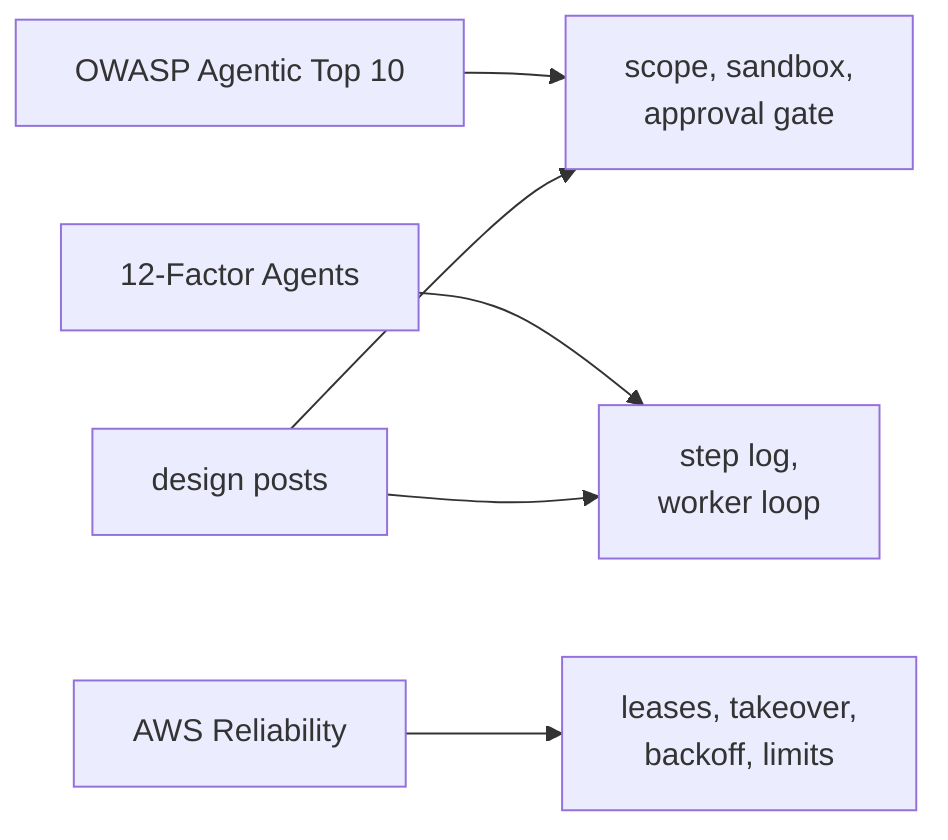

# Framework mapping

This maps the runtime's layer to three external frameworks and to three
design posts. It is not a conformance claim. The security standard the
runtime is measured against is [OWASP APTS](apts.md); it is not repeated here.

Sources, read on 2026-11-21:

- [OWASP Top 10 for Agentic Applications](https://genai.owasp.org/resource/owasp-top-10-for-agentic-applications-for-2026/), version 2026, December 2025.
- [12-Factor Agents](https://github.com/humanlayer/12-factor-agents/tree/d20c728368bf9c189d6d7aab704744decb6ec0cc) at commit `d20c728` (2025-09-21). It has no release.
- [AWS Well-Architected Framework](https://docs.aws.amazon.com/wellarchitected/latest/framework/reliability.html), reliability section, last updated 2026-11-16. The separate pillar paper is marked historical.

Code lines are read at commit `878cb3a`, factor 7 at `7096a5c`. Many have
moved since ([issue 201](https://github.com/sindredg/agent-runtime/issues/201)).

| Status | Meaning |
|---|---|
| tested | A named test, or a recorded result on a [results page](results/README.md) |
| built, not tested | In the code, with no test for this item |
| accepted limit | Built with a stated limit in [Known limits](limits.md) or an ADR |
| gap | Not built |
| n/a | Does not apply to a runtime of this shape; the reason follows |

## OWASP Top 10 for Agentic Applications

| Item | Status | File and line | Test or evidence |
|---|---|---|---|
| ASI01 Agent Goal Hijack | gap: injected text in a file or tool result is not detected. Scope, sandbox and gate bound what it can do. | [agent.py:411](../src/runtime/worker/agent.py#L411), [scope.py:204](../src/runtime/scope.py#L204) | [issue 160](https://github.com/sindredg/agent-runtime/issues/160) |
| ASI02 Tool Misuse and Exploitation | tested. A fixed tool set, a call to any other name runs nothing, and a token budget caps loops. | [tools/\_\_init\_\_.py:15](../src/runtime/tools/__init__.py#L15), [agent.py:244](../src/runtime/worker/agent.py#L244), [budget.py:62](../src/runtime/worker/budget.py#L62) | [test_worker.py:133](../tests/integration/test_worker.py#L133), [test_budget.py:29](../tests/integration/test_budget.py#L29) |
| ASI03 Identity and Privilege Abuse | tested for the database roles, and for two secrets through a whole job. Accepted limit: the API has no authentication. | [runner.py:249](../src/runtime/sandbox/runner.py#L249), [0006_app_role.py:58](../migrations/versions/0006_app_role.py#L58) | [test_roles.py:90](../tests/integration/test_roles.py#L90), [test_secret_canary.py:149](../tests/integration/test_secret_canary.py#L149), [ADR 0027](adr/0027-an-api-without-authentication-on-localhost.md), [API limits](limits.md#api), [Secrets limits](limits.md#secrets) |
| ASI04 Agentic Supply Chain Vulnerabilities | built, not tested: images pinned by digest, actions by commit, Python by lock file. Tools are code, not loaded at run time. | [Dockerfile:6](../Dockerfile#L6), [ci.yml:20](../.github/workflows/ci.yml#L20), [uv.lock](../uv.lock) | |
| ASI05 Unexpected Code Execution (RCE) | tested: a container per call, not root, no capabilities, read-only root. Accepted limit: the kernel is shared. | [runner.py:249](../src/runtime/sandbox/runner.py#L249) | [test_escape.py:70](../tests/escape/test_escape.py#L70), [Scope and sandbox](results/sandbox.md) |
| ASI06 Memory & Context Poisoning | n/a: no memory outlives a job. A conversation is rebuilt from its own hash-chained step log. | [replay.py:168](../src/runtime/worker/replay.py#L168) | [test_step_log_chain.py:366](../tests/integration/test_step_log_chain.py#L366) |
| ASI07 Insecure Inter-Agent Communication | n/a: one agent per job, and agents send each other nothing. | | |
| ASI08 Cascading Failures | tested: a job that crashes workers is failed after 5 takeovers. Each call has its own container and scope. | [jobs.py:205](../src/runtime/store/jobs.py#L205) | [test_crash_loop.py:30](../tests/chaos/test_crash_loop.py#L30) |
| ASI09 Human-Agent Trust Exploitation | tested for the gate, with accepted limits. The log does not record who approved, and the gate is per tool. | [approval.py:20](../src/runtime/worker/approval.py#L20), [app.py:179](../src/runtime/api/app.py#L179) | [test_approval.py:145](../tests/chaos/test_approval.py#L145), [Approval](limits.md#approval) |
| ASI10 Rogue Agents | tested for cancel and the tamper-evident log. Behaviour is not watched. | [halt.py:61](../src/runtime/worker/halt.py#L61), [0007_step_log_chain.py:84](../migrations/versions/0007_step_log_chain.py#L84) | [test_halt_worker.py:60](../tests/integration/test_halt_worker.py#L60), [test_step_log_chain.py:272](../tests/integration/test_step_log_chain.py#L272) |

## 12-Factor Agents

| Item | Status | File and line | Test or evidence |
|---|---|---|---|
| 1 Natural Language to Tool Calls | tested. A response is checked before its calls run. | [agent.py:580](../src/runtime/worker/agent.py#L580) | [test_response_check.py:19](../tests/unit/test_response_check.py#L19) |
| 2 Own your prompts | built, not tested. The job file holds the prompt and system text; the runtime sends them as given. | [spec.py:34](../src/runtime/spec.py#L34), [agent.py:684](../src/runtime/worker/agent.py#L684) | |
| 3 Own your context window | tested: the conversation is rebuilt from the step log. Accepted limit: past the window the job fails. | [replay.py:168](../src/runtime/worker/replay.py#L168) | [test_replay.py:186](../tests/unit/test_replay.py#L186), [ADR 0028](adr/0028-send-the-whole-conversation-and-fail-past-the-context-window.md) |
| 4 Tools are just structured outputs | tested. The registry maps a name to code; an unknown name is an error result. | [base.py:123](../src/runtime/tools/base.py#L123), [agent.py:244](../src/runtime/worker/agent.py#L244) | [test_worker.py:133](../tests/integration/test_worker.py#L133) |
| 5 Unify execution state and business state | tested. The step log is the source of truth; a takeover replays it. | [steps.py:82](../src/runtime/store/steps.py#L82), [replay.py:168](../src/runtime/worker/replay.py#L168) | [test_kills.py:66](../tests/chaos/test_kills.py#L66) |
| 6 Launch/Pause/Resume with simple APIs | tested for submit, list, cancel and approve. No pause command. | [app.py:136](../src/runtime/api/app.py#L136), [app.py:204](../src/runtime/api/app.py#L204), [app.py:240](../src/runtime/api/app.py#L240) | [test_api.py:154](../tests/integration/test_api.py#L154), [test_api.py:898](../tests/integration/test_api.py#L898), [test_approval.py:140](../tests/integration/test_approval.py#L140), [test_api_list.py:54](../tests/integration/test_api_list.py#L54) |
| 7 Contact humans with tool calls | tested: a parked job's question is posted to `NOTIFY_URL` at least once, also across kills and a receiver that was down. The model has no tool to ask a person. | [agent.py:422](../src/runtime/worker/agent.py#L422), [notify.py:128](../src/runtime/worker/notify.py#L128) | [test_notify.py:214](../tests/chaos/test_notify.py#L214), [Notification results](results/notify.md) |
| 8 Own your control flow | tested. The worker breaks before a gated call and writes the intent before a tool runs. | [agent.py:411](../src/runtime/worker/agent.py#L411), [agent.py:560](../src/runtime/worker/agent.py#L560) | [test_approval.py:145](../tests/chaos/test_approval.py#L145), [test_kills.py:173](../tests/chaos/test_kills.py#L173) |
| 9 Compact Errors into Context Window | tested for an error as a result. Repeated errors are not capped. | [agent.py:244](../src/runtime/worker/agent.py#L244) | [Bad tool output](results/controls.md#bad-tool-output), [issue 168](https://github.com/sindredg/agent-runtime/issues/168) |
| 10 Small, Focused Agents | n/a: agent design. The runtime bounds a job by tokens and time, not by steps. | [budget.py:62](../src/runtime/worker/budget.py#L62) | |
| 11 Trigger from anywhere, meet users where they are | gap for triggers: the API and the CLI start a job, no webhook or schedule. A parked job's question is posted out (factor 7). | [app.py:136](../src/runtime/api/app.py#L136) | |
| 12 Make your agent a stateless reducer | tested. Workers keep no state; a conversation is a fold over the step log. | [replay.py:168](../src/runtime/worker/replay.py#L168) | [test_kills.py:124](../tests/chaos/test_kills.py#L124) |

## AWS Well-Architected: reliability

One row per question. The best practices named carry the status.

| Item | Status | File and line | Test or evidence |
|---|---|---|---|
| REL 1 Manage service quotas and constraints | tested for one job (BP03). Workers share no limit on provider calls. | [backoff.py:29](../src/runtime/worker/backoff.py#L29) | [test_backoff_in_stack.py:92](../tests/integration/test_backoff_in_stack.py#L92), [issue 175](https://github.com/sindredg/agent-runtime/issues/175) |
| REL 2 Plan your network topology | n/a: one host with Docker Compose, no cloud network. | | |
| REL 3 Design your workload service architecture | tested (BP01, BP03). API, worker and Postgres apart; a typed API contract. | [models.py:20](../src/runtime/api/models.py#L20), [app.py:136](../src/runtime/api/app.py#L136) | [test_api.py:154](../tests/integration/test_api.py#L154), [API](api.md) |
| REL 4 Design interactions in a distributed system to prevent failures | tested (BP02, BP04): an operation id and intent per call. `POST /jobs` has no idempotency key. | [base.py:60](../src/runtime/tools/base.py#L60), [agent.py:560](../src/runtime/worker/agent.py#L560) | [test_kills.py:173](../tests/chaos/test_kills.py#L173), [issue 176](https://github.com/sindredg/agent-runtime/issues/176) |
| REL 5 Design interactions in a distributed system to mitigate or withstand failures | tested for retries (BP03), sandbox timeouts (BP05) and cancel (BP07). Some worker tools have no timeout, and no throttle is shared (BP02). | [backoff.py:29](../src/runtime/worker/backoff.py#L29), [runner.py:249](../src/runtime/sandbox/runner.py#L249) | [test_backoff.py:55](../tests/unit/test_backoff.py#L55), [test_sandbox.py:278](../tests/integration/test_sandbox.py#L278), [test_halt_worker.py:60](../tests/integration/test_halt_worker.py#L60) |
| REL 6 Monitor workload resources | tested for health checks; logs are JSON. Gap: no metrics, traces or alarms. | [logs.py:13](../src/runtime/logs.py#L13), [app.py:131](../src/runtime/api/app.py#L131) | [test_health.py:21](../tests/unit/test_health.py#L21), [issue 177](https://github.com/sindredg/agent-runtime/issues/177) |
| REL 7 Design your workload to adapt to changes in demand | gap. Workers can be added by hand; no scaling, no load test. | | Throughput: not measured |
| REL 8 Implement change | built, not tested: functional, escape and chaos tests run on every pull request (BP02, BP03). Nothing is deployed, so BP04 and BP05 are n/a. | [ci.yml:170](../.github/workflows/ci.yml#L170) | CI checks |
| REL 9 Back up data | gap: no backup of Postgres. A restored older backup is not found by the chain. | | [Step log chain](step-log-chain.md#what-it-does-not-catch), [issue 178](https://github.com/sindredg/agent-runtime/issues/178) |
| REL 10 Use fault isolation to protect your workload | tested for bulkheads (BP03): a container, workspace and scope per call. One host, so BP01 is n/a. | [runner.py:249](../src/runtime/sandbox/runner.py#L249) | [test_escape.py:82](../tests/escape/test_escape.py#L82) |
| REL 11 Design your workload to withstand component failures | tested (BP03): another worker takes over a job whose lease expired, by the database clock. | [jobs.py:155](../src/runtime/store/jobs.py#L155), [held.py:67](../src/runtime/store/held.py#L67) | [test_kills.py:66](../tests/chaos/test_kills.py#L66), [test_stale_worker.py:43](../tests/chaos/test_stale_worker.py#L43) |
| REL 12 Test reliability | tested (BP04): kill runs, and runs with each mechanism switched off. No game day (BP05). | [failpoints.py:60](../src/runtime/failpoints.py#L60) | [Kill runs](results/kill-runs.md), [Switched-off runs](results/switched-off.md) |
| REL 13 Plan for Disaster Recovery (DR) | gap: one Postgres on one host, and no recovery objective. | | [issue 179](https://github.com/sindredg/agent-runtime/issues/179) |

## Design references: Anthropic engineering posts

Design references, not requirements. Only practices that apply to a
runtime are listed. Posts: [Scaling Managed Agents](https://www.anthropic.com/research/managed-agents)
(MA), [Effective harnesses for long-running agents](https://www.anthropic.com/research/effective-harnesses-for-long-running-agents)
(EH), [Harness design for long-running application development](https://www.anthropic.com/research/harness-design-long-running-apps) (HD).

| Practice | Post | Status | File and line |
|---|---|---|---|
| An append-only log of every event, kept outside the loop | MA | tested | [steps.py:82](../src/runtime/store/steps.py#L82), [0007_step_log_chain.py:206](../migrations/versions/0007_step_log_chain.py#L206) |
| A stateless loop that resumes from the last event after a crash | MA | tested | [replay.py:168](../src/runtime/worker/replay.py#L168), [jobs.py:155](../src/runtime/store/jobs.py#L155) |
| A container that fails becomes a tool error, not a dead job | MA | tested | [test_sandbox.py:278](../tests/integration/test_sandbox.py#L278) |
| Credentials out of reach of the sandbox | MA | tested | [runner.py:249](../src/runtime/sandbox/runner.py#L249), [test_secret_canary.py:149](../tests/integration/test_secret_canary.py#L149) |
| One interface for every tool: name and input in, text out | MA | built, not tested | [base.py:83](../src/runtime/tools/base.py#L83) |
| A container only when a call needs one | MA | built, not tested | [runner.py:395](../src/runtime/sandbox/runner.py#L395) |
| No irreversible compaction; the full history stays recoverable | MA, EH | accepted limit | [ADR 0028](adr/0028-send-the-whole-conversation-and-fail-past-the-context-window.md) |
| A context reset with a structured handoff for long work | EH, HD | accepted limit: a job ends at the context window | [replay.py:168](../src/runtime/worker/replay.py#L168) |
| A separate check of the outcome before work counts as done | EH, HD | gap | [issue 159](https://github.com/sindredg/agent-runtime/issues/159) |
| Remove one component at a time to see which ones carry weight | HD | tested | [Switched-off runs](results/switched-off.md) |

## Main gaps

1. Injected instructions in tool output are not detected or tested (ASI01, [issue 160](https://github.com/sindredg/agent-runtime/issues/160)).
2. No check of a job's outcome before it counts as `succeeded` ([issue 159](https://github.com/sindredg/agent-runtime/issues/159)).
3. No backup, no recovery objective, and no metrics or alarms (REL 6 [issue 177](https://github.com/sindredg/agent-runtime/issues/177), REL 9 [issue 178](https://github.com/sindredg/agent-runtime/issues/178), REL 13 [issue 179](https://github.com/sindredg/agent-runtime/issues/179)).
