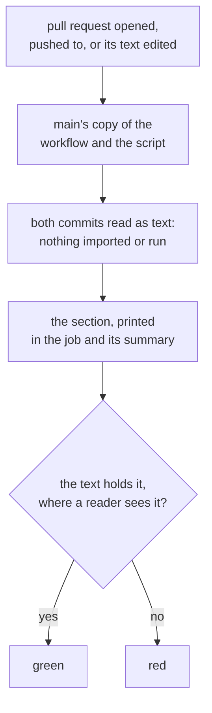

# Guarded changes

A guarantee is tested only while its test stays as strict as it was. A pull
request that changes a test, an entry of the switched-off list, or what runs
the tests has to say so in its own text
([ADR 0024](adr/0024-show-a-changed-test-in-the-pull-request.md)).

Status: configured, not tested. The check has not run on a pull request yet.

## What gets a line

| Line | When |
|---|---|
| `- removed test: file::name` | A test is gone, or has another name. |
| `- changed tests: file: n` | The marks, arguments or body of n tests differ. A docstring or the layout does not count. |
| `- added tests: file: n` | A file that was there has n new tests. They run beside the others. |
| `- changed support code: file` | Anything else in a test file changed: a fixture, a helper, an import. |
| `- added file`, `- changed file`, `- removed file` | Any other file under `tests/`. A workflow, a make file, a pytest settings file, the check's own script. |
| `- changed pytest settings: file` | The pytest table or the plugin entry points of a `pyproject.toml`. |
| `- removed entry: name`, `- changed entry: name` | An entry of `scripts/switched_off.py`. |
| `- changed outside the entries: file` | The rest of that script: a constant an entry uses, the judge. |
| `- cannot be compared: file` | The file does not parse, or defines a test twice. A person reads it. |

## Stating it

`python -I scripts/guarded_changes.py main HEAD` prints the section for a
branch. The failed job prints it too.

- Paste it as it is: the heading and each line at the left edge, an empty
  line before and after the heading.
- Put it above any HTML in the text. A comment or a tag before the end of
  the section is refused, because it could hide the section.
- A pull request without guarded changes needs no section.

## Limits

- The check shows a change. Whether the change weakens a test is for the
  reader of the pull request, and for the
  [switched-off runs](testing.md#must-fail-runs).
- Not guarded: the code under test, the images and compose files, the
  dependency pins and the lock file.
- The text is judged when the job runs. GitHub starts no run for an edit
  made with a workflow's own token, so such an edit is not judged.
- A stricter check does not judge an open pull request again before its
  next push or edit.
