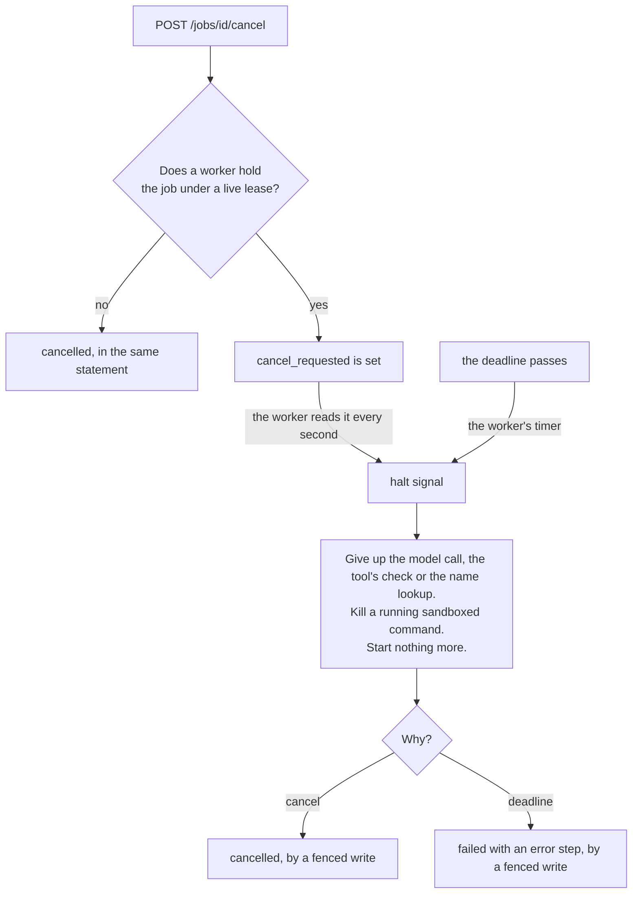
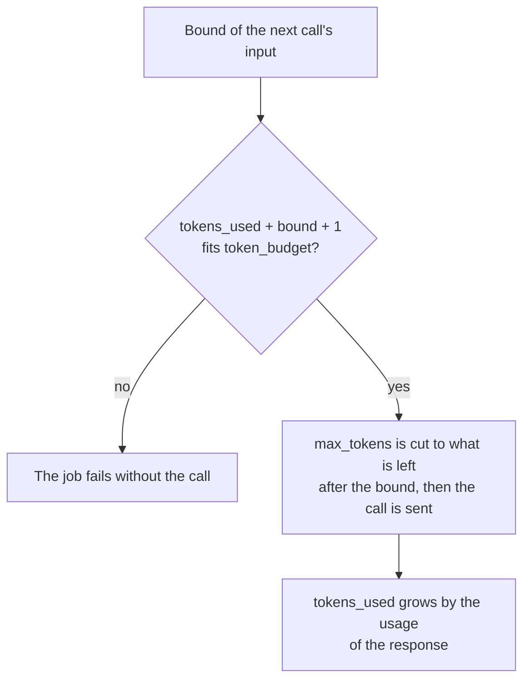

# Cancel, deadline and budget

A job can be cancelled, is failed at its deadline, and stays inside its token
budget. A cancel and the deadline stop a job through one path, also in the
middle of a model call or a tool command
([ADR 0010](adr/0010-one-halt-path-and-a-budget-bound.md)).

## One halt path

The code is `worker/halt.py`.

- Right after the claim the worker reads the time left before the deadline
  from the database clock, and keeps a timer.
- On a halt the worker checks once more right before a tool's intent, so no
  new call starts.
- Killing a sandboxed command removes its containers.
- A tool in the worker process runs on in its thread. Its result is dropped.

## A job no worker holds

"No worker holds it" means `queued`, `waiting`, `needs_approval`, or
`running` with its lease over.

| What | Who ends the job | How fast |
|---|---|---|
| A cancel | The cancel route, in one statement | At once |
| The deadline | Every worker runs `fail_overdue` each second | Within about a second |
| Either, found by a claim | The claim ends the job instead of handing it out | At the next claim |

- `fail_overdue` appends an `error` step to each job it fails. It skips rows
  another worker has locked.
- The claim cancels a `running` job whose lease ran out with a cancel
  requested, and one a stopping worker released to `queued` with it.
- A job that waits for a person is failed at its deadline the same way: no
  answer is a no.

## What the cancel route answers

| Answer | When |
|---|---|
| 200, the job `cancelled` | No worker held it, or it was cancelled already |
| 202, the job still `running` | Its worker will stop it within seconds |
| 409 | The job succeeded or failed |
| 404 | No such job |

A cancel leaves no step. The job's status and `cancel_requested` are the
record. A deadline failure has its `error` step.

## Token budget

The provider counts a call's input, and the count arrives with the answer.
So the worker bounds the input before it sends the call (`worker/budget.py`).

The bound is the sum of:

- The input and output tokens of the previous response.
- The bytes of the messages added since, a token for each byte.
- 1024, for what the provider adds around messages and tool definitions.

For the first call it is the bytes of the whole request plus 1024.

- `tokens_used` counts the usage of each response that was received in full.
- A call that fails or is given up part way is not counted. It may still be
  billed.
- `MAX_TOKENS` is the most a call asks for. A call asks for less when the
  budget has less left.

The bound stops a job early when its tool results are large, and a lost call
is not counted. Both are in [Known limits](limits.md#halt-and-budget).
