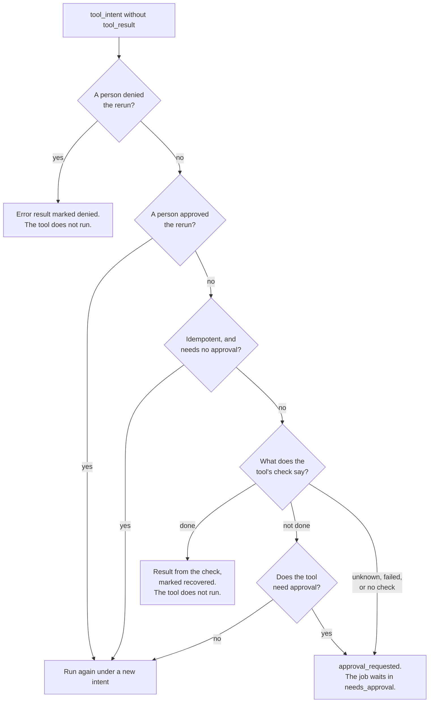
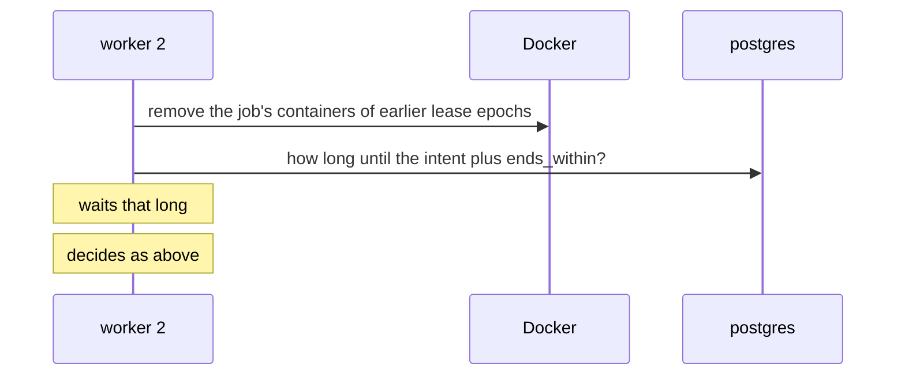

# Interrupted tool calls

A worker that takes a job over can find a `tool_intent` without a
`tool_result`. The log cannot tell whether the tool ran. The call is run
again only when that is known to be safe
([ADR 0005](adr/0005-rerun-an-interrupted-tool-call-only-when-it-is-safe.md)).

## The decision

The denial is checked in `worker/agent.py`, the rest in `worker/recovery.py`.

- An answer counts only for the question it names
  ([ADR 0012](adr/0012-an-answer-names-its-question.md)). A denial from
  before answers named their question still counts for its call.
- An approval covers one run. If the approved run is interrupted, the
  decision is made again without it.
- A tool with no check, or one that needs approval, then asks a person
  again. `create_issue` asks its check first.
- The denied result says the call may or may not have run.
- A worker that does not have the tool runs the call again unless it was
  denied. That run only yields the "unknown tool" error result.

## Operation id

Every tool call has an operation id: the job id and the model's id for the
call, joined by a colon. It is the same for every run of the call, and the
tool receives it.

A tool declares whether it is `idempotent`, and may bring a `check` that asks
the system behind it whether the call already happened.

| Tool | Idempotent | Check |
|---|---|---|
| `read_file` | Yes | |
| `list_dir` | Yes | |
| `create_issue` | No | Asks the tracker for an issue with the operation id |
| `run_shell` | No | None: an interrupted command needs a person |
| `crash_worker` (failure tests only) | Yes, on purpose | |

The `create_issue` check answers done when the issue is found, not done on a
clear answer with none, and unknown on anything else.

## Before the decision: a sandboxed call

The container of a sandboxed call can outlive its worker
([ADR 0008](adr/0008-run-each-tool-call-in-its-own-container.md)). Its intent
records `ends_within`: the seconds after the intent by which the container
has ended. See [Sandbox](sandbox.md#time-bounds) for the sum, 57 s with the
defaults.

- The removal covers tool and guard containers on the worker's own Docker
  host whose epoch label is lower than its own or cannot be read.
- A worker removes them only when it offers the tool itself. A failed removal
  is logged, and the wait still applies.
- The wait is needed because a container on another host cannot be removed
  from here.
- A stop or a lost lease ends the wait, and nothing is decided. A cancel or
  the deadline ends it too, and the job ends `cancelled` or `failed`.

`ends_within` does not cover a worker that was paused before the start
request, or a Docker daemon that acts on a request late. See
[Known limits](limits.md#tool-calls).

## When `create_issue` gets no answer

`create_issue` uses the same lookup when its own request times out or the
connection breaks.

| The lookup finds | The result |
|---|---|
| The issue | Says the issue was created |
| Nothing, or gets no clear answer | An error that says the issue may exist |

The model is then not told that a call failed which went through. Each
request has 10 s for each connect, write and read, with no limit on the whole
request.
