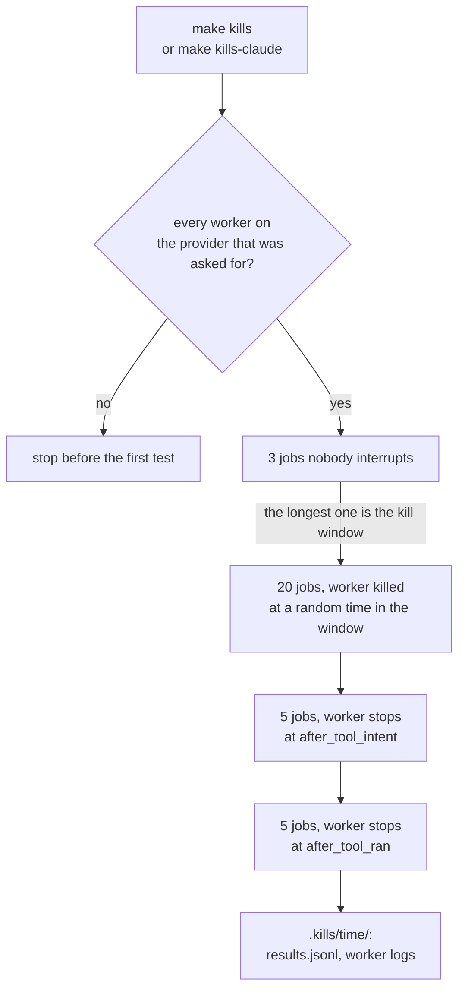

# Kill runs

The chaos tests compare a killed job with a job nobody interrupted, request
by request. A real model does not give the same answer twice, so that
comparison cannot run on the Claude API. The kill runs judge a job by what
is left when it is over, so the same runs work on the fake provider and on
a real model.



## Run it

```bash
make kills
```

That is the fake provider and costs nothing. On the Claude API:

```bash
make kills-claude KILLS_MODEL=claude-haiku-5-5
```

- The API run submits 33 jobs of at most 50,000 tokens each, and stops at
  the first failure. It needs `CLAUDE_API_KEY` in `.env`
  ([Settings](settings.md#the-claude-api)).
- Both replace the normal stack. Run `make up` afterwards.
- The `KILLS_*` variables are in [Settings](settings.md#the-kill-runs).

Recorded runs start from the Manual runs workflow on GitHub Actions
([ADR 0020](adr/0020-run-recorded-kill-and-api-runs-in-a-manual-workflow.md)). A job on the Claude API waits for a reviewer:

```bash
gh workflow run manual-runs.yml -f suite=kills -f provider=claude -f model=claude-haiku-5-5
```

A must-fail run is a branch `must-fail/<name>` with the mechanism switched
off, started with `--ref must-fail/<name> -f suite=kills-after-tool-ran`,
and deleted afterwards.

## What a job is judged by

The job is `examples/ci-triage.json`: read a CI log, open an issue in the
fake tracker. Every job has to pass all of these:

| Rule | Read from |
|---|---|
| The job ends `succeeded`. A job that waits for approval gets it from the runner, which counts it per tool. | The API |
| The job has at least one issue. | The tracker's own list |
| No operation id has more issues than one plus the approved reruns for it. | The tracker's own list |
| `tokens_used` is at most the budget of 50,000. | The API |
| Every model request names the model the run was started for. | The step log |

Each kind of run adds its own rules:

| Run | Also has to hold |
|---|---|
| Nobody interrupts | No takeover and no approval. |
| Random kill | At least half the kills hit a worker that held the job. At least a quarter of the jobs were taken over. |
| `after_tool_intent` | The failpoint fired once, one takeover, no approval. The call has intents at lease epochs 1 and 2, and its result is not recovered. |
| `after_tool_ran` | The failpoint fired once, one takeover, no approval. The call has one intent, and its result is recovered. |

A random kill rarely lands in the milliseconds between a call's intent and
its result. The two failpoints aim there
([Interrupted calls](interrupted-calls.md)). The rules are in
`tests/kills/rules.py`, and `tests/unit/test_kill_rules.py` breaks each one.

### Recorded, not judged

A model decides by itself whether an answer holds a `thinking` block. Each
line of `results.jsonl` counts them, and no count fails a run:

- `jobs_with_a_thinking_block`: jobs with the block in a model response.
- `jobs_that_sent_one_back_after_a_takeover`: of those, jobs where the
  next worker sent it back and was answered. A job that was also claimed
  after a wait or an approval is left out.
- `block_types`: the blocks of every response, by type.

## The stack

`docker-compose.kills.yml` goes on top of the normal stack.

| Setting | Value |
|---|---|
| Workers | Three, restarted when they stop themselves |
| Lease | 6 s, renewed every 2 s |
| Failpoint | Set by the tests, only in `create_issue` calls |
| Sandbox timeout | 10 s |
| Tools | The normal ones. Not `crash_worker`: a model that is not scripted must not get it. |

## What keeps a run from paying by mistake

- The session ends before the first test unless every worker's
  `ANTHROPIC_BASE_URL` belongs to `KILLS_PROVIDER`. Only that variable is
  read from a worker.
- On the Claude API the model has to be named. There is no default.
- Every job carries the 50,000 token budget, and a job with another budget
  fails its run.
- A run on the Claude API that plans more than 40 jobs does not start, and
  the 41st submission is refused.

## Runs

One run per row: 2026-11-19, commit `adc388d`, the Manual runs workflow on
GitHub Actions (Linux x86_64, 4 CPUs), seed `20261119`, 3 + 20 + 5 + 5 jobs.

| Provider, model | Window | Kills that hit the holder | Tokens, all jobs | Most in one job | Run |
|---|---|---|---|---|---|
| Fake provider | 1.76 s | 17 of 20 | 65,835 | 1,995 | [44602128214](https://github.com/sindredg/agent-runtime/actions/runs/44602128214) |
| Claude API, `claude-haiku-5-5` | 3.31 s | 18 of 20 | 131,545 | 4,079 | [44604752837](https://github.com/sindredg/agent-runtime/actions/runs/44604752837) |
| Claude API, `claude-opus-5-5` | 7.03 s | 19 of 20 | 138,432 | 4,352 | [44606477808](https://github.com/sindredg/agent-runtime/actions/runs/44606477808) |
| Claude API, `claude-fable-5-2` | 7.98 s | 20 of 20 | 142,234 | 4,582 | [44608054848](https://github.com/sindredg/agent-runtime/actions/runs/44608054848) |

In every row: 4 of 4 tests passed, every job whose holder was killed was
taken over, and each failpoint fired in 5 of 5 jobs. No approval was asked
for, no job had more than one `create_issue` operation, and no operation id
has two issues. Status: tested.

### With the intent write switched off

The same commit with the intent write removed, as branch
`must-fail/g2-intent-skipped` (`49b9c6e`, deleted afterwards). Five jobs at
`after_tool_ran`. The run has to end red.

| Provider, model | Result | Run |
|---|---|---|
| Fake provider | Red. 5 of 5 jobs have two issues for one operation id. | [44602234151](https://github.com/sindredg/agent-runtime/actions/runs/44602234151) |
| Claude API, `claude-haiku-5-5` | Red. 5 of 5 jobs have two issues for one operation id. | [44605952449](https://github.com/sindredg/agent-runtime/actions/runs/44605952449) |

## What a pass does not show

- The order of the requests the provider got. On the fake provider the
  chaos tests check it; the Claude API keeps no such log to read.
- That a killed job gives the same answer as one nobody interrupted.
- A rate. Twenty jobs without a failure put the failure rate under about
  14 percent, at 95 percent confidence, and no lower.
- A kill during a model's second call of a tool. The failpoints fire in the
  job's first `create_issue` call.
- A `thinking` block sent back after a takeover. The runs above are from
  before the results counted it ([issue 113](https://github.com/sindredg/agent-runtime/issues/113)).
- More than one run per model. GitHub Actions deletes a run's log after 90
  days; a copy is kept outside the repository.
