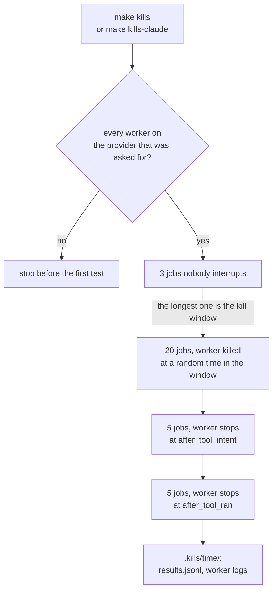
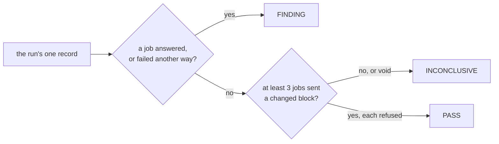

# Kill runs

The chaos tests compare a killed job with a job nobody interrupted, request
by request. A real model does not give the same answer twice, so that
comparison cannot run on the Claude API. The kill runs judge a job by what
is left when it is over, so the same runs work on the fake provider and on
a real model.



## Run it

```bash
make kills
```

That is the fake provider and costs nothing. On the Claude API:

```bash
make kills-claude KILLS_MODEL=claude-haiku-5-5
```

- The API run submits 33 jobs of at most 50,000 tokens each, and stops
  after the first test that fails. It needs `CLAUDE_API_KEY` in `.env`
  ([Settings](settings.md#the-claude-api)).
- Both replace the normal stack. Run `make up` afterwards.
- The `KILLS_*` variables are in [Settings](settings.md#the-kill-runs).

Recorded runs start from the Manual runs workflow on GitHub Actions
([ADR 0020](adr/0020-run-recorded-kill-and-api-runs-in-a-manual-workflow.md)). A job on the Claude API waits for a reviewer:

```bash
gh workflow run manual-runs.yml -f suite=kills -f provider=claude -f model=claude-haiku-5-5
```

A must-fail run on the fake provider is a branch `must-fail/<name>` with the
mechanism switched off, started with `--ref must-fail/<name> -f
suite=kills-after-tool-ran`, and deleted afterwards. On the Claude API it is
an entry of the reviewed list, [below](#a-switched-off-run-on-the-claude-api).

## What a job is judged by

The job is `examples/ci-triage.json`: read a CI log, open an issue in the
fake tracker. Every job has to pass all of these:

| Rule | Read from |
|---|---|
| The job ends `succeeded`. A job that waits for approval gets it from the runner, which counts it per tool. | The API |
| The job has at least one issue. | The tracker's own list |
| No operation id has more issues than one plus the approved reruns for it. | The tracker's own list |
| `tokens_used` is at most the budget of 50,000. | The API |
| Every model request names the model the run was started for. | The step log |

Each kind of run adds its own rules:

| Run | Also has to hold |
|---|---|
| Nobody interrupts | No takeover and no approval. |
| Random kill | At least half the kills hit a worker that held the job. At least a quarter of the jobs were taken over. |
| `after_tool_intent` | The failpoint fired once, one takeover, no approval. The call has intents at lease epochs 1 and 2, and its result is not recovered. |
| `after_tool_ran` | The failpoint fired once, one takeover, no approval. The call has one intent, and its result is recovered. |

A random kill rarely lands in the milliseconds between a call's intent and
its result. The two failpoints aim there
([Interrupted calls](interrupted-calls.md)). The rules are in
`tests/kills/rules.py`, and `tests/unit/test_kill_rules.py` breaks each one.

### Recorded, not judged

The worker asks for no thinking, so whether an answer holds a `thinking`
block is up to the model. Each `results.jsonl` line counts, and no count fails a run:

- `jobs_with_a_thinking_block`: jobs with the block in a model response.
- `jobs_that_sent_one_back_after_a_takeover`: of those, jobs that succeeded
  and got an answer after a takeover that followed the block. A job that
  was also released is left out: a release leaves no step.
- `block_types`: the blocks of every response, by type.
- `jobs_that_sent_a_rebuilt_thinking_block`: jobs with a model request at a
  later lease epoch than a signed block. Every claim rebuilds the
  conversation from the step log, not only a takeover.
- `jobs_answered_after_sending_one` and `jobs_refused_after_sending_one`: of
  those, jobs with a model response after that claim, and jobs that failed
  on the API's 400 for the block's signature.
- `errors_of_failed_jobs`: each different error, cut to 500 characters.

### A switched-off run on the Claude API

`thinking-signature-changed` changes the first character of each stored
signature on every claim. It runs 5 jobs of the `after_tool_ran` test on
`claude-fable-5-2`, at most 250,000 counted tokens, [not a hard
bound](limits.md#halt-and-budget) ([ADR 0022](adr/0022-run-switched-off-entries-on-the-claude-api-from-the-list.md)).



- PASS: the test fails on `assert not failures`, and the run's one record
  says `failed`. At least 3 jobs sent a changed block, each was refused,
  and every other job passed.
- FINDING: a job was answered after it sent a changed block, a job failed
  another way, or the test did not end as listed. A 400 that says "bound to
  a different conversation" is such a failure. Recorded, never rerun to pass.
- INCONCLUSIVE: fewer than 3 jobs sent a changed block, the run is void, or
  it left no one record that is its own.

Refused means: failed on the 400 that names the `signature` of a `thinking`
block, with no model response after that claim. `make switched-off-rehearsal`
runs the same steps on the fake provider first, and is not a result.

## The stack

`docker-compose.kills.yml` goes on top of the normal stack.

| Setting | Value |
|---|---|
| Workers | Three, restarted when they stop themselves |
| Lease | 6 s, renewed every 2 s |
| Failpoint | Set by the tests, only in `create_issue` calls |
| Sandbox timeout | 10 s |
| Tools | The normal ones. Not `crash_worker`: a model that is not scripted must not get it. |

## What keeps a run from paying by mistake

- The session ends before the first test unless every worker's
  `ANTHROPIC_BASE_URL` belongs to `KILLS_PROVIDER`. It and `LEASE_SECONDS`
  are the only variables read from a worker; the key never is.
- On the Claude API the model has to be named. There is no default.
- Every job carries the 50,000 token budget, and a job with another budget
  fails its run.
- A run on the Claude API that plans more than 40 jobs does not start, and
  the 41st submission is refused. `KILLS_JOB_LIMIT` lowers that number.

## Runs

The recorded runs, and what a pass does not show:
[Kill run results](results/kill-runs.md).
