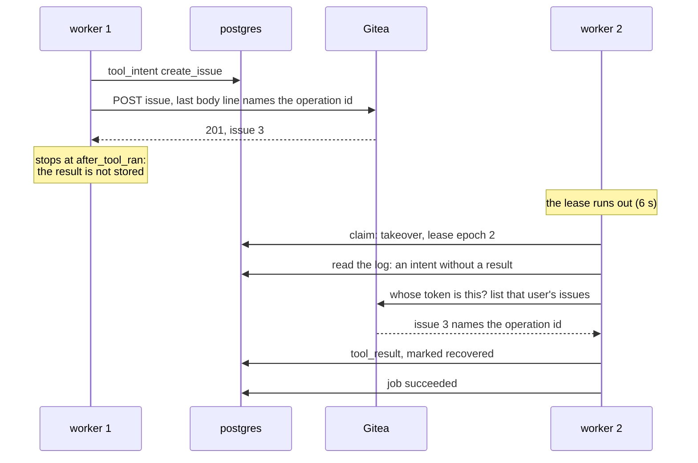
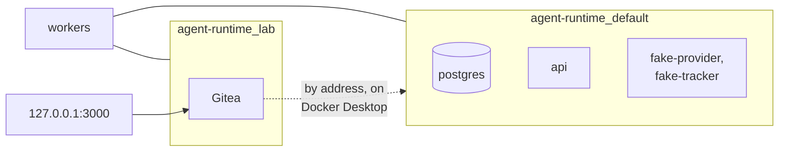

# Lab demo

`make lab` stops a worker in the middle of a call that opens an issue in
Gitea, a real issue tracker in a container. Another worker takes the job
over. Afterwards Gitea holds the issue exactly once.



## Run it

```bash
make lab
```

It needs Docker and pulls Gitea 28.4.0 on the first run. The two cases take
about a minute. At the end Gitea stops, its data kept, and the stack is back
to what `make up` starts. `make clean` deletes Gitea's data too.

To read the issues, start Gitea again, and stop it when done:

```bash
docker compose -f docker-compose.yml -f docker-compose.lab.yml up --detach --wait gitea
```

```bash
docker compose -f docker-compose.yml -f docker-compose.lab.yml stop gitea
```

The repository is public: `http://127.0.0.1:3000/lab-admin/shop/issues`
needs no login.

## The two cases

| Failpoint | Where the worker stops | The check of the next worker | Then |
|---|---|---|---|
| `after_tool_ran` | Gitea has the issue. The result is not stored. | Done | The result comes from the check, marked recovered. The tool does not run. |
| `after_tool_intent` | The intent is stored. The request was never sent. | Not done | The call runs again under a new intent. |

A case passes when all of these hold:

- The failpoint fired once, and the job has a takeover.
- The job ends `succeeded`.
- Gitea's own list, read with the admin login, has exactly one new issue,
  and it names the call's operation id.
- `runtime verify` finds the job's step log intact.

## The setup

| Part | What it is |
|---|---|
| Gitea | The rootless image, pinned by digest. SQLite, sign-up off, published on `127.0.0.1` only. |
| Users | `lab-admin` owns the public repository `shop`, `lab-bot` opens the issues. Both get a new random password each run. |
| Token | A new one for `lab-bot` on each run. It can write issues and read its own user. |
| Workers | Two, on the fake provider. Lease 6 s, restarted when they stop themselves. |

- `tests/lab` makes the users, the repository and the token. A second run
  finds the users and the repository and keeps them.
- Gitea is on its own network, which only the workers join, so it cannot
  look up Postgres, the API or the fakes by name. On Docker Desktop 4.55.0 it
  still connected to the API and Postgres by address: the engine did not
  block traffic between the two networks.
- The lab workers' deny list names both networks, so no scope of a sandboxed
  command can reach Gitea.



- While Gitea is up, nothing in front of it checks `Host`. A local program,
  or a page that reaches loopback, meets Gitea's own login and the public
  repository. A `LAB_GITEA_PASSWORD`, when set, must not be a public value.
- The worker reads the token from `TRACKER_TOKEN`
  ([Settings](settings.md#worker-the-issue-tracker)).

## How the check finds the issue

Gitea has no field for an operation id and no idempotency key. The tool
appends the operation id as the issue body's last line. The check asks Gitea
whose token it holds, lists that user's issues page by page, and matches
that line exactly. It answers "not done" only after a whole, steady list
([ADR 0019](adr/0019-find-a-gitea-issue-by-a-marker-line-not-by-search.md)).

## What it does not show

- One job per case, on one machine. It is a demonstration, not a rate.
- A check that runs while the request is still on its way to Gitea.
- An issue whose marker line a person edited, or wrote below. A rerun then
  opens a second issue. See [Known limits](limits.md#tool-calls).
