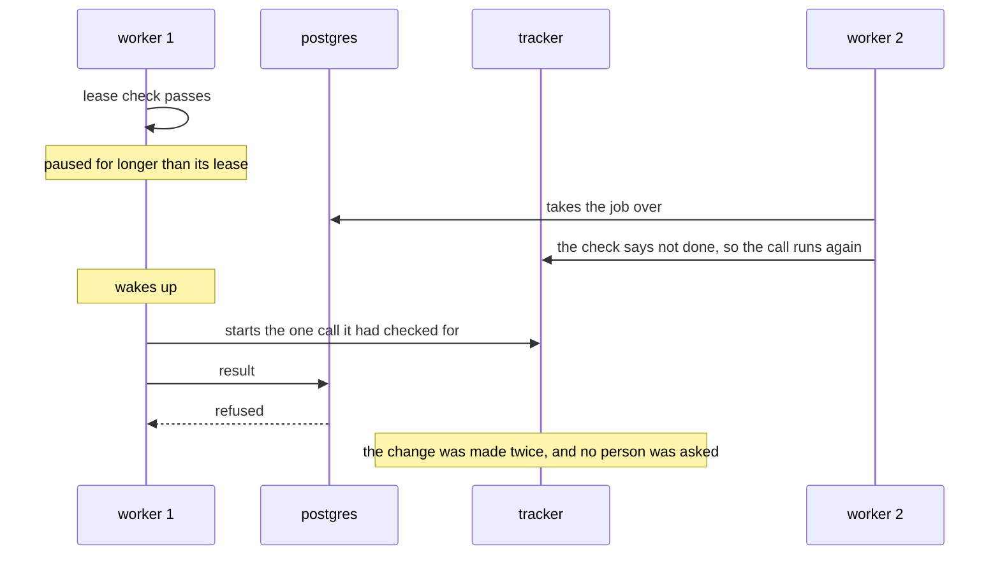

# Known limits

What the design accepts, and what is not built. Reasons are in the
[decision records](adr/).

## The main one: fencing protects the database, not the outside world

A worker that passes its lease check and is then paused for longer than its
lease starts that one tool or model call when it wakes. Its result is
refused, but the tool ran. An idempotency key on the other side closes this.

## Durability

- The worker's lease deadline is on its monotonic clock, the lease itself on
  the database clock. A suspended machine, or a database clock set forward,
  lets one check pass on a lease that is over. The write is still refused.
- A job is failed at its sixth takeover, also when the workers were lost for
  reasons that have nothing to do with the job. The limit is a constant.
- Only a rate limit or overload is waited out. Any other failed model call
  fails the job, and workers share no limit ([Backoff](backoff.md#limits)).
- A response cut off at `max_tokens`, or a refusal, fails the job. It is not
  continued.
- The whole conversation is sent with every model call. A job that outgrows
  the model's context window fails.
- All workers have to see the same workspace directory. The stack does that
  with one volume on one host.
- A workspace left behind waits up to `SWEEP_INTERVAL_SECONDS` for the sweep.
  A workspace root that no running worker mounts is not swept.

## Tool calls

- "Not done" from a tool's check is the tool author's claim. A check that
  cannot rule out a request still on its way has to answer unknown.
- On Gitea, the `create_issue` check misses an issue whose marker line a
  person edited or wrote below. It answers unknown past 1,000 issues by its user
  ([ADR 0019](adr/0019-find-a-gitea-issue-by-a-marker-line-not-by-search.md)).
- The operation id protects a call the runtime runs again. A model that is
  told a call failed and asks again makes a new call with a new id.
- A tool in the worker process that is running when its worker loses the
  lease, or when its job is halted, runs to its end. Its result is dropped.
- `read_file`, `create_issue` and `crash_worker` have no general timeout. One
  that outlasts the stop grace period is killed with its worker.
- A worker told to stop while it writes a `tool_intent` still runs that tool:
  the intent is already in the log.
- A worker that takes over an interrupted call of a tool it does not offer
  stores "unknown tool". The call may have run. Run every worker of a
  deployment with the same tools.
- The wait before a decision about an interrupted sandboxed call assumes the
  worker was not paused before the start request, and that Docker does not
  act on a request late. A container that starts later can still be running.
- A takeover during a sandboxed call costs up to `ends_within` (60 s with the
  defaults) before the job goes on.

## Sandbox and scope

- The worker holds the Docker socket. Whoever controls the worker controls
  the host. Tool containers share the host's kernel.
- The workspace limit is soft, and some writes are not seen at all: a file
  deleted while it is held open, a large `fallocate`. One call can still
  fill the disk that holds the Docker volumes, Postgres among them. The hard
  limit is [issue 78](https://github.com/sindredg/agent-runtime/issues/78).
- A command can also write to `/dev/shm` (counted against its memory) and
  `/dev/mqueue`. Neither outlives the call.
- A tool container whose removal failed, or was cut off when its worker
  exited, stays on the host stopped. The sweep removes workspaces only
  ([issue 45](https://github.com/sindredg/agent-runtime/issues/45)).
- A container whose `create` was cut off is removed by name. If Docker had
  not created it yet, it is left in the `created` state, without running.
- The scope is enforced on IPv4 addresses and ports. Two sites on one address
  cannot be told apart, and URL paths cannot be scoped. No wildcards.
- A name is resolved once per call. A name with only IPv6 addresses is
  accepted at submit, and each `run_shell` call is then refused.
- A scope that covers an address of the host that is not on a denied Docker
  network reaches whatever the host serves there. Keep such addresses out of
  scopes.
- A name lookup that hangs is given up after 5 s, but its thread runs on
  until the system resolver gives up.
- `read_file` checks paths and symlinks, not hard links. Nothing built so far
  can create a hard link out of a workspace. It checks the file it opened,
  so a link swapped in after the path check is refused too.
- Before a workspace is removed, its directories get mode 700. A link swapped
  in during that walk is followed. Its target is the worker's own, and gets
  the same mode.

## Halt and budget

- `token_budget` is not a hard bound. A model call that is cut off can be
  billed and is not counted. A job can be taken over 5 times.
- The bound counts tool results by their bytes, a token for each. A job with
  large tool results stops well before its budget is spent.
- The bound assumes a token is never shorter than one byte. Tokens a provider
  reports under other names, such as prompt cache reads, are not counted.
- A worker with more tools than the one before it relies on the 1024
  allowance to cover the difference in tool definitions.
- A halt waits for what it cannot race: container removals and the fenced
  write that ends the job. A slow Docker daemon can push a cancel or a
  deadline past 5 s.
- A cancel that arrives as the job finishes can find it `succeeded`. The API
  had answered 202.
- The deadline timer reads the database clock once, then counts on the
  worker's clock. A skew between the two is not tested.
- The 5 s a stop leaves around a sandboxed call is a margin, not a bound. A
  slow database can push a stop past `STOP_GRACE_SECONDS`.

## Approval

- The gate is per tool, not per call. With `run_shell` named, a command that
  lists a directory asks as loudly as one that deletes it.
- A job that names no tool is asked only about an interrupted call that
  nobody can vouch for, such as an interrupted `run_shell` call.
- A waiting job waits until a person answers or cancels, or until its
  deadline. Entering a call's result by hand is not built.
- The log records that a call was approved or denied, not by whom.
- A job that waits for a person tells nobody. Someone has to ask for the
  job ([issue 75](https://github.com/sindredg/agent-runtime/issues/75)).

## API

- No authentication. Anyone who can reach the API can submit, approve, deny
  and cancel. That includes every local user and process of the host.
- The Host and Origin check stops a browser page of another site. It does not
  stop a program on the host, which can send any header.
- Postgres is published on `127.0.0.1` with default passwords for both
  [roles](database-roles.md). A local process can write jobs and steps
  directly, past the fence and the gate. As the owner it can switch the
  [chain's](step-log-chain.md) triggers off and rewrite the log.
- There is no list of jobs and no status page. A job is found only by its
  id ([issue 74](https://github.com/sindredg/agent-runtime/issues/74),
  [issue 76](https://github.com/sindredg/agent-runtime/issues/76)).
- The size of a request body is not capped. Only the fields are limited.
