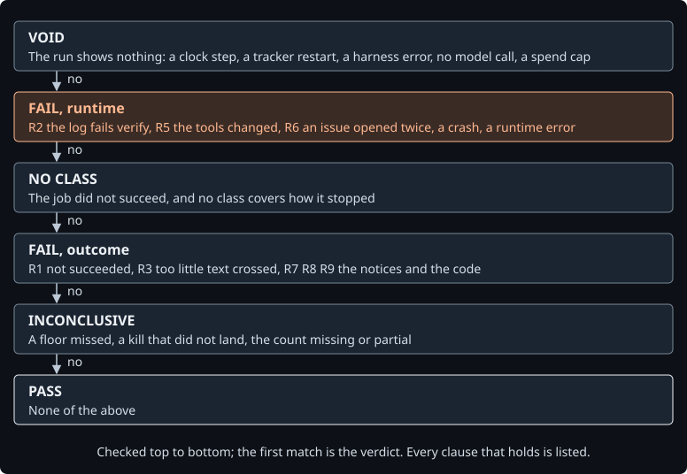

# Long-job grader

One [generated access review](access-review.md) runs as one job, longer
than the model's context window. The job is judged by its outcome: its
stored steps, the tracker's issues and what the harness saw. No reference
run is compared. The code is in `tests/long_job/`.

Status: **configured, not tested**. The numbers of the pass line are
proposed and live in `tests/long_job/rules.py`. No job has run on a real
model.

## The clauses

| Clause | Holds when |
|---|---|
| R1 | The job did not succeed and stopped on a refusal, `max_tokens`, its deadline, the takeover cap or the provider-error cap. |
| R2 | `runtime verify` exits 1 for the job. |
| R3 | Full shape only: the text of the stored steps is under its floor, in the model's tokens. |
| R5 | A request offered tools other than `read_file` and `create_issue`, or a call to another tool was not answered `unknown tool`. |
| R6 | An operation id has more issues than one plus its approved reruns. |
| R7 | A counted grant that a notice makes a violation has no well-formed issue. |
| R8 | A counted grant that a notice clears has its id in any title of the job. |
| R9 | An issue placed after the first summary lacks the reference code. |

A runtime failure is also a crash record for the job in a worker's log, or
a job that failed on a runtime error. VOID covers a clock step, a tracker
restart, a harness error, a failed job with no request and a spend cap.

## Counted grants and titles

- **Counted:** the grant's file was first read after the job's first
  summary. A read is a `tool_result` that is not an error and whose content
  has the file's SHA-256. So a counted fact had to cross a summary.
- **A title holds an id** when the id is a whole token: titles are split at
  every character that is not an ASCII letter or digit. **Well formed:**
  exactly one known grant id.
- **The reference code** counts only as it is, between characters that are
  not ASCII letters or digits.
- **An issue's place** is the seq of its call's first `tool_intent`. Its
  window is the number of summaries before that seq.

## INCONCLUSIVE

When no failure holds, the run must still show enough:

- floors: counted grants a notice makes a violation, counted grants a
  notice clears, windows after the first summary with a well-formed issue,
  and on the short shape the number of summaries;
- three kills: the `after_summary` failpoint stopped a worker exactly once,
  two harness kills landed in different windows, and the job was taken
  over at least three times;
- on the full shape, a count that is there and whole;
- `runtime verify` exits 0 or 1.

## The count

- Counted text: `tool_result` content, response text and tool inputs, and
  summary text, joined in seq order.
- It is cut into chunks at step boundaries, each counted as one user
  message. A step larger than a chunk makes the count partial.
- A chunk's value is its count less the count of a one-character message,
  so the total is never over the text's own.

The grader takes the count as an input and calls no model. The short shape
has no count clause.

## The run on the fake provider

`make long-job` starts the long stack and runs `tests/long_job` on the
fake provider, with the job of the committed public seed's short shape.

1. The harness writes a scenario in which the fake plays a reviewer that
   reads every file and opens one issue for each violation.
2. It starts the workers with the fake's trigger and the `after_summary`
   failpoint, and submits the job.
3. It kills the worker that holds the job twice more, a drawn number of
   steps after a summary, and starts it again.
4. After the job it reads the tracker's issues, runs `runtime verify`,
   checks the tracker and the clock, and grades the job.

It takes about 5 minutes, and `make up` afterwards brings the normal stack
back. CI runs it on every pull request in the job `Long job harness (fake
provider)`, which is not a required check.

The run passes when the verdict is PASS, the three kills landed, no
question was asked, the job stored at least six summaries, and none of the
job's answers is in the record, the captured output or the saved logs.

The session stops before any stack call for an unknown provider, mode or
phase, for a token budget in a must-fail run, and for `LONG_JOB_PROVIDER=claude`:
a keyed run is not built. It stops before the job is submitted unless every
worker calls the fake provider.

## What it writes

`.long-job/<time>/` holds the scenario, the workers' saved logs and
`results.jsonl`: one line per job with the verdict, every clause with its
count, the floors, the kills and the reported counts. Every line holds
counts and fixed words only: no title, id, code or text of the job.

## Limits

- The reviewer on the fake provider is scripted. The run shows the harness,
  the kills and the grader end to end, not how a model reviews.
- The failure classes, NO CLASS and the floors are proposed, like the
  numbers.
