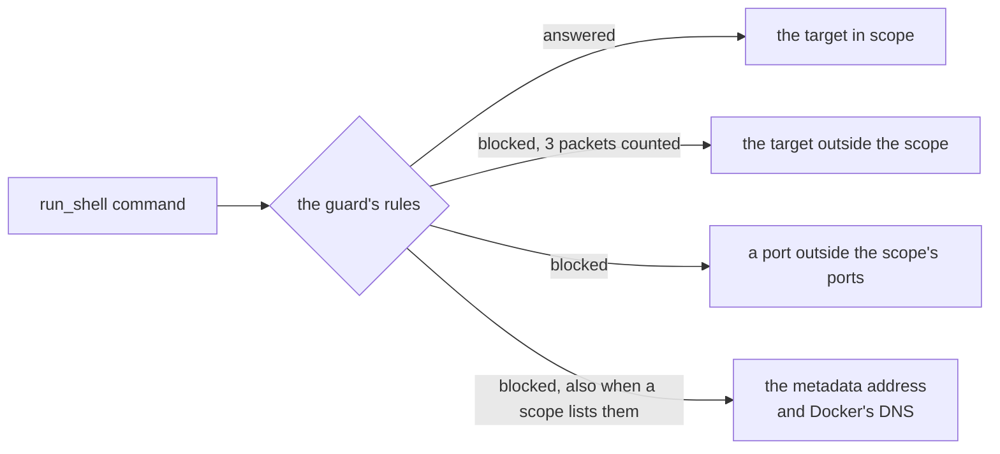

# Results: budget, scope and approval

The evidence for the guarantees about what a job may spend, reach and do.
Each result names its commit and where it ran. The overview is on the
[Results](results.md) page.

## Budget, deadline and cancel

Tested.

Budget, at `dfe2936` on 2026-11-14, `tests/integration/test_budget.py`,
Linux aarch64 under WSL2:

- A job that loops, set to read a 2 KB file thirty times, with a budget of
  20,000 tokens.
- It ended `failed` with "the token budget does not cover the next model
  call" after 7 calls, at 13,636 tokens by the fake provider's own count.
- That count equals the job's `tokens_used`.
- For each call the provider's input stayed within the recorded bound, and
  the count, the bound and `max_tokens` together fit the budget.

Cancel and deadline, at `cb15d5b` on 2026-11-14, `test_halt_worker.py`,
`test_halt_store.py` and the halt tests of `test_sandbox.py`:

- A cancel in the middle of a model call, and of a sandboxed `sleep 300`,
  ended the job `cancelled`.
- The deadline in the middle of each ended it `failed` with an `error` step.
- Each within 5 s, and with the command's container removed.
- A claim cancels a job whose cancel was requested and fails one past its
  deadline.
- A job waiting for an approval is failed by the workers' timer within 5 s
  of its deadline.

With the mechanism off:

| Removed | Outcome |
|---|---|
| The bound: `max_tokens` never cut, no check | The job ran all 31 calls and spent 282,118 tokens. The test fails. |
| The cancel check | Both cancel tests fail |
| The deadline timer | Both deadline tests fail. The job runs on. |
| The claim's deadline check | Both claim tests fail |

## Scope and sandbox

Tested. `make escape`, 22 of 22 tests at `2ed5361` on 2026-11-14. Linux
aarch64 under WSL2, Docker 29.1.3, `kernel.yama.ptrace_scope` 1.

Without a scope, 12 escape attempts, each as a `run_shell` call:

- DNS, TCP out, the cloud metadata address, a network interface besides
  loopback, the Docker socket, a write to the root file system.
- A mount, capabilities, gaining privileges, running as root, 200 forks, 512
  MiB of memory.
- Each was stopped and came back as a failed tool result. 61 of 200 forks
  ran, and the memory hog was killed (137).
- The host's canary file and another job's file were not found, while the
  same search found a file of the job's own. Both stayed unchanged.
- No metadata service runs on this machine. That attempt shows only that the
  address was unreachable.

With a scope, against two targets on the guards' network:

- The target in scope answered. The one outside was blocked, its packets
  counted (3) and reported to the model.
- A port outside the scope's ports was blocked.
- A pinned name resolved and no other name did.
- The metadata address and Docker's DNS stayed blocked even in a scope that
  listed them, each with its own count.
- `nft flush ruleset` as root in the namespace, without capabilities, was
  refused, and the outside target stayed blocked.

With the mechanism off:

| Switch | Outcome |
|---|---|
| `ESCAPE_DOCKER_DEFAULTS=1`: Docker's default settings, and a scoped command on the network directly | 13 tests failed |
| `ESCAPE_NO_RULES=1`: a guard with no rules | All 7 scope tests failed |

## Approval before a tool call

Tested. `tests/chaos/test_approval.py` in the short run of `make chaos`, 16
of 16 tests, at `9af6677` on 2026-11-15. Seed `20261113`, 3 workers, fake
provider, Linux aarch64 under WSL2.

- 20 jobs that ask before `create_issue`. The worker holding the job was
  killed at a random time before the question, and again after the answer.
- 27 kills sent, 18 takeovers. 14 jobs were approved and 6 denied. 20 of 20
  jobs succeeded.
- The tracker holds 14 issues for 14 approvals, each created after its
  approval by the tracker's own time, and none for a denied call.
- Worker stopped after the intent of an approved call: a person is asked
  again. Two approvals, one issue.
- Worker stopped after the approved call ran: the check finds the issue. One
  approval, one issue.
- A job nobody answered, with an 8 s timeout: `failed` 0.46 s after its
  deadline, no issue.

`tests/integration/test_approval.py` covers the same with a tool that
records its own runs, and that a spec cannot take a tool out.

With the mechanism off: with the gate removed, all 4 chaos tests fail (6 of
6 jobs opened an issue with no approval) and 9 integration tests fail.

## Bad tool output

Built for `run_shell` and `list_dir`. No result recorded yet.

- An integration test runs one job whose commands run past the timeout, exit
  non-zero, print 100 MB and print bytes that are not UTF-8.
- Each becomes a tool result of at most 64 KiB, the 100 MB one flagged
  `truncated`, and the job succeeds.
- `read_file` and `create_issue` run in the worker and have no general
  timeout.
