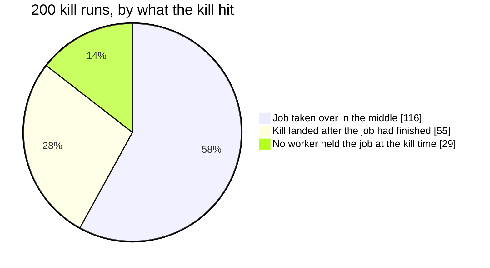

# Results: durability

The evidence for the four durability guarantees. Run conditions, the seed
and what the runs do not show are on the [Results](results.md) page. The
mechanisms are in [Durability](durability.md).

## A job survives a worker stopping

Tested. `tests/chaos`, 200 runs.

- In each run a job was submitted, and the worker holding it was killed with
  `docker kill` at a random time from a seed. 171 kills were sent.
- 200 of 200 jobs succeeded, each with the same final conversation as a job
  nobody interrupted.
- The provider was never asked an earlier turn again.
- 116 of the jobs were taken over in the middle. The other 84 were not
  interrupted.
- At 29 kill times no worker held the job, before the claim or after the
  end. 55 kills landed after the job had finished.
- One more run per failpoint, with the worker ending its own process: 6 of
  6.

With the mechanism off: with resume switched off, so that the log is not
replayed, the provider is asked turns 0, 1, 0, 1, 2 and the test fails.

## An unsafe tool call does not run twice without approval

Tested, with [one accepted exception](limits.md#the-main-one-fencing-protects-the-database-not-the-outside-world)
for a worker paused at the wrong instant.

- The same 206 runs: no operation id has more than one issue in the tracker,
  and no approval was needed.
- Worker stopped after the tool ran: the check finds the issue and the
  result is recovered.
- Worker stopped after the intent: the check finds nothing and the call runs
  once more. One issue.
- One run with the tracker frozen, so the check gets no answer: the job
  waits in `needs_approval`. After the approval the tracker holds two issues
  for one approval.

With the mechanism off:

- Intent write skipped: two issues for one operation id.
- Every tool treated as idempotent: two issues for one operation id.

## A stale worker cannot corrupt a job

Tested.

- A worker waiting for a model answer was paused with `docker pause` for 45
  s under the default 30 s lease.
- Another worker took the job over after 29.3 s.
- The first was woken while the second was in the middle of the job. It
  wrote no step after the takeover, sent no further request to the provider
  and opened no issue.
- The job succeeded with one takeover.

With the mechanism off: with the epoch check removed from the fence, the
woken worker marks the job `failed` under the second worker.

## A job that crashes its worker does not loop forever

Tested.

- A job whose tool ends the worker's process: `failed` after 5 takeovers,
  with 6 runs in the tool's own log.

With the mechanism off: with the limit removed, the job was still running
after 180 s and had been taken over 34 times.

## Also tested: a graceful stop

A worker stopped with `docker stop` (SIGTERM) handed its job back in 1.2 s.
The job finished on another worker with no takeover counted.
